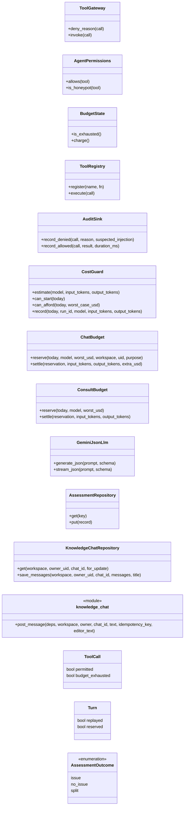
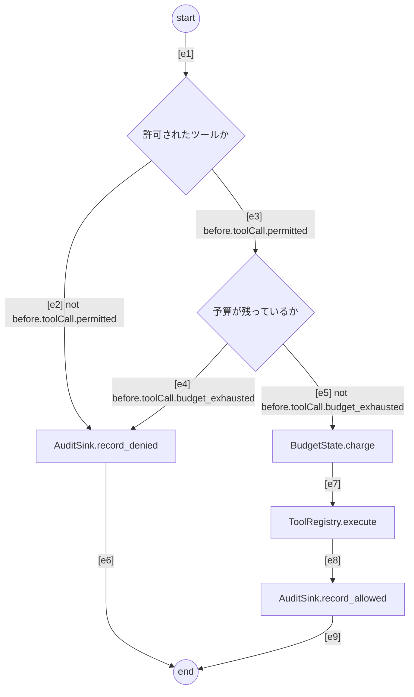
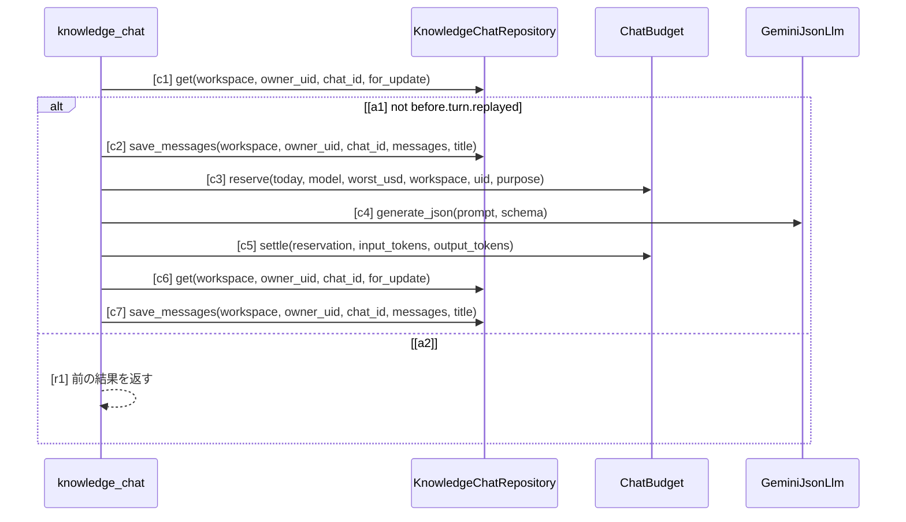

# SPEC-AI-001 AI 支援全体

SPEC-SYS-001 の区画のうち、LLM（Vertex AI の Gemini）を使うすべての機能と、その境界・費用を定める:
知識のチャット（`speclino.services.knowledge_chat`）、仕様の書き換え提案（`speclino.services.spec_suggest`、REST・MCP・A2A）、
LLM 支援の規約（`speclino.services.llm_policies`）、未解決の指摘の調査エージェント（`speclino.agent`、`speclino.services.investigation`）、
A2A の議論役（`speclino.a2a_server`）。全体の要求 R-SYS-01、R-SYS-11〜14 を詳しくする。

## 1. 目的と範囲

- AI は書く人を助け、証拠を集め、説明する。IR への変換・判定・承認・保存には関与しない
- 範囲外: 判定の規則（SPEC-GATE-002）、確定（attest）の権限（SPEC-GATE-002・SPEC-WS-001）

## 2. AI の機能と境界

| 機能 | 入口 | AI が返すもの | AI が持たないもの |
| --- | --- | --- | --- |
| 知識のチャット | 画面の「AI と作る」（`/api/workspaces/{slug}/knowledge/chats`） | 説明の文と下書きの提案（種類ごとの許可リストの欄だけ）、会話の要約の案 | ツール、DB への書き込み、保存、承認 |
| 仕様の書き換え提案 | REST `POST /api/workspaces/{slug}/specs/suggest`、MCP `spec_suggest`、A2A `spec_suggest` | 本文の置換（範囲・置換・理由）と、当てた後の診断 | IR、保存 |
| LLM 支援の規約 | worker（run の前に評価） | チェック項目ごとの「該当する／しない」と根拠の引用 | VIOLATED と VERIFIED_IN_SCOPE |
| 調査エージェント | worker（未解決の指摘があるとき） | 証拠と再解析の依頼、メモ（agent_note） | 判定を書くツール、コードの書き込み、デプロイ |
| A2A の議論役 | `/a2a`（既定で無効） | `spec_review`・`requirement_consult`・`run_clarification`・`spec_suggest` の提案・説明・診断・補足 | 判定の書き換え、承認、保存 |

## 3. 要求

| ID | level | 要求 | 形式化 |
| --- | --- | --- | --- |
| R-AI-01 | mandatory | AI には承認・保存・判定の経路が無く、AI の出力はゲートの入力にならない。判定の層（conformance・analysis・spec/uml・verifiers）は LLM と adapters を import しない | - |
| R-AI-02 | mandatory | 知識のチャットの会話は本人だけが読み書き・削除でき（同じワークスペースの owner にも 404）、提案できる欄は種類ごとの許可リスト（仕様は markdown、スキルは skill_md と付属ファイル、指示書は body、規約はルールの定義）に限り、スコープ・domain・旧形式の IR・compiled・承認の情報は応答に含めない | ai-vocab#KnowledgeChatRepository |
| R-AI-03 | mandatory | 提案は元の本文のハッシュに結び付け、反映は編集欄にだけ入る。サーバは提案を compile_spec や型で検証して診断つきで返すが、この検証は案内で、保存と承認の検証は独立に行う | - |
| R-AI-04 | mandatory | 仕様の書き換え提案は本文の置換（最大 10 件、重なり・範囲外・32KB 超・空の理由を捨てる）だけを返し、各提案を当てた写しを compile_spec で通した結果を添える。MCP ではワークスペースの MCP トークンだけが呼べる | - |
| R-AI-05 | mandatory | AI 支援の操作を監査に残す: 会話の作成・発言・削除・消去（件数と成否だけ、本文は残さない）、エージェントのツール呼び出しの許可と拒否（引数はハッシュ）、A2A のツール呼び出し | ai-vocab#AuditSink |
| R-AI-06 | mandatory | LLM 支援の規約の verdict は常に REVIEW で、区分（issue・no_issue・split）を assessment_outcome に持つ。新しいキーは temperature 0 で 3 回評価し 2 回以上で issue、1 回で split とし、記録があるキーは呼ばない。replay は記録だけで再評価する。失敗・上限超過・記録の破損は UNKNOWN にし、必須の規約は no_issue でも人の確定まで阻止する | ai-vocab#AssessmentRepository |
| R-AI-07 | mandatory | 調査エージェントのツール呼び出しは実行の前に権限・予算を検査し（許可されないツールとハニーポットは実行せず拒否を記録）、上限はツール 20 回・600 秒・LLM 40 回。エージェントの失敗は run を落とさず、指摘は未解決のまま残る | ai-vocab#ToolGateway, ai-vocab#AgentPermissions, ai-vocab#BudgetState, ai-vocab#ToolRegistry |
| R-AI-08 | mandatory | LLM の費用は日次の上限（既定 3.0 USD）と 1 run の余裕（0.50 USD）の中に収め、呼ぶ前に最悪の額で可否を判断（チャット・提案・議論役は予約）し、呼んだ後に実費で精算する。費用ガードの無い構成では LLM を呼ばない | ai-vocab#CostGuard, ai-vocab#ChatBudget, ai-vocab#ConsultBudget |
| R-AI-09 | mandatory | 知識のチャットは、利用者ごとに 1 日 50 発言・日次の枠の 20%、ワークスペースごとに枠の 50% を原子的に数え、入力は 64KB（会話は直近 48KB）・出力は 16,384 トークンに固定する。出力の上限で切れた返答は提案を省いた説明だけで確定する。同じ冪等キーの再送は LLM を呼ばずに前の結果を返す | ai-vocab#GeminiJsonLlm |
| R-AI-10 | mandatory | 秘密らしい値を含むコードの単位は LLM に送らず UNKNOWN にし、モデルの引用の秘密は伏せる。チャットの API のエラーは固定のコードだけを返し、入力・LLM の応答・プロンプト・例外の文をログと応答に出さない | - |
| R-AI-11 | mandatory | 会話・本文・知識の名前・リポジトリの検索結果は信頼しないデータとして区切ってプロンプトに入れ、中の指示に従わせない。LLM 支援の規約は対象のコードを import も実行もせず、文字列の値を伏せた正規形を送る | - |
| R-AI-12 | mandatory | A2A は設定で有効にしたときだけ公開し、Agent Card 以外はワークスペースの MCP トークンで認証する。返すのは提案・説明・診断・補足だけで、補足は判定にもゲートにも効かない | - |
| R-AI-13 | advisory | モデルは明示の ID で固定し（エイリアス `-latest` を使わない）、run の manifest と LLM 支援の記録のキーにモデルとプロンプトの版を残す | - |
| R-AI-14 | advisory | ツールの関門の流れ（図 tool-gate） | tool-gate#s, tool-gate#p, tool-gate#b, tool-gate#dn, tool-gate#ch, tool-gate#ex, tool-gate#al, tool-gate#z, tool-gate#e1, tool-gate#e2, tool-gate#e3, tool-gate#e4, tool-gate#e5, tool-gate#e6, tool-gate#e7, tool-gate#e8, tool-gate#e9 |
| R-AI-15 | advisory | 知識のチャットの 1 発言の流れ（図 chat-turn） | chat-turn#c1, chat-turn#a1, chat-turn#c2, chat-turn#c3, chat-turn#c4, chat-turn#c5, chat-turn#c6, chat-turn#c7, chat-turn#a2, ai-vocab#knowledge_chat |

## 4. 語彙（クラス図）

`ToolGateway` などはコードのクラス。`knowledge_chat` はモジュール `speclino.services.knowledge_chat` の関数を表す。

## 5. ツールの関門（アクティビティ図）

`ToolGateway.invoke`。許可されないツールと予算切れは実行せずに拒否を記録し、許可されたものは予算を数えてから 1 回だけ実行し、
許可を記録する。拒否のときは `ToolResult.denied(reason)` を返す（`ToolResult` は `agent/gateway.py` と `ports/text_llm.py` に同名のクラスがあり、クラス名だけでは一意に決まらないため図には描かず、文章で述べる）。

## 6. 知識のチャットの 1 発言（シーケンス図）

短いトランザクションで保留の発言を足し（同じ冪等キーの再送なら前の結果を返して終わる）、ロックを持たずに費用を予約して
LLM を呼び、精算してから、持ち主と版を確かめて確定する。会話が途中で消えていたら応答を捨てる。

## 観測境界

- 構造の義務（関門・予算・費用・LLM・記録のクラス）はコードで照合できる
- ツールの関門の図は bindings.yaml の振る舞い `tool_gateway_invoke` に入口の名前で対応し、操作は宣言型で解決した
  シンボル（`speclino.agent.gateway.ToolRegistry.execute` など）に名前で一致する。ガードの変数 `toolCall.*` は
  bindings の variables に図の変数名で対応づける
- ツールの関門の図は、同名の `ToolResult` を決められないため `ToolResult.denied` の段を描かず、図が closed でない範囲で REVIEW（図に無い処理）が残る
- チャットの 1 発言の図は、ガードの変数 `turn.replayed`（冪等キーの照合の結果）が入口の値に対応づけられないため UNKNOWN
- チャットの図の「予約が拒否されたとき」「LLM が失敗したとき」の分岐（発言を失敗にする）は図に含めていない
- 費用の予約が拒否されたときの利用者へのエラー（429 の message_limit・cost_limit）、プロンプトの区切りはテストで確かめる
