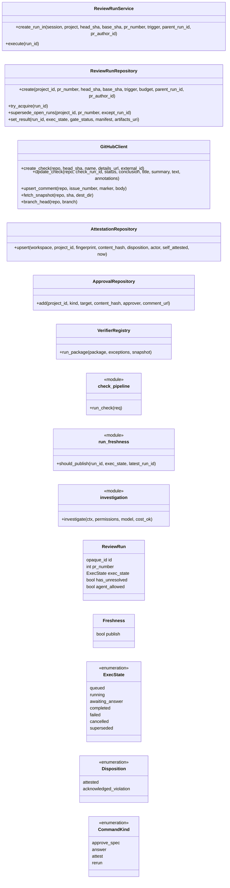
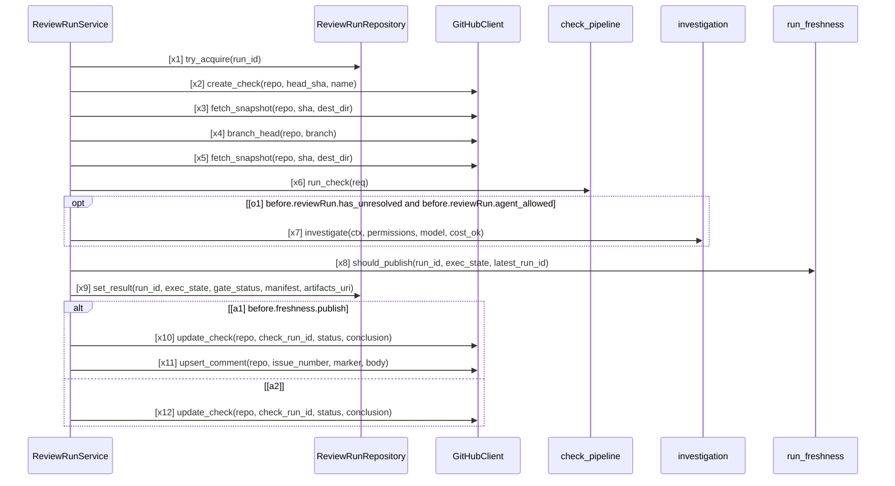

# SPEC-GATE-002 PR のゲート全体

SPEC-SYS-001 の区画のうち、PR の検査（run）からゲートの判定・公開までを定める: webhook、run の実行、検査器、
期待する要求の補完、例外（免除）、PR コメントのコマンドと人の確定（attest）、古い run の扱い、replay。
全体の要求 R-SYS-05〜09、R-SYS-15、R-SYS-16 を詳しくする。関数単位の仕様は SPEC-GATE-001（ゲートの決定のフェイルクローズ）、
SPEC-RUN-001（古い run の不採用）、SPEC-TEST-002（テストの観測）、SPEC-TOOL-001（エージェントのツールの関門）。

## 1. 目的と範囲

- 対象: GitHub の PR のイベントから Check「SpecLino / gate」と PR コメントの更新まで（worker の `ReviewRunService`）
- 範囲外: lock の判定の中身（SPEC-SYNC-001 の 3 章）、AI による調査の中身（SPEC-AI-001）

## 2. 判定の対象と検査器

| 対象 | 検査 | 出す verdict |
| --- | --- | --- |
| 仕様の構造の義務（クラス図） | クラスとメソッドの有無、引数の名前と数（AST だけ、import しない） | VERIFIED_IN_SCOPE / VIOLATED / UNKNOWN |
| 仕様の順序の義務（シーケンス図） | ガードが成り立つ経路の呼び出し列が図の呼び出し列を部分列として含むか | 4 値 |
| 仕様の遷移の義務（状態遷移図） | 状態の属性への代入ごとに、許された遷移か | 4 値 |
| 仕様の包含の義務（アクティビティ図） | 経路の呼び出しが図の道筋に沿うか。外れたら `closed: true` の図だけ VIOLATED、それ以外は REVIEW | 4 値 |
| 旧形式の要求（Spec IR v0.1） | 経路ごとに Z3 で「仮定 ∧ 適用条件 ∧ 経路条件 ∧ ¬保証」の充足性 | 4 値 |
| 規約の決定的な検査器 | `makefile.required_targets`・`spec.required_sections`・`spec_tests`・`ci.required_conditions`・`api.error_format`・`api.conventions`・`naming.identifiers`・`error_message.format`・`lint.preset` | 4 値 |
| 規約の LLM 支援 | `llm.checklist`（worker が先に評価した結果を返すだけ。SPEC-AI-001） | REVIEW か UNKNOWN |
| KNOWLEDGE-LOCK-001 | PR の head の `.speclino/lock.json`（SPEC-SYNC-001 の 3 章） | 4 値（必須） |
| KNOWLEDGE-BINDINGS-001 | 信頼側と head の `.speclino/`（bindings.yaml・contracts・exceptions.yaml・規約）の違い | REVIEW（違いが無ければ出さない） |
| KNOWLEDGE-SPEC-001 | bundle に仕様が無いのにリポジトリに旧形式の仕様がある | UNKNOWN |

## 3. Check の結論

| run の状態 | ゲート | Check の conclusion |
| --- | --- | --- |
| completed | pass | success |
| completed | pass_with_exceptions | neutral |
| completed | fail | failure |
| failed・awaiting_answer・superseded | なし | action_required |
| 公開しない古い run | なし | cancelled（題「古い実行」） |

## 4. 要求

| ID | level | 要求 | 形式化 |
| --- | --- | --- | --- |
| R-GATEPR-01 | mandatory | webhook は署名を検証し（手元の開発環境で秘密が無いときを除く）、配信 ID の重複を除いてから run を作る。プロジェクトはリポジトリの GitHub の ID で引く | - |
| R-GATEPR-02 | mandatory | run は開始時に bundle を 1 つに固定して run の中で再解決せず、bundle の署名かメンバーのハッシュが合わなければ run を失敗にする。manifest に bundle の世代とハッシュ・信頼側のコミット・期待する要求 ID・LLM 支援の記録のキー・確定・各版と上限を残す | - |
| R-GATEPR-03 | mandatory | bundle から出るべき要求 ID（仕様の義務・旧形式の要求・規約・KNOWLEDGE-LOCK-001）を列挙し、Finding が 1 つも無い要求には UNKNOWN（missing_finding）を補う | - |
| R-GATEPR-04 | mandatory | Finding の verdict は VERIFIED_IN_SCOPE・VIOLATED・UNKNOWN・REVIEW の 4 値で、ゲートの状態（pass・pass_with_exceptions・fail）と実行の状態とは分けて持つ | - |
| R-GATEPR-05 | mandatory | ゲートは SPEC-SYS-001 の 8 章の順でフェイルクローズに決め、表に無い要求は mandatory とみなし、既定の fail_on は VIOLATED・UNKNOWN・REVIEW とする | - |
| R-GATEPR-06 | mandatory | VIOLATED と VERIFIED_IN_SCOPE を出すのは解析が厳密（exact_in_model）な経路だけで、不完全な経路・未解決の呼び出し・対応の無い図の要素・上限（既定で深さ 2・64 経路・500ms、最大 4・256・1000ms）の超過・検査器の例外は UNKNOWN にする | gate-vocab#VerifierRegistry |
| R-GATEPR-07 | mandatory | KNOWLEDGE-LOCK-001 は必須の要求として毎回評価し、プロジェクトのリポジトリ ID が未登録なら UNKNOWN にする | - |
| R-GATEPR-08 | mandatory | bundle の run では、対応・契約・免除・規約をデフォルトブランチの先端（信頼側）から読み、PR の head のものでは判定しない | - |
| R-GATEPR-09 | mandatory | 信頼側と head の `.speclino/` の設定が違うとき、または信頼側を取得できないときは必須の REVIEW（KNOWLEDGE-BINDINGS-001）にし、その確定は PR コメントだけで受け付ける（画面の API は拒否する） | - |
| R-GATEPR-10 | mandatory | 例外は id・rule・対象のパス・理由・承認者・期限・代替策を必須とし、期限内のものだけが VIOLATED だけを免除する。exceptions_allowed が偽のルールは免除しない。免除があれば pass_with_exceptions にし、verdict は VIOLATED のまま残す | - |
| R-GATEPR-11 | mandatory | 人の確定は指紋と内容のハッシュに結び付けて attestations に記録し、attested は REVIEW だけを阻止から外し、acknowledged_violation は阻止したままにする。内容が変われば確定は効かない。PR の作成者自身の確定は拒否せず印を残す | gate-vocab#AttestationRepository |
| R-GATEPR-12 | mandatory | verdict を書き換える経路は無い。エージェントの調査は証拠を集めて決定的な再解析を促すだけで、ゲートは再評価後の検査器の Finding で決め直す | - |
| R-GATEPR-13 | mandatory | 同じ PR の新しい run を作るとき未完了（queued・running・awaiting_answer）の run を superseded にし、公開の判断（publish・superseded・not_latest）が publish のときだけ Check と PR コメントを現在の結果として更新する | gate-vocab#ReviewRunRepository |
| R-GATEPR-14 | mandatory | PR コメントのコマンドは approve-spec・answer・attest・rerun で、rerun 以外はプロジェクト設定の承認者の GitHub ユーザー ID とだけ照合する（ID が無い・設定が不正なら誰も承認者でない）。受理と拒否を監査に残し、受理されたら最新の head で子の run を作る | gate-vocab#ApprovalRepository |
| R-GATEPR-15 | mandatory | Check は 3 章の対応で結論を出し、ゲートが無い・失敗した run を成功にしない | gate-vocab#GitHubClient |
| R-GATEPR-16 | mandatory | replay は manifest の世代の bundle を引いて署名と記録のハッシュを照合し、決定的な検査とゲートを再実行し、LLM 支援は記録で再評価して呼び直さない。記録が欠けていれば差分にする | - |
| R-GATEPR-17 | advisory | run の実行の流れ（図 run） | run#x1, run#x2, run#x3, run#x4, run#x5, run#x6, run#o1, run#x7, run#x8, run#x9, run#a1, run#x10, run#x11, run#a2, run#x12, gate-vocab#ReviewRunService, gate-vocab#check_pipeline, gate-vocab#run_freshness, gate-vocab#investigation |
| R-GATEPR-18 | advisory | run の実行の状態は 7 章の表の遷移でだけ変わる | - |

## 5. 語彙（クラス図）

`ReviewRunService`・`ReviewRunRepository`・`GitHubClient`・`AttestationRepository`・`ApprovalRepository`・`VerifierRegistry` は
コードのクラス。`check_pipeline`・`run_freshness`・`investigation` はモジュールの関数を表す。

## 6. run の実行（シーケンス図）

worker の `ReviewRunService.execute`。実行権を原子的に取り、Check を作り、head・base・信頼側のスナップショットを取り、
bundle を固定して検査し、未解決があれば（設定と費用が許せば）エージェントが証拠を集めて再ゲートし、公開してよいかを決めてから
結果を保存し、公開してよいときだけ現在の結果として Check と PR コメントを更新する。

## 7. run の実行の状態

初期状態は `queued`。

| 遷移 | 前 | 後 | 契機 | 条件 |
| --- | --- | --- | --- | --- |
| x1 | `queued` | `running` | `try_acquire` | - |
| x2 | `running` | `completed` | `set_result` | - |
| x3 | `running` | `awaiting_answer` | `set_result` | - |
| x4 | `running` | `failed` | `set_result` | - |
| x5 | `queued` | `superseded` | `supersede_open_runs` | - |
| x6 | `running` | `superseded` | `supersede_open_runs` | - |
| x7 | `awaiting_answer` | `superseded` | `supersede_open_runs` | - |

## 観測境界

- 構造の義務（`ReviewRunService`・`ReviewRunRepository`・`GitHubClient`・`AttestationRepository`・`ApprovalRepository`・
  `VerifierRegistry`）はコードで照合できる
- run の順序は、入口・操作は名前の一致でコードに対応するが、ガードの変数（`reviewRun.*`、`freshness.publish`）が
  run の実行中に計算される値で入口の値に対応づけられないため UNKNOWN（advisory）。run の実行の状態（7 章）は
  DB の行が持ち、SQL の更新で変わるので AST の解析で代入を観測できない。表で定め、R-GATEPR-18 は未形式化
  （リポジトリの結合テストで確かめる）
- 実行の状態 `cancelled` は型にはあるが、run に設定する経路は無い（Check の結論としてだけ使う）
- ゲートの決定そのものは SPEC-GATE-001、古い run の公開の判断は SPEC-RUN-001 が関数単位で検証する
