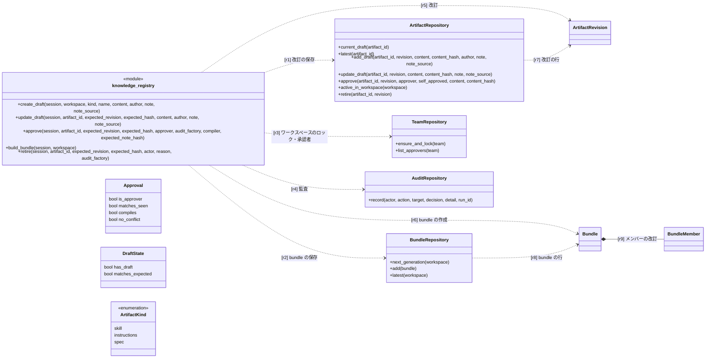
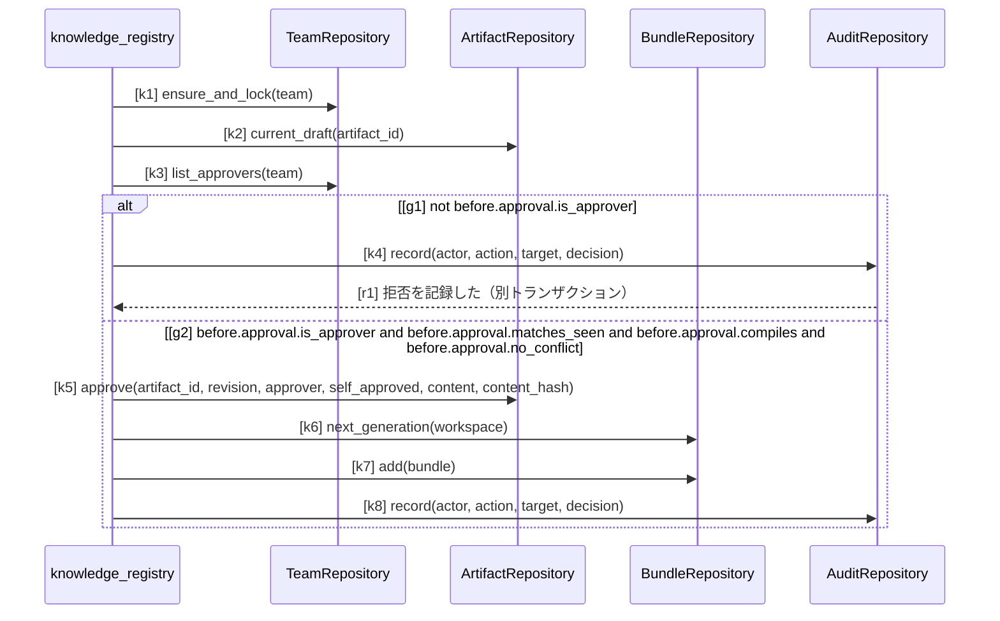

# SPEC-KNOW-001 知識の改訂・承認・bundle・署名

SPEC-SYS-001 の区画のうち、知識レジストリ（`speclino.services.knowledge_registry`、規約は
`speclino.services.policy_governance`）を定める。全体の要求 R-SYS-01〜05、R-SYS-13 を詳しくする。

## 1. 目的と範囲

- 対象: スキル・指示書・仕様（表 `artifacts` / `artifact_revisions`）と規約（表 `policy_revisions`）の改訂・承認・取り下げ、
  bundle（表 `bundles`）の作成と署名、プロジェクト規約との合成、監査
- 範囲外: 書き出しと lock（SPEC-SYNC-001）、ゲートでの使い方（SPEC-GATE-002）、AI による下書き（SPEC-AI-001）

## 2. 用語

| 用語 | 意味 |
| --- | --- |
| 知識（artifact） | ワークスペースの中で `kind`（skill / instructions / spec）と名前で一意なもの。名前は `^[a-z0-9][a-z0-9-]*$`・64 文字まで |
| 改訂（revision） | 知識の連番の版。状態は draft（可変）・active・superseded（不変）。知識ごとに active と draft はそれぞれ最大 1 つ |
| スコープ | `{"workspace": true}` か `{"projects": [...]}`（プロジェクト ID の正規形の UUID、重複なし）のどちらか一方。種類（スキル・指示書・仕様）に依らず同じ型。仕様の `{"workspace": true}` はワークスペースで共有する仕様（要求仕様など）で、すべてのプロジェクトに当たる（run の解決・sync の書き出し・可観測性の要求の表）。リポジトリ固有の仕様は projects で絞る。スコープの変更も新しい改訂と承認を要する |
| bundle | ワークスペースの、ある時点の active な改訂の集合と有効な規約。世代はワークスペースごとの連番。サーバの鍵で署名する |
| content_hash | 改訂の内容の正規 JSON の sha256。承認者が見た内容の照合と bundle のメンバーに使う |
| 取り下げ（retire） | 有効な改訂を、後継の有効な改訂を作らずに superseded にすること。行は消さない |
| プロジェクト規約 | リポジトリの `.speclino/policy/*.yaml`（`*.yml`）。SpecLino の改訂ではなく、信頼側（デフォルトブランチの先端）から読む |

## 3. 要求

| ID | level | 要求 | 形式化 |
| --- | --- | --- | --- |
| R-KNOW-01 | mandatory | 規約・スキル・指示書・仕様の正本は SpecLino に置き、スキル・指示書・仕様は (ワークスペース, kind, 名前) で一意な知識の改訂として、規約は規約の改訂として扱う | know-vocab#ArtifactRepository |
| R-KNOW-02 | mandatory | 改訂の内容を型で制限する: 本文は 256KB まで、スキルの付属ファイルは相対パス（絶対パス・`..`・バックスラッシュ・`SKILL.md` の重複を拒否）で 1 ファイル 256KB・合計 1MB まで、本文に管理区画の印（`<!-- speclino:begin` / `<!-- speclino:end`）を含めない | - |
| R-KNOW-03 | mandatory | 承認できるのはワークスペースの owner と approver だけで、それ以外の承認は拒否し、拒否を別のトランザクションで監査に残す（理由 not_an_approver） | know-vocab#TeamRepository |
| R-KNOW-04 | mandatory | 承認は、承認者が見た下書きの改訂番号と content_hash（と、送られたときは説明のハッシュ）が今の下書きと一致するときだけ成立し、違えば競合（409）にする | - |
| R-KNOW-05 | mandatory | 承認者が下書きの作者か編集者なら、承認は認めたうえで self_approved を改訂と監査に残す | - |
| R-KNOW-06 | mandatory | 下書きの保存は保存する人が前提にした改訂（番号と content_hash）と照合し、違えば競合にする。下書きがあれば同じ番号で置き換え、無ければ最新の改訂の次の番号で作る | - |
| R-KNOW-07 | mandatory | 仕様の承認では、保存済みの本文・domain・旧形式の IR から決定的な parser（compile_spec）で IR を作って改訂に固定し、エラーが 1 つでもあれば承認を拒否する。下書きに IR（compiled）を含めた保存は拒否する | - |
| R-KNOW-08 | mandatory | 下書きの作成・保存・承認・bundle の作成は、ワークスペースの行のロックで直列化する | know-vocab#TeamRepository |
| R-KNOW-09 | mandatory | 承認と規約の有効化のたびに、同じトランザクションの中で新しい世代の bundle（メンバーの改訂と content_hash、規約の改訂とハッシュ、スコープのハッシュ、鍵の ID、署名）を作る | know-vocab#BundleRepository |
| R-KNOW-10 | mandatory | bundle を作るとき、スコープのプロジェクトがワークスペースに属すること、スコープの重なる同名のスキルと同じ要求 ID の仕様が無いことを確かめ、問題があれば承認ごと拒否する（指示書は競合させず連結する）。ワークスペース全体のスコープはどのプロジェクトのスコープとも重なるとみなし、要求 ID（固定した IR の要求の行と旧形式の要求）の競合はワークスペース全体の仕様と各プロジェクトの仕様の間でも検査する | - |
| R-KNOW-11 | mandatory | bundle は HMAC-SHA256 で署名し鍵の ID を付ける。検証は鍵の ID の鍵だけで行い、知らない鍵の ID は失敗にする。本番で署名鍵が無ければ起動しない。鍵の更新では全ワークスペースの bundle を今の鍵で新しい世代として作り直す | - |
| R-KNOW-12 | mandatory | 下書きの作成・保存、承認、取り下げ、拒否を監査の記録に残す（knowledge.draft、knowledge.approve、knowledge.retire、policy.draft、policy.approve） | know-vocab#AuditRepository |
| R-KNOW-13 | advisory | Git の旧形式の仕様の取り込み（speclino import-specs）は下書きを作るだけで承認しない。承認は画面か API で人が行う | - |
| R-KNOW-14 | advisory | 承認の流れ（図 approve） | approve#k1, approve#k2, approve#k3, approve#g1, approve#k4, approve#g2, approve#k5, approve#k6, approve#k7, approve#k8, know-vocab#knowledge_registry |
| R-KNOW-15 | advisory | 下書きの保存の流れ（図 save-draft） | save-draft#s, save-draft#d, save-draft#u, save-draft#n, save-draft#a, save-draft#z, save-draft#e1, save-draft#e2, save-draft#e3, save-draft#e4, save-draft#e5, save-draft#e6, save-draft#e7, save-draft#e8 |
| R-KNOW-16 | mandatory | 構成要素のつながり: 知識レジストリは改訂・bundle・ワークスペース・監査の各リポジトリを使って改訂と bundle を作り、bundle はメンバー（改訂と content_hash）を部品として持つ（クラス図の関係） | know-vocab#r1, know-vocab#r2, know-vocab#r3, know-vocab#r4, know-vocab#r5, know-vocab#r6, know-vocab#r7, know-vocab#r8, know-vocab#r9 |
| R-KNOW-17 | mandatory | 有効な改訂の取り下げは owner と approver だけができ（それ以外は拒否して監査に残す、理由 not_an_approver）、ワークスペースの行のロックの下で、見た改訂番号と content_hash が今の有効な改訂と一致するときだけ成立する（違えば競合、有効な改訂が無ければ artifact_not_active） | - |
| R-KNOW-18 | mandatory | 取り下げは有効な改訂を superseded にし後継の有効な改訂を作らず、行は消さず下書きも残す。同じトランザクションで取り下げた改訂を外した新しい世代の bundle を作り、監査 knowledge.retire に種類・名前・content_hash・理由・bundle の世代を残す。過去の bundle は変えない | - |
| R-KNOW-19 | advisory | 取り下げた知識は、次の取り込みで sync が書き出したファイルを absent として消す。戻すときは最新の改訂を土台に下書きを作って承認する | - |
| R-KNOW-20 | mandatory | run はチーム規約（bundle の規約）を先に評価し、プロジェクト規約は追加だけとする。チーム規約と同じ ID のプロジェクト規約は評価せず、無視したことを規約のハッシュの入力に注記する | - |

## 4. 語彙（クラス図）

`ArtifactRepository` などはコードのクラス（`speclino.db.repositories.*`）で、操作と引数はコードのとおり。
`knowledge_registry` はモジュール `speclino.services.knowledge_registry` の関数を表す（コードのクラスではない）。

## 5. 承認（シーケンス図）

`knowledge_registry.approve` はワークスペースの行をロックし、承認者を確かめ、見た内容を照合し、仕様なら IR を作り、
改訂を active にして（それまでの active は superseded）bundle を作り、監査に残す。どこかで拒否されたら呼び出し側が
rollback する（拒否の監査だけは別のトランザクションで確定する）。

## 6. 下書きの保存（アクティビティ図）

`knowledge_registry.update_draft`。前提にした改訂と合わなければ何も書かずに競合（`DraftConflict`）で終わる。

```mermaid
%%@ id: save-draft
%%@ entry: knowledge_registry.update_draft
flowchart TD
    s((start))
    d{下書きがあるか}
    u[ArtifactRepository.update_draft]
    n[ArtifactRepository.add_draft]
    a[AuditRepository.record]
    z((end))
    s -->|"[e1]"| d
    d -->|"[e2] before.draftState.has_draft and before.draftState.matches_expected"| u
    d -->|"[e3] not before.draftState.has_draft and before.draftState.matches_expected"| n
    d -->|"[e4] not before.draftState.matches_expected"| z
    u -->|"[e5]"| a
    n -->|"[e6]"| a
    a -->|"[e7]"| z
    u -->|"[e8]"| z
```

## 観測境界

- 構造の義務（`ArtifactRepository` などのクラスと操作の有無・引数）はコードで照合できる
- `knowledge_registry` は `<<module>>` でモジュール直下の関数と照合する
- 承認の順序と下書きの保存の流れは、入口・操作は名前の一致でコードに対応するが、ガードの変数（`approval.*`、`draftState.*`）は
  コードの中で計算される値（承認者の一覧への所属、下書きとの照合）で入口の値に対応づけられず、関数も `try` を含む
  ため UNKNOWN（advisory）になる
- 署名の鍵の扱い（R-KNOW-11）と内容の制限（R-KNOW-02）は単体テストで確かめる
- 取り下げ（R-KNOW-17〜19）とプロジェクト規約の合成（R-KNOW-20）は図にせず、結合テストで確かめる。取り下げの改訂の状態の遷移は SPEC-SYS-001 の 7 章の表（k4）が定める
- プロジェクト規約の評価はファイルごとに既知の ID を足していくので、プロジェクト規約のファイル同士で同じ ID があれば後のファイルのものも評価しない
