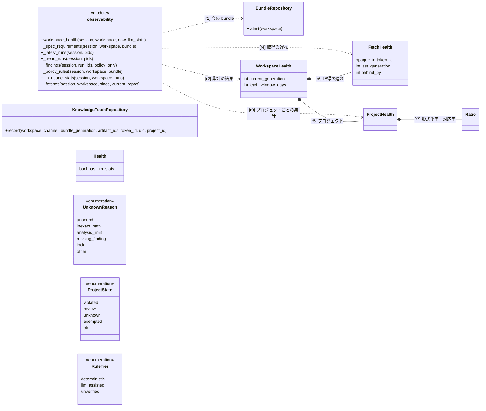
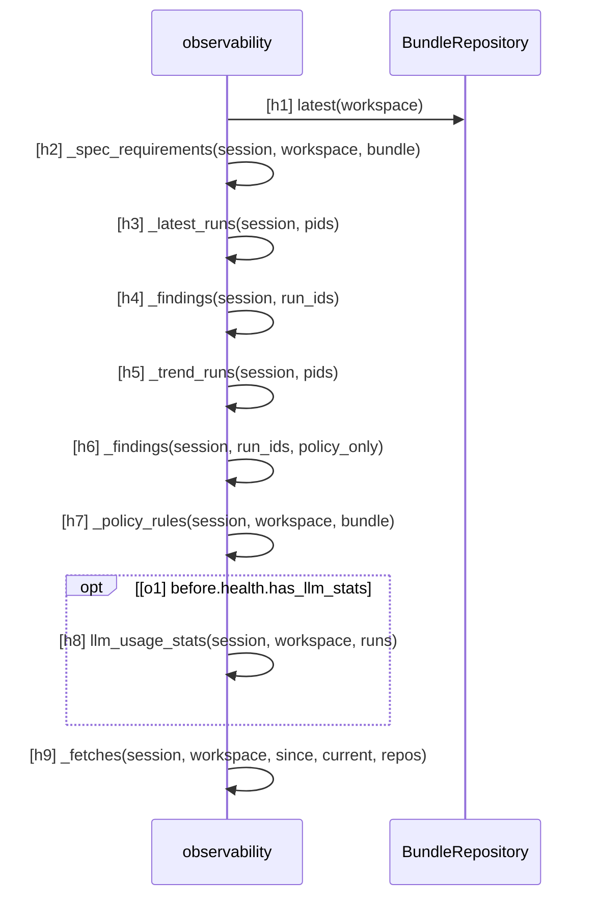

# SPEC-OBS-001 可観測性

SPEC-SYS-001 の区画のうち、どの知識の組み合わせで作業・判定したか、仕様がどこまで形式化・対応づけされているか、
規約と LLM 支援がどう推移しているかを観測する仕組み（`speclino.services.observability`、`speclino.services.project_overview`、
画面 `/w/:slug/observability` とホームの利用状況）を定める。全体の要求 R-SYS-17 を詳しくする。

## 1. 目的と範囲

- ワークスペースの健全性を 1 つの集計（`workspace_health`）で作り、画面はそれを表示するだけにする
- 範囲外: 判定そのもの（SPEC-GATE-002）、取得の記録の書き込み（SPEC-SYNC-001 の R-SYNC-11）

## 2. 指標

| 指標 | 定義 | 材料 |
| --- | --- | --- |
| 形式化率（プロジェクトごと） | 今の bundle の、そのプロジェクトに当たる仕様の要求の表のうち、形式化の列がある行の割合 | bundle の仕様の `compiled.requirements` |
| 対応率（プロジェクトごと） | 最新の完了 run の仕様の義務のうち、対応が無い（unbound）ことによる UNKNOWN の無いものの割合。規約と知識（`policy:`・`knowledge:`）の Finding は除く | 最新の完了 run の Finding |
| UNKNOWN の内訳 | 最新の完了 run の UNKNOWN を unbound・inexact_path・analysis_limit・missing_finding・lock・other に分ける | Finding の文言（分類の文言はテストで固定） |
| 取得の遅れ（経路・トークン・利用者・プロジェクトごと） | 直近 30 日の最後の取得の時刻と世代、遅れ = 今の世代 − 最後に取得した世代 | `knowledge_fetches`、トークンの失効 |
| run の世代の遅れ | 今の bundle の世代 − run の manifest の bundle の世代 | run の manifest |
| 規約の推移（ルールごと） | 直近 10 件の完了 run（completed・awaiting_answer）の VIOLATED・REVIEW・UNKNOWN・VERIFIED_IN_SCOPE の数と、ルールの level・tier | run の Finding、今の規約 |
| LLM 支援の安定度 | issue・no_issue・split の数、キャッシュの当たり率（記録の作成が run より前なら当たり、記録の無いキーは分母から外す）、確定の件数と自己確定・照合できない確定の内訳 | Finding、manifest の `llm_assessment_keys`、`llm_assessments`、`attestations` |
| ホームの状態（プロジェクトごと） | 要求と規約を violated・review・unknown・exempted・ok の 5 区分で数え、最も重い区分を状態にする。免除中は独自の区分 exempted | 最新の完了 run |

## 3. 要求

| ID | level | 要求 | 形式化 |
| --- | --- | --- | --- |
| R-OBS-01 | mandatory | 可観測性の画面とホームの利用状況は、1 つの集計（workspace_health）の結果だけを表示し、画面ごとに数え直さない | - |
| R-OBS-02 | mandatory | 測っていない・分母が 0 の指標は未計測（値なし）として返し、0 や 100% にしない | - |
| R-OBS-03 | mandatory | 可観測性はワークスペースのメンバーなら誰でも読め、所属していない利用者には 404 を返す | - |
| R-OBS-04 | mandatory | 形式化率は 2 章の定義で、今の bundle からプロジェクトごとに数える | obs-vocab#BundleRepository |
| R-OBS-05 | mandatory | 対応率と UNKNOWN の内訳は 2 章の定義で、最新の完了 run から数える | - |
| R-OBS-06 | mandatory | 取得の遅れは直近 30 日の取得の記録から、経路・トークン・利用者・プロジェクトごとの最後の取得で数え、失効したトークンは遅れに数えない。失効していない sync トークンで期間内に取得の無いものも未取得の行として出す | obs-vocab#KnowledgeFetchRepository |
| R-OBS-07 | mandatory | 規約の推移は直近 10 件の完了 run から、ルールごとに 4 値の数を run の順に並べる | - |
| R-OBS-08 | mandatory | LLM 支援の安定度は、区分の数・キャッシュの当たり率・確定の件数（自己確定と照合できない確定の内訳つき）を出す | - |
| R-OBS-09 | mandatory | ホームの状態は 2 章の 5 区分から最も重い区分を選び、免除中を通常の適合と区別する | - |
| R-OBS-10 | advisory | 集計の問い合わせの数はプロジェクトの数に比例しない | - |
| R-OBS-11 | advisory | 集計の流れ（図 health） | health#h1, health#h2, health#h3, health#h4, health#h5, health#h6, health#h7, health#o1, health#h8, health#h9, obs-vocab#observability |
| R-OBS-12 | mandatory | 構成要素のつながり: 集計は今の bundle を読み、1 つの結果（ワークスペース → プロジェクト・取得の遅れ → 率）を組み立てる（クラス図の関係） | obs-vocab#r1, obs-vocab#r2, obs-vocab#r3, obs-vocab#r4, obs-vocab#r5, obs-vocab#r6, obs-vocab#r7 |

## 4. 語彙（クラス図）

`BundleRepository`・`KnowledgeFetchRepository` はコードのクラス。`observability` はモジュール `speclino.services.observability` の関数を表す。
属性だけのクラスは `speclino.domain.observability` の型の要点。

## 5. 集計（シーケンス図）

## 観測境界

- 構造の義務は `BundleRepository`・`KnowledgeFetchRepository` で照合できる。`observability` は `<<module>>` でモジュール直下の関数と照合する。
  集計の流れの図は、ガードの変数 `health.has_llm_stats` が引数 `llm_stats` の有無で、今のガードの式では書けないため UNKNOWN
- `knowledge_fetches` の利用者（uid）の列は、今の取得の経路では埋まらない（トークンの ID だけが入る）
- 指標の正しさ（分類の文言、未計測の扱い）は単体テストで確かめる
