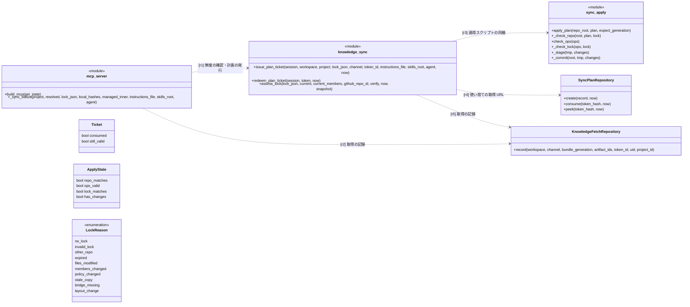
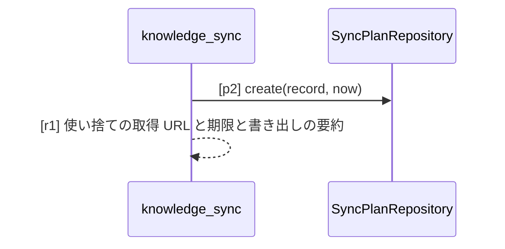
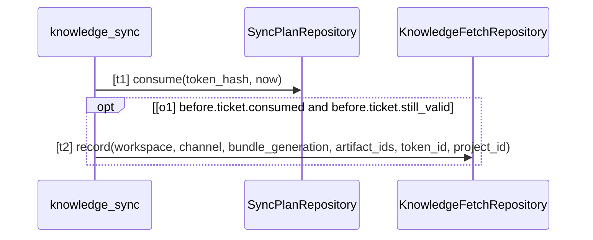
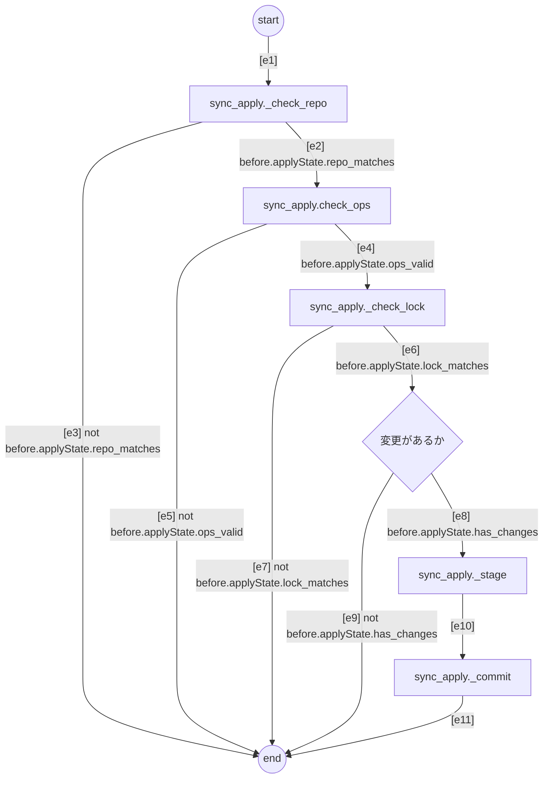

# SPEC-SYNC-001 知識の配信と lock・鮮度・エージェントのレイアウト

SPEC-SYS-001 の区画のうち、承認済みの知識をリポジトリに書き出す配信（`speclino.services.knowledge_sync`、
`speclino.sync_apply`、`speclino sync`、MCP の `sync_status` / `knowledge_pull` / `spec_get` / `skill_get`）と、
lock の鮮度の判定を定める。全体の要求 R-SYS-05、R-SYS-06、R-SYS-14 を詳しくする。

## 1. 目的と範囲

- コーディングエージェント（または人の `speclino sync`）が、リポジトリに当たる最新の bundle をエージェントの読み込みの場所に
  書き出し、`.speclino/lock.json` で「この checkout が宣言している bundle」を残す
- 人は承認するだけでよい。エージェントは作業の前に `sync_status` で鮮度を確かめ、古ければ `knowledge_pull` の計画を
  適用スクリプトで当て、lock ごと作業の PR にコミットする
- 範囲外: lock の照合をゲートでどう扱うか（SPEC-GATE-002 の R-GATEPR-07）、トークンの発行（SPEC-WS-001）

## 2. 書き出し先

| 知識 | 書き出し先 | 規則 |
| --- | --- | --- |
| スキル | `.agents/skills/<name>/` と `.claude/skills/<name>/`（集合 R のすべて） | R は前回の lock の `skill_roots` に名乗りのルートを足したもの（名前に claude を含めば `.claude/skills`、それ以外は `.agents/skills`）。`skills_dir` を明示したときはそれだけ |
| 指示書 | `AGENTS.md` の管理区画（`<!-- speclino:begin bundle=<n> -->` 〜 `<!-- speclino:end -->`） | ワークスペース全体 → プロジェクトの順、それぞれ名前順に連結。`instructions_file=CLAUDE.md` を明示したときだけ CLAUDE.md に書き AGENTS.md を片付ける。区画の外は触らない |
| CLAUDE.md の橋 | `CLAUDE.md` の管理区画に `@AGENTS.md` | 本文が AGENTS.md のとき、CLAUDE.md が手元にあるときだけ書く（作らない）。lock の `files` に載せない |
| 仕様 | `.speclino/specs/<name>.md` | 読み取り専用の写し |
| lock | `.speclino/lock.json` | 最後に書く |

## 3. lock の鮮度の判定（`assess_lock`）

上から順に最初に当たった行で決まる。MCP の `sync_status` とゲートの KNOWLEDGE-LOCK-001 は同じ関数を使う。

| 条件 | verdict | 理由（`sync_status` の reasons） |
| --- | --- | --- |
| lock が無い | UNKNOWN | no_lock |
| 読めない・署名が合わない・lock の世代が今の bundle より新しい | UNKNOWN | invalid_lock |
| 別のワークスペースかリポジトリの lock | UNKNOWN | other_repo |
| 期限（発行から 30 日）が切れた | UNKNOWN | expired |
| 書き出したファイルの改変・欠落、`absent` の残り、lock に無いスキルのファイル | UNKNOWN | files_modified |
| 同じ世代なのにメンバーか規約が違う（他のプロジェクトの lock の持ち込み） | UNKNOWN | members_changed / policy_changed |
| 古い写しが別の場所に残る、CLAUDE.md があるのに橋が無い | REVIEW | stale_copy / bridge_missing |
| 世代が古く、このプロジェクトに当たるメンバーか規約が違う | REVIEW | members_changed / policy_changed |
| それ以外（世代が古くてもこのプロジェクトに関係する変化が無ければ含む） | VERIFIED_IN_SCOPE | なし |

## 4. 要求

| ID | level | 要求 | 形式化 |
| --- | --- | --- | --- |
| R-SYNC-01 | mandatory | 配信の材料は、署名とメンバーのハッシュを検証できた今の bundle をリポジトリのプロジェクトに当てた結果だけで、検証できなければ配らない | - |
| R-SYNC-02 | mandatory | 書き出しの計画（write・set_managed_block・remove_managed_block・delete）と lock はサーバが作って署名し、エージェントは計画を作らずファイルを個別に書かない | - |
| R-SYNC-03 | mandatory | 削除と区画の取り除きは、署名・ワークスペース・リポジトリ ID を確かめた前回の lock からだけ計画する。前回の lock が無い・無効なら削除を計画せず、内容の違う既存のファイルへの書き込みは止める | - |
| R-SYNC-04 | mandatory | 書き出し先は 2 章の規則に従い、AGENTS.md・CLAUDE.md の管理区画の外を変えない。CLAUDE.md を新しく作らない | - |
| R-SYNC-05 | mandatory | 適用スクリプトは、パスの許可リスト・途中の symlink が無いこと・期待するハッシュ・区画の印が 1 組だけ・lock と計画の対応・リポジトリ ID と世代の一致をすべて先に確かめ、1 つでも崩れたら何も書かずに終了コード 2 で止まる | - |
| R-SYNC-06 | mandatory | 適用は一時ディレクトリに作ってから置き換え、途中で失敗したら元に戻して終了コード 1 にし、lock は最後に書く | - |
| R-SYNC-07 | mandatory | lock は bundle の世代・メンバー・規約・書き出したファイルのハッシュ・消したもの（absent）・スキルのルート・発行と期限（30 日）・鍵の ID・署名を持ち、意味は「この checkout が宣言している bundle」で利用の証明ではない | - |
| R-SYNC-08 | mandatory | 鮮度の判定は 3 章の表の 1 つの関数で行い、MCP の sync_status とゲートで同じ結論を出す | - |
| R-SYNC-09 | mandatory | 計画は MCP の応答で運ばず、使い捨ての取得 URL（1 回だけ・10 分・ワークスペースとリポジトリに結び付く）で渡す。発行元のトークンの失効やリポジトリの付け替えで取得できなくなり、理由を区別せず 404 にする | sync-vocab#SyncPlanRepository |
| R-SYNC-10 | mandatory | sync トークンは読み取り専用・1 プロジェクト限定で、`speclino sync` は環境変数からだけ受け取り、トークン・取得 URL のトークンを lock・ログ・エラー表示に出さない | - |
| R-SYNC-11 | mandatory | 取得（sync の計画の作成、計画の取得、MCP の spec_get・skill_get）を knowledge_fetches にワークスペース・経路・トークン・bundle の世代・プロジェクトとともに記録する | sync-vocab#KnowledgeFetchRepository |
| R-SYNC-12 | mandatory | MCP の読み取り系（context_get・verification_get・sync_status・knowledge_pull・spec_get・skill_get）は sync トークンでも呼べるが自分のプロジェクトに限り、verification_start と spec_suggest はワークスペースの MCP トークンだけが呼べる | - |
| R-SYNC-13 | mandatory | 計画の上限は 2,000 op・1 ファイル 256KiB・合計 8MiB・計画 8MiB で、サーバの作成時と適用スクリプトの両方で確かめる | - |
| R-SYNC-14 | advisory | 適用スクリプトもサーバが sha256 つきで配り、手順書は sha256 が一致したときだけ実行する | - |
| R-SYNC-15 | advisory | 取り込みの計画の発行（図 pull） | pull#p2, sync-vocab#mcp_server, sync-vocab#knowledge_sync |
| R-SYNC-16 | advisory | 計画の取得（図 redeem） | redeem#t1, redeem#o1, redeem#t2 |
| R-SYNC-17 | advisory | 計画の適用（図 apply） | apply#s, apply#r, apply#o, apply#l, apply#d, apply#st, apply#c, apply#z, apply#e1, apply#e2, apply#e3, apply#e4, apply#e5, apply#e6, apply#e7, apply#e8, apply#e9, apply#e10, apply#e11, sync-vocab#sync_apply |
| R-SYNC-18 | mandatory | 構成要素のつながり: MCP は配信と取得の記録を使い、配信は適用スクリプト・計画の保存・取得の記録を使う（クラス図の関係） | sync-vocab#r1, sync-vocab#r2, sync-vocab#r3, sync-vocab#r4, sync-vocab#r5 |

## 5. 語彙（クラス図）

`SyncPlanRepository` などはコードのクラス（`speclino.db.repositories.sync_tokens`）。`knowledge_sync`・`sync_apply` はモジュールの関数、
`mcp_server` は `<<module>>` で `speclino.mcp_server.server`（bindings の `modules` で対応づける）。MCP のツール
（`sync_status`・`knowledge_pull`）は `build_mcp` の中の関数でモジュール直下に無いので、語彙には直下の
`build_mcp` と、`sync_status` の判定の本体 `_sync_status` を書く。

## 6. 取り込みの計画の発行（シーケンス図）

MCP の `knowledge_pull` はリポジトリをトークンのワークスペースで引き、`knowledge_sync.issue_plan_ticket` で計画を作って
サーバに置き、取得 URL と適用スクリプトの URL・sha256 を返す。計画の本文は応答に含めない。図の入口は
計画を作る `issue_plan_ticket`（MCP のツールはモジュール直下の関数ではないため入口にできない）。

## 7. 計画の取得（シーケンス図）

## 8. 計画の適用（アクティビティ図）

`sync_apply.apply_plan`（標準ライブラリだけの Python 1 ファイル。CLI と MCP の手順書で共通）。前提の確認で崩れたら
何も書かずに止まる（終了コード 2）。

## 観測境界

- 構造の義務はクラスと `<<module>>`（`mcp_server`・`knowledge_sync`・`sync_apply`）で照合できる
- 図の順序は、入口・操作は名前の一致でコードに対応するが、計画の発行は対応外の比較（`is not None`）と、計画の組み立て（`_plan_for`）の中の DB の問合せ、取得と適用は
  ガードの変数（`ticket.*`、`applyState.*`）がコードの中で計算される値で入口の値に対応づけられないため UNKNOWN（advisory）
- 上位ディレクトリの CLAUDE 系ファイル、手順書を読まないエージェントの名乗りは扱わない
