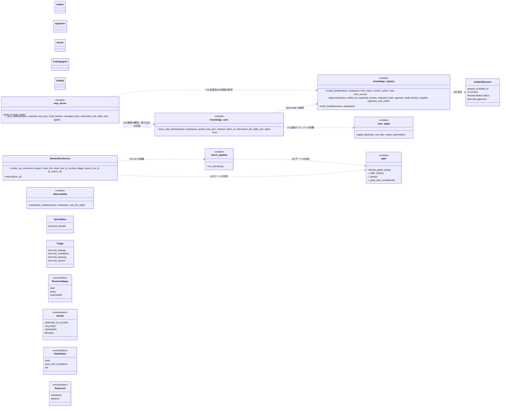
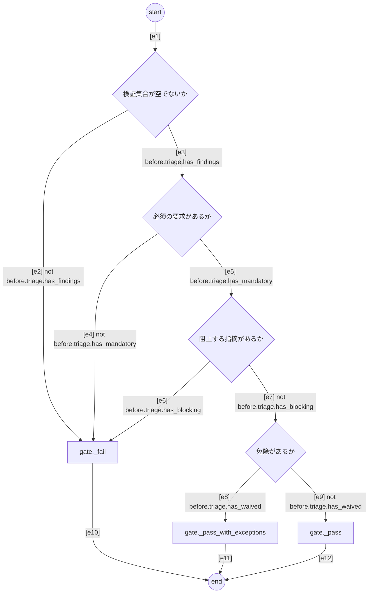

# SPEC-SYS-001 SpecLino システム全体

SpecLino 全体を上から見た仕様。個々の関数の振る舞いではなく、利用者・構成要素・知識のライフサイクル・判定のモデルと、
システム全体で守る要求を定める。各要求の詳細は下位の仕様（SPEC-KNOW-001、SPEC-SYNC-001、SPEC-GATE-002、
SPEC-WS-001、SPEC-AI-001、SPEC-OBS-001）が定め。

## 1. 目的と範囲

チームがコーディングエージェントに渡す知識（規約・スキル・指示書・仕様）を、SpecLino の画面で改訂・承認し、
MCP・A2A・`speclino sync` で各自のエージェントに配り、PR のゲートで守られていることを決定的に保証し、観測できるようにする。

- 仕様は人が読める Markdown と厳格な UML（Mermaid の部分集合）で書き、決定的な parser で IR に変換する
- 判定は決定的な検査器（Z3 を含む）だけが行い、要求ごとに 4 値（VERIFIED_IN_SCOPE / VIOLATED / UNKNOWN / REVIEW）を出す
- AI（Gemini）は執筆の提案・証拠の収集・説明を担い、変換も判定も承認もしない
- 範囲外: 実行トレースとの照合、Python 以外の言語の構造・順序の検査、旧形式の仕様から図への自動変換

## 2. 利用者

| 利用者 | SpecLino での役割 | 主な入口 |
| --- | --- | --- |
| 作者（ワークスペースのメンバー） | 知識の下書きを作り、直す。AI と会話して下書きを作る | Web の画面 |
| 承認者（approver） | 下書きを見て承認する。LLM 支援の指摘を確定（attest）する。sync トークンを発行する | Web の画面 |
| owner | approver の権限に加え、メンバー・招待・ロール・MCP トークン・リポジトリの登録を管理する | Web の画面 |
| PR の承認者（プロジェクト設定の GitHub ユーザー ID） | PR コメントのコマンド（`/speclino approve-spec`・`answer`・`attest`）を打つ | GitHub の PR コメント |
| コーディングエージェント | 作業前に知識の鮮度を確かめて取り込み、lock を作業の PR に含める。仕様の書き換え提案を受ける | MCP・A2A・`speclino sync` |
| GitHub（CI） | PR のイベントを webhook で送り、Check「SpecLino / gate」の結果で保護されたブランチへのマージを止める | webhook・Checks API |

## 3. 構成要素と責務

| 構成要素 | 置き場所 | 責務 | 持たない責務 |
| --- | --- | --- | --- |
| Web（画面） | `web/` | 知識のエディタ・差分と承認・AI と作る・可観測性・メンバー管理の表示と操作 | ロジック（`services/` に置く） |
| API | `api/`（`SPECLINO_ROLE=web`） | 認証（Identity Platform の ID トークン）、ワークスペースの所属の確認、`services/` の呼び出し、webhook の受信と署名の検証 | 判定、業務ロジック |
| worker | `services/review_run_service.py`（`SPECLINO_ROLE=worker`、Cloud Tasks から呼ばれる） | run の実行: bundle の固定、スナップショットの取得、検査、ゲート、成果物の保存、Check と PR コメントの更新 | 公開してよいかの判断を飛ばすこと |
| 知識レジストリ | `services/knowledge_registry.py`、`services/policy_governance.py` | 改訂の作成・更新・承認、仕様の IR の固定、bundle の作成と署名、競合の検査、監査 | 承認者以外の承認 |
| 仕様の変換器 | `spec/uml/` | Markdown と Mermaid の部分集合を決定的・全か無かで `CompiledSpec` に変換する | LLM・adapters への依存 |
| 検査器 | `conformance/`、`analysis/`、`verifiers/` | 仕様の義務（構造・順序・遷移・包含）、旧形式の要求、規約の検査器、Finding の 4 値 | LLM の呼び出し |
| ゲート | `conformance/gate.py`、`conformance/expected.py`、`conformance/exceptions.py` | 欠けた要求の補完、免除、人の確定の適用、フェイルクローズの判定 | verdict の書き換え |
| 配信（sync） | `services/knowledge_sync.py`、`sync_apply.py`、`cli_sync.py`、`api/routes/sync.py` | bundle をリポジトリに当てた書き出しの計画と署名つき lock、使い捨ての取得 URL、適用スクリプト | エージェントにファイルを直接書かせること |
| MCP サーバ | `mcp_server/server.py`（`/mcp`） | `context_get`・`verification_start`・`verification_get`・`sync_status`・`knowledge_pull`・`spec_get`・`skill_get`・`spec_suggest` | 判定・承認 |
| A2A サーバ | `a2a_server/`（`/a2a`、既定で無効） | スキル `spec_review`・`requirement_consult`・`run_clarification`・`spec_suggest`（提案・説明・診断だけ） | 判定・承認・保存 |
| AI 支援 | `services/knowledge_chat.py`、`services/spec_suggest.py`、`services/llm_policies.py`、`agent/` | 下書きの提案、書き換えの提案、LLM 支援の規約の評価（常に REVIEW）、未解決の指摘の証拠集め | 判定・承認・保存 |
| 可観測性 | `services/observability.py`、`services/project_overview.py` | 1 つの集計から形式化率・対応率・UNKNOWN の内訳・取得の遅れ・規約の推移・LLM の安定度を出す | 画面ごとの数え直し |
| ワークスペース | `services/workspaces.py`、`members.py`、`invitations.py`、`mcp_tokens.py`、`sync_tokens.py`、`repo_registration.py` | 所属・ロール・招待・トークン・リポジトリの登録とテナントの分離 | ワークスペースを越えた参照 |

## 4. 要求

| ID | level | 要求 | 形式化 |
| --- | --- | --- | --- |
| R-SYS-01 | mandatory | 知識と規約を承認できるのはワークスペースの owner と approver（人）だけで、AI・エージェント・トークンには承認する経路が無い | - |
| R-SYS-02 | mandatory | 承認は承認者が見た改訂（改訂番号・content_hash・説明のハッシュ）に対してだけ成立し、違えば拒否する。作者本人の承認は認めるが self_approved として記録し表示する | - |
| R-SYS-03 | mandatory | 仕様の IR は承認の時点でサーバが本文から決定的な parser で作って固定し、診断にエラーが 1 つでも残る仕様は承認できない。クライアントが送った IR は受け取らない | - |
| R-SYS-04 | mandatory | 承認と規約の有効化のたびに、同じトランザクションで署名つきの bundle（ワークスペースごとの連番）を作り、競合（スコープの重なる同名スキル・同じ要求 ID）があれば承認ごと拒否する | - |
| R-SYS-05 | mandatory | run・sync・replay は 1 つの bundle に固定して扱い、配るのはサーバの鍵で署名を検証できる bundle から作った計画と lock だけである | - |
| R-SYS-06 | mandatory | PR のゲートは `.speclino/lock.json` の署名・期限・持ち主・書き出したファイルを必須の要求 KNOWLEDGE-LOCK-001 として照合し、無い・壊れた・改変されたものは UNKNOWN、古いものは REVIEW にする | - |
| R-SYS-07 | mandatory | 判定は要求ごとに 4 値で表し、ゲートはフェイルクローズにする: 検証集合が空・必須の要求が無い・必須の要求に VIOLATED / UNKNOWN / REVIEW が残るときは失敗 | - |
| R-SYS-08 | mandatory | verdict を書き換える手段は無い。人の確定は attestations に記録し、REVIEW だけをゲートの阻止から外せる。UNKNOWN と VIOLATED は確定で通せず、VIOLATED を通すのは期限つきの例外（免除）だけ | - |
| R-SYS-09 | mandatory | 解析できない・対応の無い・上限を超えた・出るべきなのに出なかった要求は UNKNOWN にし、偽の VERIFIED_IN_SCOPE を出さない | - |
| R-SYS-10 | mandatory | データと権限はワークスペースごとに分離し、所属していないワークスペースのもの（知識・run・リポジトリ・トークン・会話）は存在を明かさず 404 にする | - |
| R-SYS-11 | mandatory | AI ができるのは提案と説明と証拠の収集だけで、IR への変換・判定・承認・保存に関与しない。AI の出力はゲートの入力にならない | - |
| R-SYS-12 | mandatory | LLM の費用は日次の上限の中に収め、呼ぶ前に最悪の額で可否を判断し、枠が無ければ呼ばない（その要求は UNKNOWN か利用者へのエラー） | - |
| R-SYS-13 | mandatory | 承認・拒否・権限の変更・招待・トークンの発行と失効・PR コメントのコマンド・人の確定・エージェントのツール呼び出しを監査の記録に残す | - |
| R-SYS-14 | mandatory | 秘密を扱わない: トークンはハッシュだけを保存し平文は発行時に 1 回だけ返す。秘密らしい値を含むコードは LLM に送らない。トークン・会話の本文をログに出さない | - |
| R-SYS-15 | mandatory | 対応（bindings.yaml）・契約・免除・規約はデフォルトブランチの先端（信頼側）から読み、PR がそれらを変えたら必須の REVIEW（KNOWLEDGE-BINDINGS-001）にして PR コメントの確定を求める | - |
| R-SYS-16 | mandatory | PR が更新された後の古い run の結果は履歴に残すが、Check と PR コメントに現在の結果として公開しない | - |
| R-SYS-17 | mandatory | 可観測性と状態の表示は 1 つの集計から作り、測っていないものを 0 や 100% と表示しない | - |
| R-SYS-18 | advisory | 構成要素の語彙: 図に現れる処理の持ち主（モジュールとクラス）と操作 | sys-vocab#knowledge_registry, sys-vocab#mcp_server, sys-vocab#knowledge_sync, sys-vocab#sync_apply, sys-vocab#ReviewRunService, sys-vocab#check_pipeline, sys-vocab#gate, sys-vocab#observability |
| R-SYS-19 | advisory | 知識のライフサイクルは、下書き → 承認 → bundle → 鮮度の確認と取り込み → PR の run とゲート → 観測の順に進む | - |
| R-SYS-20 | advisory | 知識の改訂の状態は、下書き → 有効 → 置き換え済み の順にだけ進む | - |
| R-SYS-21 | mandatory | ゲートの決定はフェイルクローズの順序で出口を選ぶ | gate-decision#s, gate-decision#c1, gate-decision#c2, gate-decision#c3, gate-decision#c4, gate-decision#f, gate-decision#pw, gate-decision#p, gate-decision#z, gate-decision#e1, gate-decision#e2, gate-decision#e3, gate-decision#e4, gate-decision#e5, gate-decision#e6, gate-decision#e7, gate-decision#e8, gate-decision#e9, gate-decision#e10, gate-decision#e11, gate-decision#e12 |
| R-SYS-22 | mandatory | 構成要素のつながり: worker は検査とゲートを、MCP は配信と知識レジストリを、配信は知識レジストリと適用スクリプトを使い、知識レジストリは改訂を扱う（クラス図の関係） | sys-vocab#r1, sys-vocab#r2, sys-vocab#r3, sys-vocab#r4, sys-vocab#r5, sys-vocab#r6, sys-vocab#r7, sys-vocab#r8 |

### 4.1 要求と下位の仕様の対応

| 全体の要求 | 下位の仕様 | 下位の要求 |
| --- | --- | --- |
| R-SYS-01 | SPEC-KNOW-001、SPEC-AI-001、SPEC-WS-001 | R-KNOW-03、R-AI-01、R-WS-02 |
| R-SYS-02 | SPEC-KNOW-001 | R-KNOW-04、R-KNOW-05 |
| R-SYS-03 | SPEC-KNOW-001 | R-KNOW-07 |
| R-SYS-04 | SPEC-KNOW-001 | R-KNOW-08、R-KNOW-09、R-KNOW-10 |
| R-SYS-05 | SPEC-KNOW-001、SPEC-SYNC-001、SPEC-GATE-002 | R-KNOW-11、R-SYNC-01、R-SYNC-02、R-GATEPR-02 |
| R-SYS-06 | SPEC-SYNC-001、SPEC-GATE-002 | R-SYNC-07、R-SYNC-08、R-GATEPR-07 |
| R-SYS-07 | SPEC-GATE-002 | R-GATEPR-04、R-GATEPR-05 |
| R-SYS-08 | SPEC-GATE-002 | R-GATEPR-10、R-GATEPR-11、R-GATEPR-12 |
| R-SYS-09 | SPEC-GATE-002 | R-GATEPR-03、R-GATEPR-06 |
| R-SYS-10 | SPEC-WS-001、SPEC-AI-001 | R-WS-07、R-WS-08、R-AI-02 |
| R-SYS-11 | SPEC-AI-001 | R-AI-01、R-AI-02、R-AI-03、R-AI-04、R-AI-06、R-AI-12 |
| R-SYS-12 | SPEC-AI-001 | R-AI-08、R-AI-09 |
| R-SYS-13 | SPEC-WS-001、SPEC-KNOW-001、SPEC-AI-001、SPEC-GATE-002 | R-WS-09、R-KNOW-12、R-AI-05、R-GATEPR-14 |
| R-SYS-14 | SPEC-WS-001、SPEC-AI-001、SPEC-SYNC-001 | R-WS-10、R-WS-13、R-AI-10、R-SYNC-10 |
| R-SYS-15 | SPEC-GATE-002 | R-GATEPR-08、R-GATEPR-09 |
| R-SYS-16 | SPEC-GATE-002 | R-GATEPR-13 |
| R-SYS-17 | SPEC-OBS-001 | R-OBS-01、R-OBS-02 |

## 5. 語彙（クラス図）

モジュールの関数は、モジュール名のクラスに `<<module>>` を付けて書く（例 `knowledge_registry.approve` は
`speclino.services.knowledge_registry.approve`）。`ReviewRunService` はコードのクラス（`speclino.services.review_run_service.ReviewRunService`）。
利用者（`Author` など）は操作を持たない参加者として書く。

## 6. 知識のライフサイクル

作者が下書きを作り、承認者が承認すると bundle ができる。コーディングエージェントは作業の前に MCP で鮮度を確かめ、
古ければ取り込みの計画を受け取って適用スクリプトで書き出し、lock ごと作業の PR に含める。GitHub の webhook で run ができ、
worker が bundle を固定して検査し、ゲートを決める。owner とメンバーは 1 つの集計で観測する。
複数の要求（画面・MCP・webhook）にまたがる流れを 1 本に並べたもので、コード上の 1 つの関数の振る舞いではないため、
図（検査の義務）にせず手順として書く。各段の順序は下位の仕様の図が定める。

1. Author → `knowledge_registry.create_draft`（l1）
2. Approver → `knowledge_registry.approve`（l2）
3. knowledge_registry → `knowledge_registry.build_bundle`（l3）
4. CodingAgent → `mcp_server._sync_status`（l4）
5. 鮮度が古い（`SyncStatus.pull_needed`）ときだけ（o1）:
   - CodingAgent → `knowledge_sync.issue_plan_ticket`（l5）
   - CodingAgent → `sync_apply.apply_plan`（l6）
6. GitHub → `ReviewRunService.create_run_in`（l7）
7. ReviewRunService → `ReviewRunService.execute`（l8）
8. ReviewRunService → `check_pipeline.run_check`（l9）
9. check_pipeline → `gate.decide_gate`（l10）
10. Owner → `observability.workspace_health`（l11）

## 7. 知識の改訂の状態

改訂（`ArtifactRevision`）は下書きで始まり、下書きは作者・メンバーが何度でも直せる（同じ改訂番号のまま置き換わる）。
承認で有効になり、同じ知識の次の改訂が承認されると、それまでの有効な改訂は置き換え済みになる。有効と置き換え済みは不変。
1 つの知識に有効な改訂と下書きはそれぞれ最大 1 つ。却下の状態は無い（下書きを直すか、そのまま残す）。

初期状態は `draft`。

| 遷移 | 前 | 後 | 契機 | 条件 |
| --- | --- | --- | --- | --- |
| k1 | `draft` | `draft` | `update_draft` | - |
| k2 | `draft` | `active` | `approve` | `before.artifactRevision.status == RevisionStatus.draft` |
| k3 | `active` | `superseded` | `approve` | - |

## 8. ゲートの判定（アクティビティ図）

Finding の verdict は 4 値で、ゲートの状態（`pass` / `pass_with_exceptions` / `fail`）とは分ける。仕分け（`triage`）は
Finding ごとに level（表に無い要求は mandatory）と `fail_on`（既定は VIOLATED・UNKNOWN・REVIEW）で
`blocking`・`advisory`・`waived`（有効な例外で免除された VIOLATED）・`cleared`（人が attested で確定した REVIEW）に分ける。
決定（`decide_gate`）は次の順で出口を選ぶ。

| verdict | 意味 | ゲート（mandatory のとき） |
| --- | --- | --- |
| VERIFIED_IN_SCOPE | 解析の範囲で成立を示せた | 阻止しない |
| VIOLATED | 反例がある（記号的な反例か観測した反例） | 阻止する。有効な例外があれば免除して例外つき通過 |
| UNKNOWN | 解析できない・対応が無い・上限・出るべき結果が無い | 阻止する（確定でも免除でも通せない） |
| REVIEW | 人の判断が要る（LLM 支援・設定の変更・古い lock など） | 阻止する。承認者の attested の確定でだけ外せる |

## 9. 実行の配置

本番は同じイメージを役割ごとの Cloud Run サービスに分ける（`SPECLINO_ROLE=web|worker|sandbox`、`all` は手元だけ）。
web は公開（API は ID トークン必須）、worker は Cloud Tasks からの IAM 呼び出しだけ、sandbox は worker からだけ呼べる。
データは Cloud SQL（PostgreSQL）、成果物は GCS（`runs/{run_id}/`）、秘密は Secret Manager から環境変数で渡す。

## 観測境界

- モジュールの関数は `<<module>>` のクラスとして書き、構造の義務でモジュール直下の関数と照合する
- 知識のライフサイクル（6 章）は複数の要求にまたがる概念の流れで、コードの 1 つの入口を持たないので図にしない（R-SYS-19 は
  未形式化。各段は下位の仕様の図で検査する）
- 改訂の状態（7 章）は DB の行（`artifact_revisions.status`）が持ち、SQL の更新で変わるので AST の解析で代入を観測できない。
  表で定め、R-SYS-20 は未形式化（`tests/integration/db/test_repositories.py` などの結合テストで確かめる）
- 全体の要求（R-SYS-01〜17）は形式化していない。検証は下位の仕様と、その下の関数単位の仕様・テストで行う
