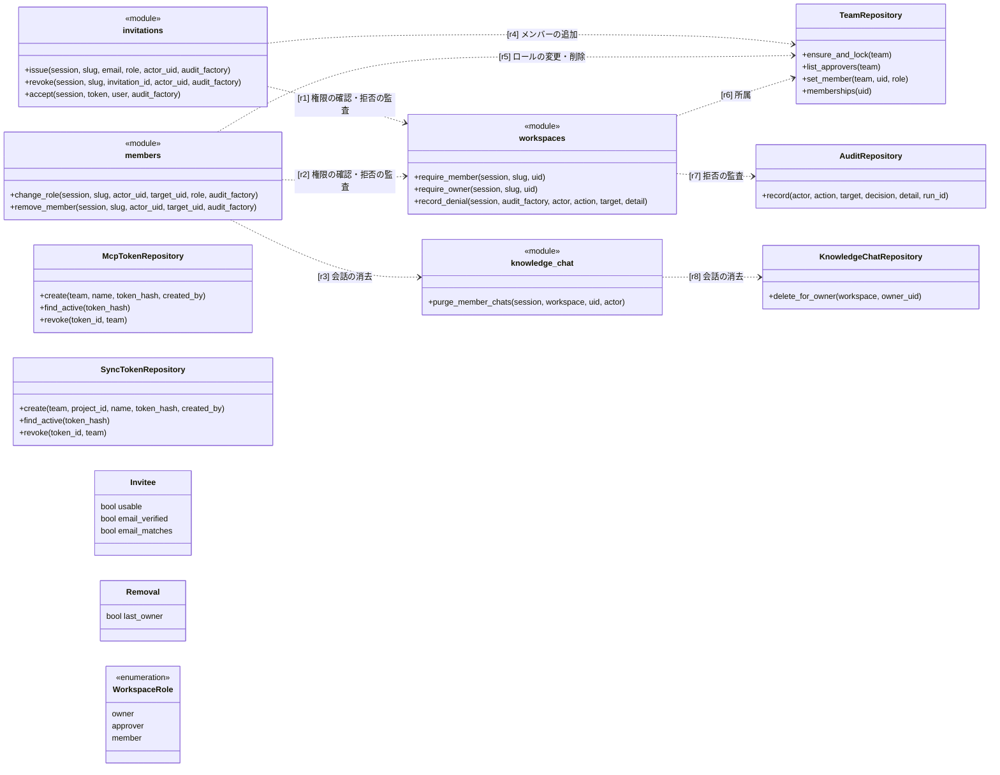
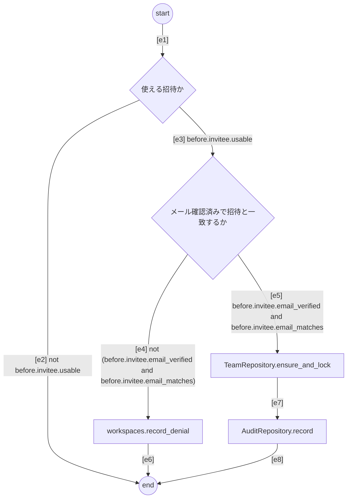
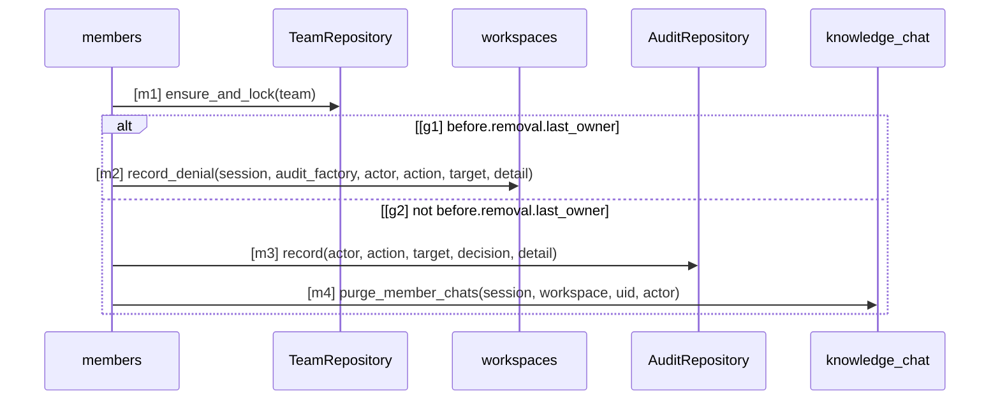

# SPEC-WS-001 ワークスペース・ロール・招待・トークン

SPEC-SYS-001 の区画のうち、テナント（ワークスペース）と利用者・トークンの権限を定める
（`speclino.services.workspaces`・`workspace_create`・`members`・`invitations`・`mcp_tokens`・`sync_tokens`・`repo_registration`・`approvers`）。
全体の要求 R-SYS-01、R-SYS-10、R-SYS-13、R-SYS-14 を詳しくする。

## 1. 目的と範囲

- チーム（ワークスペース）ごとに知識・リポジトリ・run・トークン・会話を分け、所属とロールで操作を許す
- 範囲外: 知識の承認の手順（SPEC-KNOW-001）、PR コメントのコマンドの中身（SPEC-GATE-002）

## 2. 主体とロール

| 主体 | 識別 | 認証 |
| --- | --- | --- |
| 利用者 | Identity Platform の uid（メールは識別子にしない） | Bearer の ID トークン（`require_user`）。開発用の dev 認証は手元の環境だけで、それ以外では設定の誤りとして 500 |
| PR の承認者 | プロジェクト設定 `approver_ids` の GitHub ユーザー ID（ログイン名は使わない） | GitHub の webhook の署名 |
| MCP トークン（`slmcp_`） | ワークスペース | Bearer。MCP と A2A |
| sync トークン（`slsync_`） | ワークスペースの 1 プロジェクト | Bearer。MCP の読み取り系と `POST /api/sync/bundle` |
| 計画の取得トークン（`slplan_`） | 1 つの計画 | URL の中。1 回だけ・10 分 |
| worker・tasks のサービスアカウント | Cloud Run の IAM | 内部の API（`/internal/...`）だけ |

| 操作 | owner | approver | member |
| --- | --- | --- | --- |
| 知識・規約の下書き、AI と作る、観測、メンバーの一覧、リポジトリの一覧、sync トークンの一覧 | 可 | 可 | 可 |
| 知識・規約の承認と取り下げ、LLM 支援の指摘の確定（画面）、sync トークンの発行・失効、プロジェクト設定の編集（PR の承認者を除く） | 可 | 可 | 不可（403） |
| ロールの変更、メンバーの削除、招待の発行・一覧・取消、MCP トークンの発行・一覧・失効、リポジトリの登録、プロジェクト設定の PR の承認者（`approvers`）の変更 | 可 | 不可 | 不可 |

ログインした利用者は誰でも、自分を owner とするワークスペースを作れる（R-WS-24。上の表はワークスペースの中の操作）。

## 3. 要求

| ID | level | 要求 | 形式化 |
| --- | --- | --- | --- |
| R-WS-01 | mandatory | ロールは owner・approver・member の 3 つで、owner は approver の権限を含む。利用者は Identity Platform の uid で識別し、メールを権限の判断に使わない | - |
| R-WS-02 | mandatory | 操作の権限は 2 章の表に従い、権限の無い操作は拒否して拒否を別のトランザクションで監査に残す | ws-vocab#TeamRepository |
| R-WS-03 | mandatory | ロールの変更とメンバーの削除はワークスペースの行のロックの下で判定し、最後の owner の降格・削除は拒否する（409） | - |
| R-WS-04 | mandatory | メンバーを外したら、その人の知識の会話を消す | ws-vocab#KnowledgeChatRepository |
| R-WS-05 | mandatory | 招待は owner が発行し、平文のトークンは発行時に 1 回だけ返してハッシュだけを保存する。期限は 7 日・1 回限りで、同じメールへの未使用の招待は新しい発行で取り消す。メールの送信はしない | - |
| R-WS-06 | mandatory | 招待の受諾は、メール確認済みでメールが招待と一致する利用者だけができ、既にメンバーならロールを変えない。使えない招待（無い・期限切れ・使用済み・取消済み）は理由を区別せず 404 にする | - |
| R-WS-07 | mandatory | 1 つのリポジトリが属するワークスペースは最大 1 つで、登録は GitHub の OAuth で本人がリポジトリの admin で GitHub App がインストール済みであることを確かめ、未登録のときだけ原子的に紐付ける。リポジトリは GitHub の ID で同定し、名前で取る前に ID を照合する | - |
| R-WS-08 | mandatory | 所属していないワークスペースの知識・run・リポジトリ・トークン・会話は、無い場合と区別せず 404 にする。他人の会話は同じワークスペースの owner にも 404 にする | - |
| R-WS-09 | mandatory | ロールの変更・削除・招待の発行と取消と受諾・リポジトリの登録・プロジェクト設定・トークンの発行と失効を、行為者・対象・決定（拒否は denied と理由）とともに監査の記録に残す | ws-vocab#AuditRepository |
| R-WS-10 | mandatory | すべてのトークン（招待・MCP・sync・計画・OAuth の state）は SHA-256 のハッシュだけを保存し、平文は発行時の応答にだけ載せる。監査にはトークンの ID だけを残す | ws-vocab#McpTokenRepository, ws-vocab#SyncTokenRepository |
| R-WS-11 | mandatory | MCP トークンはワークスペース単位で、sync トークンは 1 プロジェクトの読み取り専用。プロジェクトが別のワークスペースに移ったら sync トークンは認証に失敗する。失効したトークンは認証に失敗し、無効なトークンは理由を区別せず 401 にする | - |
| R-WS-12 | mandatory | PR コメントの承認者はワークスペースのロールとは別に、プロジェクト設定の GitHub ユーザー ID でだけ決め、ID が無い・設定の型が不正なら誰も承認者にしない | - |
| R-WS-13 | mandatory | 本番の秘密（GitHub App の鍵・webhook の秘密・bundle の署名鍵など）は Secret Manager から環境変数で渡し、コードとリポジトリに置かない | - |
| R-WS-14 | advisory | 招待の受諾の流れ（図 accept） | accept#s, accept#u, accept#v, accept#rd, accept#l, accept#a, accept#z, accept#e1, accept#e2, accept#e3, accept#e4, accept#e5, accept#e6, accept#e7, accept#e8, ws-vocab#invitations, ws-vocab#workspaces |
| R-WS-15 | advisory | メンバーの削除の流れ（図 remove） | remove#m1, remove#g1, remove#m2, remove#g2, remove#m3, remove#m4, ws-vocab#members, ws-vocab#knowledge_chat |
| R-WS-16 | mandatory | 構成要素のつながり: 招待とメンバー管理はワークスペースの権限の確認とメンバーのリポジトリを使い、メンバーの削除は知識のチャットの会話を消す（クラス図の関係） | ws-vocab#r1, ws-vocab#r2, ws-vocab#r3, ws-vocab#r4, ws-vocab#r5, ws-vocab#r6, ws-vocab#r7, ws-vocab#r8 |
| R-WS-17 | mandatory | リポジトリの登録は GitHub App のユーザー認可（web application flow）で行い、認可 URL に state（ハッシュだけを保存、10 分で失効、条件付きの更新で 1 回だけ消費、別の uid・期限切れ・使用済みは拒否）と PKCE（S256）を付ける | - |
| R-WS-18 | mandatory | 本人の権限は、ユーザーのトークンで /user/installations と /user/installations/{id}/repositories に列挙され、かつ permissions.admin が真であることで確かめる（GET /repos の 200 はインストールの証明にしない）。列挙に無ければ not_installed、admin でなければ not_admin で拒否する | - |
| R-WS-19 | mandatory | 確認が済んだら DELETE /applications/{client_id}/grant で認可ごと取り消し、取り消せたときだけ登録する（失敗は github_revoke_failed）。拒否・例外の経路でも取り消しを試み、ユーザーのトークンを DB・ログ・監査・例外の文面に出さず保存しない | - |
| R-WS-20 | mandatory | 招待のリンクはトークンを URL のフラグメント（/invite#トークン）に載せてサーバのアクセスログに残さず、プレビューと受諾は POST の本文でトークンを送る | - |
| R-WS-21 | mandatory | プロジェクト設定は型で検証してから保存し、fail_on は VIOLATED・UNKNOWN・REVIEW をすべて含むもの以外を拒否する（ゲートを弱められない）。設定の変更は owner と approver ができるが、PR の承認者（approvers）を変えられるのは owner だけで、approver_ids は owner の保存のときにサーバが GitHub から引いて埋める（送られた値は使わない） | - |
| R-WS-22 | mandatory | 調査エージェントとテストの実行は、サーバの設定とプロジェクト設定の両方で有効なときだけ動く（AND） | - |
| R-WS-23 | mandatory | 保存されたプロジェクト設定が型に合わなければ安全側の値（エージェントとテストの実行は無効、承認者なし、fail_on は既定）に置き換え、そのプロジェクトでは誰も PR の承認者にしない | - |
| R-WS-24 | mandatory | ログインした利用者は識別子（英小文字・数字・ハイフンで 2〜40 文字、先頭と末尾は英小文字か数字、ハイフンの連続なし）を指定してワークスペースを作れ、作った人が owner になる。同じ識別子の行が既にあれば、メンバーの有無によらず拒否し（409）、既存の行とその下のデータを引き取らない。1 人が owner のワークスペースは 5 個までで、超える作成は拒否する（409）。作成は行為者つきで監査に残す | - |

## 4. 語彙（クラス図）

`TeamRepository` などはコードのクラス（`speclino.db.repositories.*`）。`invitations`・`members`・`workspaces`・`knowledge_chat` は
`speclino.services` のモジュールの関数を表す。

## 5. 招待の受諾（アクティビティ図）

## 6. メンバーの削除（シーケンス図）

owner の確認の後、ワークスペースの行をロックし、最後の owner なら拒否する。削除したら監査に残し、その人の会話を消す。

## 観測境界

- 構造の義務（`TeamRepository`・`McpTokenRepository`・`SyncTokenRepository`・`KnowledgeChatRepository`・`AuditRepository`）は
  コードで照合できる。権限の表と 404 の分離は結合テスト（`tests/integration/services/`）で確かめる
- リポジトリの登録（R-WS-17〜19）は GitHub の API を相手にするので図にせず、単体テスト（GitHub の応答の差し替え）で確かめる
- 招待の受諾とメンバーの削除の流れは、入口・操作は名前の一致でコードに対応するが、ガードの変数（`invitee.*`、
  `removal.last_owner`）は DB の問合せの結果で入口の値に対応づけられないため UNKNOWN（advisory）
