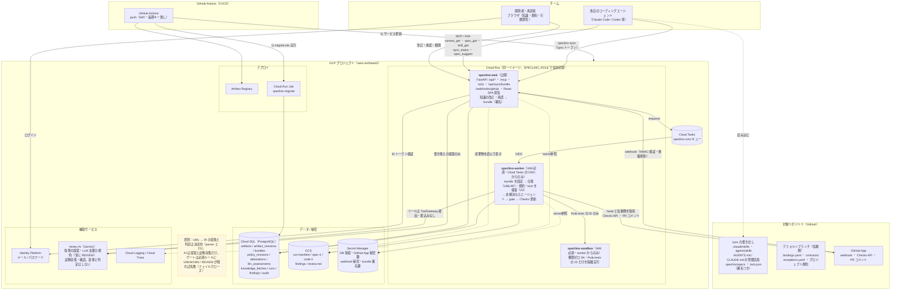
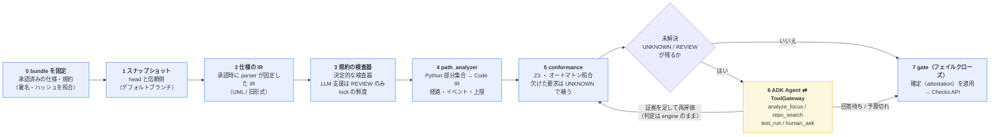
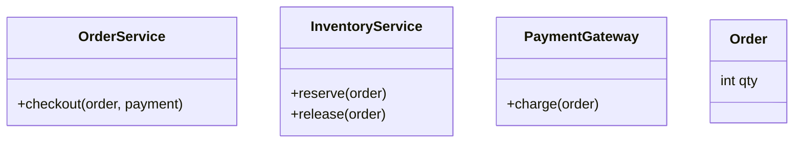
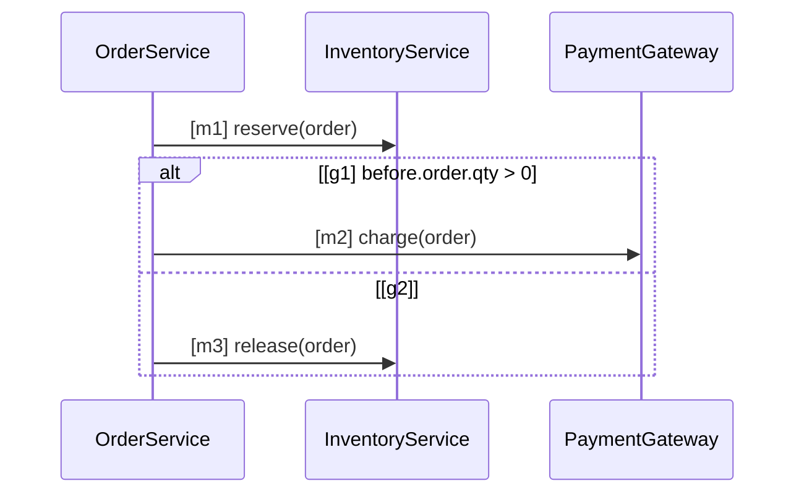

# SpecLino

**チームがコーディングエージェントに渡す知識を 1 か所で管理し、守られていることをゲートで保証する。**

コーディングエージェントの出来は、渡す知識で決まる。規約・スキル・AGENTS.md・仕様が各リポジトリや
各自の手元に散らばっていると、エージェントごとに読むものが違い、守ったかどうかも誰にも分からない。
SpecLino は、チームの知識を画面で改訂・承認し、各自のエージェントに MCP / A2A / `speclino sync` で配り、
PR ごとに「承認済みの知識どおりか」を決定的に検査する。

| 種類 | 中身 | 守られているかの確かめ方 |
| --- | --- | --- |
| **規約** | コーディング規約、命名規則、API のエンドポイント、エラーとレスポンスの形式、エラーメッセージの書き方 | 決定的な検査器（AST・OpenAPI・CI の定義）。それ以外は LLM 支援（常に「要確認」で、人が確定する） |
| **スキル** | チームのツールの使い方、環境の癖、文書の書き方（Agent Skills 形式の `SKILL.md`） | 配った版（lock）が最新か |
| **指示書** | `AGENTS.md` / `CLAUDE.md` | 配った版（lock）が最新か |
| **仕様** | 人が読める Markdown ＋ 厳格な UML（Mermaid の部分集合） | UML を決定的に IR へ変換し、Z3 とオートマトンで実装と照合 |

```text
R-CANCEL-04：在庫復元コマンドを1回呼ぶ
判定：VIOLATED（missing_effect）
条件：管理者でない / 所有者である / 注文が PENDING
実装：inventory_restore_command を 0 回
コード：examples/orders/app/service.py:19-27
```

AI（Gemini + ADK）は仕様の**書き換えを提案**し、検査の後に**証拠を集めて人に聞く**。
仕様を機械可読な形に**変換するのも、判定するのも決定的な処理だけ**で、AI の出力は判定経路に入らない
（`spec/uml/`・`conformance/`・`analysis/` は LLM・外部 I/O を import できず、テストで強制している）。

> 第5回 Agentic AI Hackathon with Google Cloud 提出作品。デモ URL・テストアカウントは
> [提出情報](#提出情報)を参照。デモの手順は [docs/demo-knowledge-registry.md](docs/demo-knowledge-registry.md)。

## 何を保証し、何を保証しないか

判定は 4 値を正直に保つ。「解析できなかった」を「適合」と言わない。

| 判定（画面の表記） | 意味 |
| --- | --- |
| `VERIFIED_IN_SCOPE`（適合） | 記述した観測範囲の中で、全経路で成立することを確認した |
| `VIOLATED`（違反） | 反例がある（記号的、またはテスト実行による観測） |
| `UNKNOWN`（未検証） | 解析できない・対応が見つからない・上限に達した・出るべき結果が出なかった |
| `REVIEW`（要確認） | 人の確認が要る（仕様に無い挙動、LLM 支援の規約、lock が古い、bindings の変更） |

**ゲートはフェイルクローズ**。必須（mandatory）の要求・規約に `VIOLATED` / `UNKNOWN` / `REVIEW` が
1 件でも残れば GitHub の Check は失敗する。**間に合わない・解析できない部分は UNKNOWN になるだけで、
偽の VERIFIED_IN_SCOPE を出さない**。出るべき要求の一覧を bundle から先に作り、結果が出なかった要求には
UNKNOWN（`missing_finding`）を補うので、検査器が黙って落ちても素通りしない。

open-world で読む: 図に無い呼び出しが間にあっても違反にしない。図に無い処理を違反にするのは
`closed: true` を宣言したアクティビティ図だけ。

## 流れ

1. **書く**: 仕様エディタで Markdown と UML を書く。AI は書き換えを提案するだけ
2. **承認する**: owner / approver が原文と正規形を見て承認する。診断にエラーがあれば承認できない
3. **配る**: 承認のたびに bundle（署名つき）ができ、`speclino sync` と MCP で各自のエージェントに届く
4. **作る**: 各自のエージェントが、配られたスキル・AGENTS.md・仕様を読んで実装する
5. **確かめる**: PR のゲートが bundle を固定し、仕様・規約・lock の鮮度を決定的に判定する
6. **観測する**: 可観測性の画面で、形式化率・対応率・UNKNOWN の内訳・取得の遅れ・規約の推移を見る

- 承認・規約の有効化のたびに **bundle**（有効な改訂の集合）を作る。run・sync・replay は bundle の番号で固定し、
  run の途中で承認が進んでも判定は変わらない
- リポジトリに残すのは、コードと同じ PR で変わるべきもの: `.speclino/bindings.yaml`（操作名とシンボルの対応）、
  `contracts/`、`exceptions.yaml`（期限つきの免除）、プロジェクト規約。ゲートはこれらを**デフォルトブランチ（信頼側）**から読む

## アーキテクチャ

Cloud Run を役割別（web / worker / sandbox）に分け、秘密と権限を分離する。



判定はこの順序でしか起きない。エージェントは **5 で未解決が残ったときだけ** 呼ばれ、証拠を足して
engine に再評価させる。エージェントの文章は判定に入らない。



（画像版: [architecture.png](design/architecture.png) / [pipeline.png](design/pipeline.png)。図の正本は
`design/*.mmd` で、`make diagrams` で作り直す）

ローカルでは同じコードが in-process キュー・ローカル FS・Docker サンドボックスに切り替わる
（`SPECLINO_QUEUE_KIND` / `SPECLINO_BLOB_KIND` / `SPECLINO_SANDBOX_KIND`）。

エージェントが判定を上書きできないのは、(a) 判定を書くツールが存在しない (b) 検査器は型付きの
IR と Evidence しか受け取らず、それを作るのは決定的なモジュールだけ (c) LLM の文章は保存されるだけで
検査器の入力にならない、という構造による。

## クイックスタート（ローカル）

必要なもの: Python 3.12、[uv](https://docs.astral.sh/uv/)、Node.js 20+、Docker（DB とサンドボックス用）。

```sh
make setup          # uv sync + npm ci
make db-up          # ローカル PostgreSQL（docker compose）
make db-migrate     # alembic upgrade head
make dev            # FastAPI（http://localhost:8080、SPECLINO_ROLE=all）
cd web && npm run dev   # 画面（Vite。/api は :8080 に転送）
```

ローカルの既定は開発用の認証（`SPECLINO_AUTH_KIND=dev`、`SPECLINO_ENV=local` のときだけ有効）。
ログイン画面の「開発モードで入る」で、利用者 `judge` として入る。ワークスペースは CLI で作る:

```sh
uv run speclino workspace create <slug> --owner-uid judge --name "<表示名>"
uv run speclino policy seed --team <slug>   # 既存の規約パッケージを最初の改訂として取り込む（任意）
```

リポジトリ（プロジェクト）の登録は GitHub App の接続が要る（[guides/github-app-setup.md](guides/github-app-setup.md)）。
UML の仕様を書いて違反する PR を検査するまでの通しの手順は
[docs/demo-knowledge-registry.md](docs/demo-knowledge-registry.md)、題材は [examples/shop/](examples/shop/)。

```sh
make test           # 単体 + 統合（統合は SPECLINO_DATABASE_URL が要る）
make selfcheck      # SpecLino を自分自身に当てる（下の「自己検証」を参照）
```

## 1 件の検査を実行する（CLI、DB なし）

CLI はリポジトリの `specs/` を読む Git の流れでも動く（自己検証と、GCP を畳んだ後の手元の確認のため）。
同梱の題材（`examples/orders/`：注文キャンセル、要求 9 件）を検査する。

```sh
uv run speclino check --repo . --project examples/orders --head WORKTREE --out build/review
```

```text
VERIFIED_IN_SCOPE: 9
VIOLATED: 0
UNKNOWN: 0
REVIEW: 0
gate: pass (必須ルールはすべて成立)
```

`build/review/` に `run-manifest.json`（入力のハッシュ・版・上限）、`spec-ir.json`、`code-ir.json`、
`findings.json`、`gate.json`、`review.md` が出る。`run_id` と実行時刻を除けば同じ入力から同じ結果になる
（`speclino replay build/review` が凍結した IR から再評価し、保存された結果と一致するか確かめる）。

違反を作って試す: `examples/orders/app/service.py` の `inventory.restore(...)` を `if user.is_admin:` の中に
移して同じコマンドを実行すると、`R-CANCEL-04` が VIOLATED になり、反例（非管理者の所有者・PENDING）が
`review.md` に出る。`--base main` を足すと、この変更が**新規に持ち込んだ**違反かどうかも分かる。

主なオプション: `--fail-on VIOLATED --fail-on UNKNOWN --fail-on REVIEW --blocking`（必須運用）、
`--depth` / `--max-paths` / `--solver-timeout-ms`（解析の上限）、`--code-ir <file>`（手書き Code IR を入力）。
終了コードは 0（ゲート条件に該当しない）/ 1（該当、`--blocking`）/ 2（入力不正・実行不能）。

## 知識を管理する

画面の上部の「知識」（仕様・スキル・指示書）と「規約」から、種類ごとに改訂を作って承認する。
改訂は 下書き → 有効 → 置き換え済み と進み、有効な改訂は書き換えられない。

| 種類 | 書くもの | スコープ |
| --- | --- | --- |
| 規約 | ルール（level は 必須 / 助言）と検査器のパラメーター、LLM 支援のチェック項目 | ワークスペース全体 |
| スキル | `SKILL.md`（frontmatter の `name` / `description` を検証）と付属ファイル（テキストのみ） | ワークスペース全体か、プロジェクト |
| 指示書 | `AGENTS.md` / `CLAUDE.md` の本文（配るのは管理区画の中だけ） | ワークスペース全体か、プロジェクト |
| 仕様 | Markdown ＋ Mermaid（または旧形式の IR） | 1 つ以上のプロジェクト（必須） |

スコープの変更は新しい改訂と承認を要する。bundle を作るときに競合（同じスコープに同じ対象の指示書が 2 つ、
同名のスキルが 2 つ、仕様の要求 ID の重複）があれば、承認ごと拒否する。

### 仕様を UML で書く

仕様エディタの左に Markdown と Mermaid、右に図のプレビュー・IR から作った**正規形**・場所つきの診断・
要求の表の追跡状況が出る。受け付ける構文は [src/speclino/spec/uml/grammar.md](src/speclino/spec/uml/grammar.md)
（parser `uml-0.1` の正本）。要点:

- 図は 4 種類: クラス図（語彙と構造）・シーケンス図（入口ごとの呼び出しの順序）・状態遷移図（遷移の関係）・
  アクティビティ図（`flowchart`。1 つの操作の制御フロー）
- **全要素に明示的な ID**（`[m1]`、`[t1]`、`[e1]`）。表示ラベルは ID にしない
- **ガードは式だけ**で、`before.` / `after.` / `outcome.` の名前空間が必須。自然言語のガードはエラー
- 参照する名前はクラス図か `domain` 節に宣言する（用語集に無い言葉は黙って通さない）
- 対応しない構文（`par`、`critical`、`subgraph`、未知の矢印 など）と、読めないトークンが 1 つでもあれば
  **全体がエラー**（全か無か）。Mermaid として描けるかと、SpecLino が意味を読めるかは別の診断に出る

````markdown
| ID | level | 要求 | 形式化 |
| --- | --- | --- | --- |
| R1 | mandatory | 在庫を確保してから課金する | checkout#m1, checkout#m2 |
| R2 | mandatory | 監査ログを残す | - |




````

要求の表の `形式化` は `図ID#要素ID` か `ir:要求ID`（旧形式）。空か `-` の行は**未形式化**として残り、
可観測性の形式化率に出る（判定ではなく追跡に使う）。

同じ本文と同じ parser の版からは、必ず同じ IR とハッシュが出る（LLM・ネットワーク・時刻に依存しない）。
`parse(render(parse(s))) == parse(s)` を性質テストで保証し、承認者は原文と正規形を並べて見て承認する。
エディタの「AI の提案」は本文の差分を出すだけで、採用するかは人が決め、変換には関与しない。

### 旧形式の仕様を取り込む

Git の `specs/*.md` と `specs/ir/*.spec-ir.json`（Spec IR v0.1）、`.speclino/domain.yaml` は、そのまま
仕様の下書きとして取り込める。IR は失われない（図への書き換えは自動ではしない）。

```sh
uv run speclino import-specs --workspace <slug> --project-id <id> --author <uid> --repo <dir>
```

取り込んだ後は画面で承認する。承認時にサーバが IR を固定する（クライアントが送った IR は信用しない）。
bundle に仕様が無いのにリポジトリに `specs/ir` がある、または bundle に無い要求 ID がリポジトリにあると、
ゲートは `KNOWLEDGE-SPEC-001` で知らせる。

### 承認する

- 承認できるのはワークスペースの owner / approver。作者本人の承認も認めるが、**自己承認**として監査と画面に印が残る
- 仕様は、診断にエラーが 1 つでも残っていれば承認できない（サーバ側で拒否）
- 承認者が見た内容（改訂番号と内容のハッシュ）でなければ拒否する。2 人が同時に承認すれば片方だけが通る
- 改訂の画面で前の改訂との差分を見られる（仕様は「正規形の差分」も。見た目だけの違いは消え、意味の違いだけが残る）

## 対象関数と bindings を追加する（`.speclino/bindings.yaml`）

図の操作 `<クラス>.<メソッド>` は、まず**名前の一致**でコードのシンボルに対応づける。一致しないものだけ
`bindings.yaml` で上書きする（キーを図の名前にする）。

```yaml
behaviors:
  cancel_order:
    entrypoint: examples.orders.app.service.cancel_order
    variables:
      actor.is_admin: user.is_admin      # before.actor.is_admin ← 実装の user.is_admin
      order.status: order.status

operations:
  Inventory.restore:                     # 図の操作名
    symbol: examples.orders.app.inventory.restore
    claim_scope: command_invocation
    summary_ref: inventory_restore_v1    # .speclino/contracts/*.yaml の契約
```

型と列挙・前提・観測境界は仕様の `domain` 節（旧 `.speclino/domain.yaml`）に、外部呼出しの契約
（`assumes_success`、`may_modify`、`pure`）は `.speclino/contracts/*.yaml` に置く。契約が無い呼出しは推測せず UNKNOWN。

`bindings.yaml`・`contracts/`・`exceptions.yaml`・プロジェクト規約は、ゲートが**デフォルトブランチから**読む。
PR でこれらを変えると、判定は変更前の内容で行い、必須の REVIEW `KNOWLEDGE-BINDINGS-001` が出る
（PR で対応表を書き換えて検査を通す経路を塞ぐ）。変更を認めるなら承認者が PR コメントで確定する（下の「LLM 支援の規約と確定」）。

## 知識を配る（`speclino sync`・MCP・A2A）

### `speclino sync` と lock

設定 → 「sync トークン」で、プロジェクト限定・読み取り専用のトークン（`slsync_…`）を発行する
（発行・失効は owner / approver）。トークンは環境変数だけで渡す（引数・lock・ログには出さない）。

```sh
export SPECLINO_SYNC_TOKEN=slsync_...
uv run speclino sync --url https://<your-speclino> --repo . --repo-id <GitHub のリポジトリ ID>   # 2 回目以降は --repo-id 不要
```

| 書き出し先 | 中身 |
| --- | --- |
| `.claude/skills/<name>/`、`.agents/skills/<name>/` | スキル |
| `AGENTS.md` / `CLAUDE.md` の管理区画（`<!-- speclino:begin bundle=<n> -->` 〜 `<!-- speclino:end -->`） | 指示書。区画の外は触らない |
| `.speclino/specs/<name>.md` | 仕様の読み取り専用の写し（判定には使わない） |
| `.speclino/lock.json` | bundle の世代、各メンバーの改訂と内容のハッシュ、書き出したファイルのハッシュ、サーバの署名、期限（30 日） |

lock の意味は「この checkout が宣言している bundle」で、**利用の証明ではない**。書き出しはパスを検査し
（`..`・絶対パス・symlink・許可リスト外は拒否）、一時ディレクトリに作ってから置き換える。失敗すれば手元の
ファイルと lock は前のまま。lock をコミットすると、ゲートが鮮度を確かめる（`KNOWLEDGE-LOCK-001`）。

### MCP / A2A / Claude Code プラグイン

- **MCP**（`/mcp`）: `context_get`（規約）、`spec_get` / `skill_get`、`sync_status`（lock が最新か）、`spec_suggest`
  （仕様の書き換えの提案）、`verification_start` / `verification_get`。読み取り系は sync トークンでも呼べ、
  検査の開始はワークスペースの MCP トークン（`slmcp_…`、設定 → トークンで owner が発行）に限る
- **A2A**（`/a2a`、Agent Card は `/.well-known/agent-card.json`）: 仕様のレビュー・要求の相談・仕様の下書きの相談・
  検査の後の聞き取り。返すのは提案だけで、判定も承認もしない。`uv run speclino a2a-send --help` が最小のクライアント
  （サーバ側は `SPECLINO_A2A_ENABLED=true`）
- **Claude Code プラグイン**: [`plugins/speclino/`](plugins/speclino/) が Skill（仕様の書き方・結果の読み方・sync）と
  MCP 接続を配る。`claude plugin marketplace add <owner>/<repo>` → `claude plugin install speclino@speclino`。
  接続先とトークンは `SPECLINO_MCP_URL` / `SPECLINO_MCP_TOKEN` の環境変数で渡し、`.claude/settings.json` に書かない

取得は記録され（`knowledge_fetches`）、可観測性の画面で「誰が・どのトークンで・どの世代を最後に取ったか」として見える。

## 判定を読む

### UNKNOWN の読み方

UNKNOWN は「壊れている」でも「大丈夫」でもなく、**この道具では確認できなかった**という報告。
Finding の `category` と `next_steps` が対処を示す。

| 原因 | よくある形 | 対処 |
| --- | --- | --- |
| 対応が見つからない | 図の操作・入口に、名前の一致でも `bindings.yaml` でも対応するシンボルが無い | 名前をそろえるか、`bindings.yaml` に上書きを足す |
| 不完全な経路 | 対応外の構文（一般の `while`、展開できない `for`、`getattr`）、不透明な領域 | その部分を単純化する、または要求に関係する効果だけを関数に切り出す |
| 解析の上限 | 経路 64 / 深さ / ソルバーの時間 | エージェントが `analyze_focus` で対象の要求だけ上限を上げて再解析する。残るなら構造を単純化する |
| 判定の欠落（`missing_finding`） | 出るべき要求・規約の結果が出なかった（検査器の例外、LLM の失敗、対応する behavior が無い） | `next_steps` の原因を直す。欠落は通過にならない |
| 契約の無い外部呼出し | 新しい SDK を呼んだ | `.speclino/contracts/` に要約を登録する |
| lock | lock が無い・署名が合わない・ファイルが改変された・期限切れ | `speclino sync` し直して lock をコミットする |

VERIFIED / VIOLATED を出すのは、モデルの中で正確な経路（`precision=exact_in_model`）だけ。段階的な
エスカレーション: 決定的解析 → エージェントの再解析 → 宣言済みテストの隔離実行（`Rule.tests` の ID だけ、
ネットワーク遮断）→ 承認者への構造化質問 → ゲート失敗。

### 知識の Finding（`KNOWLEDGE-*`）

| ID | 判定 | 意味と対処 |
| --- | --- | --- |
| `KNOWLEDGE-LOCK-001` | 適合 / 要確認 / 未検証 | lock が今の bundle と一致すれば適合。世代が古くメンバーが違えば要確認（sync し直す）。lock が無い・署名不一致・改変・期限切れ・別リポジトリなら未検証 |
| `KNOWLEDGE-SPEC-001` | 未検証 / 要確認 | リポジトリに取り込んでいない仕様（`specs/ir`）がある。`import-specs` で取り込んで承認する |
| `KNOWLEDGE-BINDINGS-001` | 要確認 | PR が `bindings.yaml`・`contracts/`・`exceptions.yaml`・プロジェクト規約を変えた（判定は変更前の内容）。承認者が確定すれば解除、マージ後の run で効く |

### LLM 支援の規約と確定

決定的に書けない規約（例: エラーメッセージが利用者に次の行動を示しているか）は、規約のルールを
`tier: llm_assisted`・検査器 `llm.checklist` にして、チェック項目の一覧を書く。

- **verdict は常に REVIEW**。区分を別に持つ: 指摘あり（`issue`）／割れた（`split`）／「LLM で確認、指摘なし
  （機械検証ではない）」（`no_issue`）。指摘には根拠の引用・場所・チェック項目が付く
- **必須（mandatory）の LLM 支援の規約は、区分にかかわらず人の確定（`attested`）までゲートを止める**。
  `no_issue` も機械検証ではないので自動では通さない（画面では「— 人の確定が必要」と出す）。
  助言（advisory）の規約はどの区分でもゲートを止めない
- 揺らぎを抑える: 関数・文字列リテラル・エンドポイントの単位で評価し、キー（規約の改訂・ルール・単位の内容の
  ハッシュ・モデル・プロンプトの版）が同じなら LLM を呼ばず記録を返す。新しいキーは 3 回評価して多数決、
  `no_issue` は 3 回とも一致したときだけ。replay は記録で再評価し、LLM を呼ばない。LLM の失敗は UNKNOWN
- **人の確定は verdict を書き換えず、ゲートの処置として記録する**（`attestations`）。指紋と内容のハッシュに結びつき、
  コードが変われば効かない。確定はプロジェクトに属し、そのプロジェクトの run にだけ効く。画面（REST）からは、
  開いている run の確定できる指摘だけを確定できる（`run_id` が必須。他の run・他のワークスペースの指摘は 404）。
  owner / approver が画面（run の詳細の「問題なしとして確定」/「問題として記録」）か、PR コメントで行う:

```text
/speclino attest <指紋> <sha256:内容のハッシュ>        # 問題なしとして確定（ゲートの阻止から外す）
/speclino attest <指紋> <sha256:内容のハッシュ> ack    # 問題として記録（阻止したまま）
```

PR コメントの承認者は GitHub のユーザー ID で照合する（ログイン名の付け替えでは通らない）。
`KNOWLEDGE-BINDINGS-001` の確定は ID で照合できる PR コメントからだけ受け付ける。PR の作成者自身の確定は
自己確定として gate.json・manifest・画面に残る。

#### LLM に送るもの（データの扱い）

- **送るのは、`tier: llm_assisted` のルールを定義したときだけ**（opt-in）。そのルールの `applies_to` /
  `params.paths` に一致する Python ファイルから取り出した単位（関数・文字列リテラル・エンドポイント）の
  正規形（`ast.unparse`。コメントは落ちる）と、ルールの題・本文・チェック項目。リポジトリ全体や差分、
  PR の本文・コメントは送らない
- 送り先は worker が呼ぶ Gemini（本番は Vertex AI。`GOOGLE_CLOUD_PROJECT` のプロジェクト、
  `SPECLINO_LLM_POLICIES_MODEL`、未指定なら `SPECLINO_AGENT_MODEL`）。費用は `SPECLINO_DAILY_COST_LIMIT_USD`
  の枠を共有する
- **秘密情報・個人情報らしい値を含む単位は送らない**: 秘密鍵のヘッダー、AWS / GCP / GitHub / Slack /
  `sk-` 形式のトークン、JWT、認証情報つきの URL、メールアドレス（`example.com` などの例示用ドメインを除く）、
  文字列リテラルの中の 32 文字以上の高エントロピーな文字列。その単位は UNKNOWN（「秘密情報らしい値を含むため
  LLM に送らない」）になり、必須の規約ならゲートを止める。モデルが返した引用も同じ検出器で伏せてから保存・表示する
- 評価の結果（区分・票・伏せた引用）は `llm_assessments` にワークスペースごとに残し、同じ内容の単位は
  呼び直さない
- 全体で止めるには `SPECLINO_LLM_POLICIES_ENABLED=false`（LLM 支援のルールはすべて UNKNOWN になる）

## 可観測性

上部の「可観測性」（`/w/<slug>/observability`）。表示はサーバの集計 1 つから作り、画面ごとに数え直さない。
数えるものが無い指標は 0 ではなく「未計測」と出す。

| 指標 | 見るもの |
| --- | --- |
| 形式化率 | プロジェクトに当たる仕様の要求の表のうち、`形式化` が書かれた行の割合 |
| 対応率 | 最新の検査の仕様の義務のうち、「対応が見つからない」UNKNOWN が無いものの割合（推定） |
| UNKNOWN の内訳 | 対応なし / 不完全な経路 / 解析の上限 / 判定の欠落 / lock / その他 |
| 取得 | メンバー・トークンごとに、最後に取得した bundle の世代と今の世代との遅れ（失効したトークンは「失効済み」） |
| 規約の推移 | 直近 10 回の完了した検査での、規約ごとの 違反 / 要確認 / 未検証 / 適合 の件数 |
| LLM 支援の安定度 | 指摘あり・割れた・指摘なしの件数、記録の再利用率、確定の件数（うち自己確定） |

## CI での運用（警告から始める）

最初は警告運用（advisory）から始め、対象を絞ってから必須にするのが安全:

```yaml
# 警告のみ（ゲート失敗でも終了コード 0。入力不正・実行不能のときだけ 2）
- run: uv run speclino check --repo . --head WORKTREE --out build/review

# 必須（必須ルールに未検証が残れば失敗）
- run: >-
    uv run speclino check --repo . --head WORKTREE --out build/self-check
    --fail-on VIOLATED --fail-on UNKNOWN --fail-on REVIEW --blocking
```

GitHub App のゲートでも同じ考え方で、規約を `level: advisory`（画面では「助言」）にすればゲートを落とさず
報告だけできる。仕様の要求も要求の表の `level` を `advisory` にできる。期限つきの免除は
`.speclino/exceptions.yaml`（全項目必須、期限切れは無効）で、免除された違反は適合に書き換えず「通過（免除中あり）」として別記する。

このリポジトリ自身が [.github/workflows/ci.yml](.github/workflows/ci.yml) で必須運用している（**自己検証**）。
CLI 側を残しているのは、**GCP を畳んだ後でも / clone した人の手元でも自己検証が回る**ことと、
**LLM を一切使わずに違反を検出できる**ことを示すため。GitHub App を作って実 PR に接続する手順は
[guides/github-app-setup.md](guides/github-app-setup.md)、GCP への初回デプロイは [guides/deploy-runbook.md](guides/deploy-runbook.md)。

## 自己検証

SpecLino は自分自身のコードを自分の仕様で検査する。CI が落ちれば自分の規約違反を自分で見つけた
ということ。

| 仕様 | 対象 | 要求 |
| --- | --- | --- |
| [SPEC-TOOL-001](specs/SPEC-TOOL-001.md) | `ToolGateway.invoke` | 権限が無ければツールを実行せず監査に残す。予算超過でも同じ |
| [SPEC-GATE-001](specs/SPEC-GATE-001.md) | `conformance.gate.decide_gate` | 検証集合が空・必須ルールが無い状態で「通過」を返さない |
| [SPEC-RUN-001](specs/SPEC-RUN-001.md) | `services.run_freshness.should_publish` | 古い実行（superseded / 最新でない）の結果を公開しない |
| [SPEC-TEST-002](specs/SPEC-TEST-002.md) | `agent.tools.test_run.decide_observation` | 宣言済みテストの成功・error・skipped・timeout は観測を別軸に記録するだけで、判定（VIOLATED）を上書きしない |

規約は MAKE-001（`make setup/test/lint` が存在し空でない）、SPEC-FMT-001（仕様の書式）、
CI-001（pull_request トリガー・必須ステップ・読取り専用権限。`echo make test` や
`continue-on-error` は通さない）、API-ERR-001（エラー応答形式）。

## 評価（判定品質）

**Golden**（`eval/golden/cancel_order/`）は、**答えを先に決めてある 27 個の題材**。
「この変異を入れたら、この要求が・この分類で・この反例とともに違反になるはず」を
`case.yaml` に固定しておき、エンジンがそのとおり判定するかを毎回確かめる
（正しい実装 / 状態誤り / 409→400 / 所有者拒否 / 在庫復元の削除・管理者経路のみ・2 回 /
別注文の商品 / 早期 return 後の呼出し / 到達不能分岐 / 変数名変更 / 同値書換え /
ヘルパー分割 / 未解決の getattr / ループ / 上限到達 / 充足不能な適用条件 / 承認切れ …）。

`make eval` はこれを **2 通りの入力**（人が書いた Code IR / Python ソースを解析器に通したもの）
で評価する。両方で同じ結果になることが、解析器と検査器を別々に検証したことになる。

| 指標 | 結果 |
| --- | --- |
| ケース一致（手書き IR 入力 / Python ソース入力） | 27 / 27 |
| **誤った VERIFIED** | **0** |
| 反例の再現 | 15 / 15 |
| Z3 と有限ドメイン総当たりの照合 | 213 一致 / 0 不一致 |

**holdout**（`eval/holdout/`）は**調整に使わない別題材 3 ケース**。Golden に合わせ込んで
過学習していないかを確かめるために取り分けてある（Golden の調整中は見ない）。

混同行列と「要求数 / 承認済み / 対応範囲 / 判定済み / 未解析」を併記し、一致率だけを見せない。
**誤った VERIFIED**（解析できなかったものを適合と言う）は最悪の失敗なので、
上の表の値は [tests/unit/eval/test_golden.py](tests/unit/eval/test_golden.py) が assert しており、
崩れると CI の `test (backend)` が落ちる。`make eval` はレポート本文を読みたいときに手元で回す。

## 既知の制約

- **対応する Python は部分集合**（if/elif/else、早期 return、認識済み raise、単純な代入と属性
  参照、and/or/not、比較、整数加減算、静的な直接呼出し）。それ以外は UNKNOWN として報告する
- ループは**要素数が静的に分かる `for`**（タプル／リストのリテラル、`range(定数)`、合計 8 回まで、
  `break`/`continue` なし）だけを展開して解析する。要素は Python と同じくループ前に評価し、
  `range` はモジュールで再定義され得るときは組込みと確定できないので展開しない。それ以外の
  `for`/`while` は UNKNOWN（S29 の構造解析で、触れないチャネルは巻き込まない）
- base を指定した検査では、到達する関数群を含むモジュール全体と仕様側入力（Spec IR・domain・
  bindings・contracts）のハッシュが base と一致する behavior の経路解析を省き、base の Code IR を
  再利用する（判定は必ず再実行する）。**再利用したことは run-manifest の `analysis` に残す**。
  この規模のリポジトリでは時間短縮は測定誤差の範囲で、効果が出るのは呼出しグラフが深い実コード
- フレームワークの応答は明示アダプター経由（FastAPI の `HTTPException(status_code=定数)` と
  `Response(status_code=定数)`）
- 「DB に永続化された」「並行実行で壊れない」は観測範囲外。コマンドの呼出しまでを検査する
- 動的証拠（`test_run`）は実行した入力の範囲に限る。静的な判定を上書きせず別軸で表示する。
  **テストの成功は判定を変えない**（テストは head の実装と同じプロセスで動くため、成功という
  観測そのものを未信頼側が偽造できる）。失敗だけを違反の証拠として受け取る
- 隔離実行の資源制限は環境で差がある。ローカル（Docker）はメモリ 512MB・CPU 1・pids 256 を
  コンテナに直接与える。本番（Cloud Run sandboxes）は**サンドボックス単位の上限を指定できず
  親サービスと資源を共有する**ため、親の側で締めて影響範囲を限っている（メモリ 512Mi・CPU 1・
  **同時実行 1**・タイムアウト 300s）。同時実行を 1 にしてあるので、未信頼コードが資源を
  食い潰しても同じコンテナの別の run を巻き込まない。ネットワーク遮断はどちらも効く
  （本番では DNS 解決の段階で失敗する）
- トレース取り込み（`trace_importer`）と増分解析は正規化 JSON の契約までで、実装は Stretch
- **UML の検査は Python の静的な経路との照合**。実行トレースとの照合、`loop` の回数の義務、非同期メッセージ、`par` は
  対象外。構造・順序の検査は Python だけ（OpenAPI による規約の検査は言語に依存しない）
- 状態遷移図は bindings の全 behavior の経路で検査する。属性への代入が対応に 1 つも無ければ UNKNOWN
- 可観測性の UNKNOWN の内訳と対応率は、検査器の決まった言い回しで分類した推定。合わないものは「その他」に入る。
  LLM 支援の記録の再利用率は、並行した run の分を外れに数えるので低めに出る
- `bindings.yaml` 等を変える PR は、承認者が確定するまで必ず REVIEW で止まる（マージ後の run で効く）
- 旧形式の仕様から図への自動変換はしない（人が移す。エディタで両方を書ける）

## 開発

```sh
make lint            # ruff（静的検査・書式）
make typecheck       # mypy strict
make check           # lint + typecheck + test + selfcheck をまとめて
make eval            # Golden 評価
make schemas         # domain/ の pydantic モデルから schemas/*.schema.json
make diagrams        # design/*.mmd から png・svg
scripts/story.sh board   # 進捗（GitHub Projects）
```

構成の規約は [CLAUDE.md](CLAUDE.md)、設計の正本は [design/2026-10-05-team-knowledge-registry.md](design/2026-10-05-team-knowledge-registry.md)
（意味検証コアは [design/2026-09-22-semantic-conformance-poc-v0.1.md](design/2026-09-22-semantic-conformance-poc-v0.1.md)）。

## 提出情報

| 項目 | 内容 |
| --- | --- |
| デモ URL | TODO（提出前に記載） |
| テストアカウント | 提出フォームにだけ記載（メール / パスワード。ソーシャルログイン不要）。リポジトリには置かない |
| デモ動画 | TODO（提出前に記載）。台本は [docs/submission/video-script.md](docs/submission/video-script.md) |
| Zenn 記事 | TODO（提出前に記載）。下書きは [docs/submission/zenn-draft.md](docs/submission/zenn-draft.md) |
| 提出フォームの回答 | [docs/submission/form.md](docs/submission/form.md) |

### 12/1 までデプロイを維持する予算計画

費用の大きい順に、構成と上限を Terraform（`infra/envs/prod/`）とアプリの設定で固定している。

| 項目 | 構成（正本） | 費用の見込み | 上限・止め方 |
| --- | --- | --- | --- |
| Cloud Run web | 1 vCPU・1 GiB、**min 1**（起動待ちを避ける）、max 2（`run.tf`） | 待機で月 $13 程度（`run.tf` の注記） | max-instances=2 |
| Cloud Run worker / sandbox | min 0、max 2。sandbox は同時実行 1 | 実行した分だけ。TODO（実績で更新） | Cloud Tasks のキュー、max-instances=2 |
| Cloud SQL | `db-f1-micro`・HDD 10GB・ゾーン・バックアップなし（`guides/deploy-runbook.md`） | TODO（請求の実績で記入） | 常時起動。止めるとサービスが止まる |
| Vertex AI（Gemini） | エージェント・仕様の提案・LLM 支援の規約・A2A | 日次の上限まで | `SPECLINO_DAILY_COST_LIMIT_USD`（既定 $3/日、全用途で共有）。超えたら起動しない。LLM 支援は記録を再利用し、同じコードでは呼ばない |
| 再実行 | 画面からの再検査 | 上の LLM の枠に含む | `SPECLINO_DEMO_RERUN_LIMIT_PER_DAY`（既定 20 回/日） |
| GCS・Cloud Tasks・Logging・Secret Manager | 既定の構成 | 少額。TODO（実績で更新） | — |

- **予算アラート**: `budget.tf` で予算（既定 45,000 円 ≒ $300）の 17% / 33% / 67% / 100% に通知する（実際の支出ベース）
- **見込み**: 固定費（web の待機と Cloud SQL）が月 TODO ドル、10/15〜12/1 の約 1.5 か月で TODO ドル。LLM は日次の上限 $3 で
  最大でも約 $140（47 日）。合計がクーポン（$300）に収まることを TODO（10/14 時点の請求で確認）
- **超えそうなとき**: (1) `SPECLINO_AGENT_ENABLED` / `SPECLINO_LLM_POLICIES_ENABLED` / `SPECLINO_SPEC_BOT_ENABLED` を false にする
  （LLM 支援の規約は UNKNOWN になり、ゲートは安全側に倒れる）、(2) 日次の上限を下げる、(3) web の min-instances を 0 に戻す
  （起動待ちが 12〜21 秒に戻る）。判定と画面は LLM 無しでも動く
- 12/1 以降に畳むときは [guides/deploy-runbook.md](guides/deploy-runbook.md) の手順で Cloud SQL を先に止める。
  CLI の自己検証は GCP が無くても回る

## ライセンス

未定（提出時に決定）。
