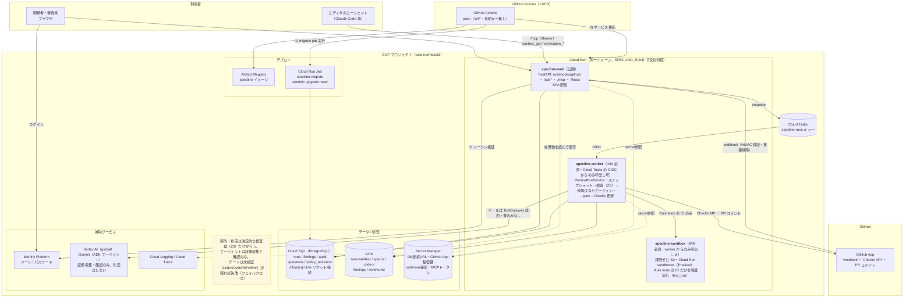
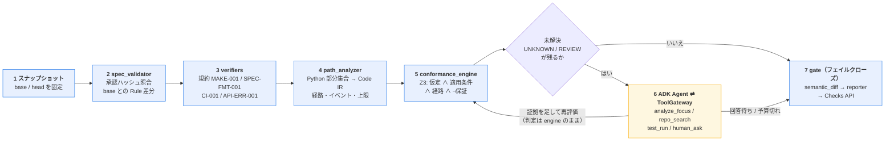

# SpecLino

**仕様（Markdown）とコードの「意味の差分」を、反例つきで指摘する PR レビュー基盤。**

Code Diff のレビューは「この変更は正しいか」を人の記憶に頼らせる。SpecLino は承認済みの仕様を
中間表現（Spec IR）に、実装を経路の中間表現（Code IR）にして、SMT ソルバー（Z3）で
「どの要求が、どの入力条件で、どう破られるか」を機械的に出す。

```text
R-CANCEL-04：在庫復元コマンドを1回呼ぶ
判定：VIOLATED（missing_effect）
条件：管理者でない / 所有者である / 注文が PENDING
実装：inventory_restore_command を 0 回
コード：examples/orders/app/service.py:19-27
```

エージェント（Gemini + ADK）は**証拠を集めて人に聞く**だけで、**判定はしない**。判定するのは
決定的な検査器だけ。エージェントが乗っ取られても最悪の結果は「証拠不足 → 未検証 → ゲート失敗」
に留まる（`conformance/` と `analysis/` は LLM・外部 I/O を import できず、テストで強制している）。

> 第5回 Agentic AI Hackathon with Google Cloud 提出作品。デモ URL・テストアカウントは
> [提出情報](#提出情報)を参照。

## 何を保証し、何を保証しないか

判定は 4 値を正直に保つ。「解析できなかった」を「適合」と言わない。

| 判定 | 意味 |
| --- | --- |
| `VERIFIED_IN_SCOPE` | 記述した観測範囲の中で、全経路で成立することを確認した |
| `VIOLATED` | 反例がある（記号的、またはテスト実行による観測） |
| `UNKNOWN` | 解析できない（対応外の構文、契約の無い外部呼出し、上限到達） |
| `REVIEW` | 人の確認が要る（未承認の仕様解釈、仕様に無い挙動、近似された経路の反例） |

**ゲートはフェイルクローズ**。必須（mandatory）ルールに `VIOLATED` / `UNKNOWN` / `REVIEW` が
1 件でも残れば GitHub の Check は失敗する。未検証のまま通過させない代わりに、Finding には
必ず「次にできること」（契約の登録、構文の単純化、テストの宣言、承認）を添える。

観測境界は仕様自身に書く。例の題材では「サービス層の状態・コマンド呼出し・モデル化した応答」が
範囲で、「DB コミット・並行実行・外部サービス内部」は対象外だと `.speclino/domain.yaml` が宣言する。

## アーキテクチャ

Cloud Run を役割別（web / worker / sandbox）に分け、秘密と権限を分離する。



判定はこの順序でしか起きない。エージェントは **5 で未解決が残ったときだけ** 呼ばれ、証拠を足して
engine に再評価させる。エージェントの文章は判定に入らない。



（画像版: [architecture.png](design/architecture.png) / [pipeline.png](design/pipeline.png)）

図は本番構成で、**すべて配線済み・稼働中**（Cloud Tasks / GCS / Cloud SQL / Cloud Run
sandboxes）。ローカルでは同じコードが in-process キュー・ローカル FS・Docker サンドボックスに
切り替わる（`SPECLINO_QUEUE_KIND` / `SPECLINO_BLOB_KIND` / `SPECLINO_SANDBOX_KIND` で選ぶ）。

エージェントが判定を上書きできないのは、(a) 判定を書くツールが存在しない (b) 検査器は型付きの
Spec IR / Code IR / Evidence しか受け取らず、それを作るのは決定的なモジュールだけ (c) LLM の
文章は `agent_note` として保存され検査器の入力にならない、という構造による。

## セットアップ

必要なもの: Python 3.12、[uv](https://docs.astral.sh/uv/)、Node.js 20+、Docker（DB と
サンドボックス用）。

```sh
make setup          # uv sync + npm ci
make db-up          # ローカル PostgreSQL（docker compose）
make db-migrate     # alembic upgrade head
make test           # 単体 + 統合（統合は SPECLINO_DATABASE_URL が要る）
make selfcheck      # SpecLino を自分自身に当てる（下の「自己検証」を参照）
```

## 1 件の検査を実行する

同梱の題材（`examples/orders/`：注文キャンセル、要求 9 件）を検査する。

```sh
uv run speclino check --repo . --project examples/orders --head WORKTREE --out build/review
```

```text
VERIFIED_IN_SCOPE: 9
VIOLATED: 0
UNKNOWN: 0
REVIEW: 0
gate: pass (必須ルールはすべて成立)
```

`build/review/` に `run-manifest.json`（入力のハッシュ・版・上限）、`spec-ir.json`、
`code-ir.json`、`findings.json`、`gate.json`、`review.md` が出る。`run_id` と実行時刻を除けば
同じ入力から同じ結果になる（`speclino replay build/review` が凍結した IR から再評価し、判定・
分類・反例が保存された結果と一致するか確認する）。

違反を作って試す:

```sh
# 在庫復元を管理者経路だけに移す
sed -i '' 's/^    inventory.restore/    if user.is_admin:\n        inventory.restore/' \
  examples/orders/app/service.py
uv run speclino check --repo . --project examples/orders --head WORKTREE --out build/review
# → R-CANCEL-04 が VIOLATED。反例（非管理者の所有者・PENDING）が review.md に出る
git checkout examples/orders/app/service.py
```

base と比べると、この変更が**新規に持ち込んだ**違反かどうかも分かる:

```sh
uv run speclino check --repo . --project examples/orders \
  --base main --head WORKTREE --out build/review
# review.md の「意味差分」節: 新規違反 / 既存違反 / 解消 / 判定不能化
```

`--head WORKTREE` は作業ツリーを、コミット SHA やブランチ名を渡せばその時点の内容を検査する。

主なオプション: `--fail-on VIOLATED --fail-on UNKNOWN --fail-on REVIEW --blocking`（必須運用）、
`--depth` / `--max-paths` / `--solver-timeout-ms`（解析の上限）、`--code-ir <file>`（解析器の
代わりに手書き Code IR を入力）。終了コードは 0（ゲート条件に該当しない）/ 1（該当、`--blocking`）
/ 2（入力不正・実行不能）。

## 仕様を書く / 対象を増やす

### 仕様 Markdown（`specs/*.md`）

`### <要求 ID>` 見出しで要求を宣言し、前提・要求・観測境界の節を置く（規約 SPEC-FMT-001 が検査）。
1 要求 = 1 判定単位にする。「〜し、かつ〜しない」は 2 つに分ける。

### Spec IR の候補を Gemini で抽出する

```sh
uv run speclino spec-extract --spec examples/orders/specs/orders-cancel.md \
  --behavior cancel_order --project examples/orders --out /tmp/candidate.spec-ir.json
```

`--project` は `.speclino/` と `specs/` を持つディレクトリ。`GOOGLE_API_KEY`（または
`GOOGLE_GENAI_USE_VERTEXAI=true` + ADC）が要る。

LLM は候補を出すだけで**承認しない**（`approval_ref` は空）。「速やかに」のような曖昧語は
確定させず `W_AMBIGUOUS` として残し、語彙で表せない要求は `W_UNEXTRACTED` に落とす。語彙外の
変数を作れば検証器が `E_REF_UNDEFINED` で弾く。エディタから使う手順は
[`plugins/speclino/skills/speclino-spec-authoring/SKILL.md`](plugins/speclino/skills/speclino-spec-authoring/SKILL.md)
（Claude Code プラグインが配る Skill と同じファイル。[下の節](#claude-code-プラグインとして使う)）。

### 対象関数と bindings を追加する（`.speclino/bindings.yaml`）

検査する入口（behavior）と、仕様の語彙に対応する実装のシンボルを宣言する。

```yaml
behaviors:
  cancel_order:
    entrypoint: examples.orders.app.service.cancel_order
    variables:
      actor.is_admin: user.is_admin      # before.actor.is_admin ← 実装の user.is_admin
      order.status: order.status
      # 契約済みの純粋な呼出し結果も変数にできる
      # permitted: pure_call:self.permissions.allows

operations:
  inventory_restore_command:             # 仕様が書く操作 ID
    symbol: examples.orders.app.inventory.restore
    claim_scope: command_invocation
    argument_bindings:
      items: positional:0
    summary_ref: inventory_restore_v1    # .speclino/contracts/*.yaml の契約
```

型と列挙は `.speclino/domain.yaml`（`variables` / `enums` / `opaque_types` / `assumptions` /
`observation_scope` / `out_of_scope`）に宣言する。外部呼出しの契約（`assumes_success`、
`may_modify`、`pure`）は `.speclino/contracts/*.yaml`。契約が無い呼出しは推測せず UNKNOWN にする。

### 仕様解釈を承認する

検証集合は**信頼済みの base**（デフォルトブランチ）から決める。head で追加・変更された要求は、
承認記録が無ければ未承認として `REVIEW: stale_approval` になり、要求を消しても
「削除の承認が無い」として同じく REVIEW になる（仕様を消して検査を通す経路を塞ぐ）。承認は PR
コメントで行う:

```text
/speclino approve-spec sha256:<要求の内容ハッシュ>        # 追加・変更を承認
/speclino approve-spec removed:sha256:<base のハッシュ>   # 削除を承認
/speclino answer Q-<id> <選択肢>                          # 語彙対応・契約の質問に回答
```

承認者はサーバー側設定（`projects.settings` / `SPECLINO_APPROVERS`）で検証する。PR 内の
ファイルを書き換えても承認は増えない。

## Claude Code プラグインとして使う

SpecLino を clone せずに、[`plugins/speclino/`](plugins/speclino/) の Skill（仕様の書き方・
検証結果の読み方）と MCP 接続（`context_get` / `verification_start` / `verification_get`）を
Claude Code のプラグインとして入れられる（S57）。

```sh
claude plugin marketplace add <owner>/<repo>   # このリポジトリ
claude plugin install speclino@speclino
```

`.mcp.json` は接続先とトークンをハード・コードしない。インストール前に環境変数を設定する:

| 変数 | 値 |
| --- | --- |
| `SPECLINO_MCP_URL` | `https://<your-speclino>/mcp`（自分の SpecLino デプロイの URL） |
| `SPECLINO_MCP_TOKEN` | ワークスペースの MCP トークン（`$WEB_URL/workspaces/<slug>/mcp-tokens` で owner が発行、`slmcp_…`） |

### チームで共有する

リポジトリの `.claude/settings.json` にコミットすると、clone した全員が同じプラグインを使う
（各自 `claude plugin install` は必要。[プラグインのインストール範囲](https://code.claude.com/docs/en/plugins/install#choose-an-install-scope)参照）:

```json
{
  "extraKnownMarketplaces": {
    "speclino": {
      "source": { "source": "github", "repo": "<owner>/<repo>" }
    }
  },
  "enabledPlugins": {
    "speclino@speclino": true
  }
}
```

`SPECLINO_MCP_URL` / `SPECLINO_MCP_TOKEN` はチームの秘密なので `.claude/settings.json` に書かず、
各自のシェルや `.env`（コミットしない）で設定する。

Claude Code 以外の MCP クライアントには、サーバーの `instructions`（2KB 以内の要点）と、
`speclino_guide` prompt（SKILL.md 本文をそのまま返す）で同じ使い方を渡す。どちらも
`plugins/speclino/skills/speclino-spec-authoring/SKILL.md` から読むので、Skill と内容がずれない
（`src/speclino/mcp_server/server.py`）。

## A2A で議論役に相談する

仕様のレビュー（`spec_review`）・要求の相談（`requirement_consult`）・検査の後の聞き取り
（`run_clarification`）は、A2A のエージェントとして会話で使える。Agent Card は
`https://<your-host>/.well-known/agent-card.json`（認証不要）、JSON-RPC は `/a2a`。
認証はワークスペースの MCP トークン（`slmcp_…`）を Bearer で付ける。サーバ側は
`SPECLINO_A2A_ENABLED=true` で有効になる。判定は検査器だけが行い、聞き取りの補足は正式な
回答ではない（承認は PR で人が行う）。

最小のクライアント（トークンは環境変数だけで受け、引数には取らない）:

```sh
export SPECLINO_TOKEN=slmcp_...
uv run speclino a2a-send --url https://<your-host> --skill requirement_consult \
  --repo <owner>/<name> --requirement-id R-CANCEL-01 "この要求は発送済みの注文にも効く？"
# state: INPUT_REQUIRED のときは、表示された task_id / context_id を付けて返信する
uv run speclino a2a-send --url https://<your-host> --task-id <task_id> --context-id <context_id> "回答"
```

テキストしか送れないクライアントは、本文の先頭に YAML front matter（`skill: ...`）を書く。
書き方は Agent Card の `examples` と `plugins/speclino/skills/speclino-spec-authoring/SKILL.md` を参照。

## UNKNOWN の読み方

UNKNOWN は「壊れている」でも「大丈夫」でもなく、**この道具では確認できなかった**という報告。
Finding の `category` と `next_steps` が対処を示す。

| 原因 | よくある形 | 対処 |
| --- | --- | --- |
| 対応外の構文 | `for` / `try` / 内包表記 / `getattr` | その部分を対応構文に単純化する、または要求に関係する効果だけを関数に切り出す |
| 契約の無い外部呼出し | 新しい SDK を呼んだ | `.speclino/contracts/` に要約を登録する（エージェントが候補を集めて `/speclino answer` で確認を求める） |
| 上限到達 | 経路 64 / 深さ 2 / ソルバー 500ms | エージェントが `analyze_focus` で対象の要求だけ上限を上げて再解析する。それでも残るなら構造を単純化する |
| 観測境界の不足 | 「DB に永続化された」ことの要求 | 観測範囲外なので仕様を「コマンドを呼ぶ」に書き直すか、`test_run` で動的証拠を取る |

段階的なエスカレーション: 決定的解析 → エージェントの再解析 → 宣言済みテストの隔離実行
（`Rule.tests` に書いた ID だけ、`--network none` の Docker）→ 承認者への構造化質問 → ゲート失敗。
構造解析（S29）は、対応外の領域が「触れ得ない観測」を特定し、関係ない要求まで巻き込んで
UNKNOWN にしないようにしている（例: ループが在庫復元しか呼ばないなら、状態と監査の要求は判定できる）。

## CI での運用

最初は警告運用（advisory）から始め、対象を絞ってから必須にするのが安全:

```yaml
# 警告のみ（ゲート失敗でも終了コード 0。結果は成果物とログに残る。
# 入力不正・実行不能のときだけ 2 を返して CI を落とす）
- run: uv run speclino check --repo . --head WORKTREE --out build/review

# 必須（必須ルールに未検証が残れば失敗）
- run: >-
    uv run speclino check --repo . --head WORKTREE --out build/self-check
    --fail-on VIOLATED --fail-on UNKNOWN --fail-on REVIEW --blocking
```

規約（`.speclino/policy/*.yaml`）は `level: advisory` にすればゲートを落とさず報告だけできる。
期限つきの例外は `.speclino/exceptions.yaml`（全項目必須、期限切れは無効）で、免除された違反は
適合に書き換えず「例外付き通過」として別記する。

このリポジトリ自身が [.github/workflows/ci.yml](.github/workflows/ci.yml) で必須運用している
（**自己検証**）。同じ判定が 2 つの経路で出るが、役割が違う:

| | `self-check (cli, no agent)` | `SpecLino / gate` |
| --- | --- | --- |
| どこで | GitHub Actions の CLI | 本番 Cloud Run |
| base との意味差分 | なし | あり |
| エージェント | **使わない**（決定的解析だけ） | 未解決があれば起動 |
| 必要なもの | リポジトリだけ | GCP・DB・GitHub App |
| 出力 | 終了コード | Check・行注釈・PR コメント・UI・成果物 |

CLI 側を残しているのは、**GCP を畳んだ後でも / clone した人の手元でも自己検証が回る**ことと、
**LLM を一切使わずに違反を検出できる**（エージェントは証拠集めだけという設計の裏付け）を
示すため。

GitHub App を作って実 PR に接続し、必須チェックにするまでの手順は
[guides/github-app-setup.md](guides/github-app-setup.md)、GCP への初回デプロイは
[guides/deploy-runbook.md](guides/deploy-runbook.md)。

## 自己検証

SpecLino は自分自身のコードを自分の仕様で検査する。CI が落ちれば自分の規約違反を自分で見つけた
ということ。

| 仕様 | 対象 | 要求 |
| --- | --- | --- |
| [SPEC-TOOL-001](specs/SPEC-TOOL-001.md) | `ToolGateway.invoke` | 権限が無ければツールを実行せず監査に残す。予算超過でも同じ |
| [SPEC-GATE-001](specs/SPEC-GATE-001.md) | `conformance.gate.decide_gate` | 検証集合が空・必須ルールが無い状態で「通過」を返さない |
| [SPEC-RUN-001](specs/SPEC-RUN-001.md) | `services.run_freshness.should_publish` | 古い実行（superseded / 最新でない）の結果を公開しない |
| [SPEC-TEST-002](specs/SPEC-TEST-002.md) | `agent.tools.test_run.decide_observation` | 宣言済みテストの成功・error・skipped・timeout は観測を別軸に記録するだけで、判定（VIOLATED）を上書きしない |

規約は MAKE-001（`make setup/test/lint` が存在し空でない）、SPEC-FMT-001（仕様の書式）、
CI-001（pull_request トリガー・必須ステップ・読取り専用権限。`echo make test` や
`continue-on-error` は通さない）、API-ERR-001（エラー応答形式）。

## 評価（判定品質）

**Golden**（`eval/golden/cancel_order/`）は、**答えを先に決めてある 27 個の題材**。
「この変異を入れたら、この要求が・この分類で・この反例とともに違反になるはず」を
`case.yaml` に固定しておき、エンジンがそのとおり判定するかを毎回確かめる
（正しい実装 / 状態誤り / 409→400 / 所有者拒否 / 在庫復元の削除・管理者経路のみ・2 回 /
別注文の商品 / 早期 return 後の呼出し / 到達不能分岐 / 変数名変更 / 同値書換え /
ヘルパー分割 / 未解決の getattr / ループ / 上限到達 / 充足不能な適用条件 / 承認切れ …）。

`make eval` はこれを **2 通りの入力**（人が書いた Code IR / Python ソースを解析器に通したもの）
で評価する。両方で同じ結果になることが、解析器と検査器を別々に検証したことになる。

| 指標 | 結果 |
| --- | --- |
| ケース一致（手書き IR 入力 / Python ソース入力） | 27 / 27 |
| **誤った VERIFIED** | **0** |
| 反例の再現 | 15 / 15 |
| Z3 と有限ドメイン総当たりの照合 | 213 一致 / 0 不一致 |

**holdout**（`eval/holdout/`）は**調整に使わない別題材 3 ケース**。Golden に合わせ込んで
過学習していないかを確かめるために取り分けてある（Golden の調整中は見ない）。

混同行列と「要求数 / 承認済み / 対応範囲 / 判定済み / 未解析」を併記し、一致率だけを見せない。
**誤った VERIFIED**（解析できなかったものを適合と言う）は最悪の失敗なので、
上の表の値は [tests/unit/eval/test_golden.py](tests/unit/eval/test_golden.py) が assert しており、
崩れると CI の `test (backend)` が落ちる。`make eval` はレポート本文を読みたいときに手元で回す。

## 既知の制約

- **対応する Python は部分集合**（if/elif/else、早期 return、認識済み raise、単純な代入と属性
  参照、and/or/not、比較、整数加減算、静的な直接呼出し）。それ以外は UNKNOWN として報告する
- ループは**要素数が静的に分かる `for`**（タプル／リストのリテラル、`range(定数)`、合計 8 回まで、
  `break`/`continue` なし）だけを展開して解析する。要素は Python と同じくループ前に評価し、
  `range` はモジュールで再定義され得るときは組込みと確定できないので展開しない。それ以外の
  `for`/`while` は UNKNOWN（S29 の構造解析で、触れないチャネルは巻き込まない）
- base を指定した検査では、到達する関数群を含むモジュール全体と仕様側入力（Spec IR・domain・
  bindings・contracts）のハッシュが base と一致する behavior の経路解析を省き、base の Code IR を
  再利用する（判定は必ず再実行する）。**再利用したことは run-manifest の `analysis` に残す**。
  この規模のリポジトリでは時間短縮は測定誤差の範囲で、効果が出るのは呼出しグラフが深い実コード
- フレームワークの応答は明示アダプター経由（FastAPI の `HTTPException(status_code=定数)` と
  `Response(status_code=定数)`）
- 「DB に永続化された」「並行実行で壊れない」は観測範囲外。コマンドの呼出しまでを検査する
- 動的証拠（`test_run`）は実行した入力の範囲に限る。静的な判定を上書きせず別軸で表示する。
  **テストの成功は判定を変えない**（テストは head の実装と同じプロセスで動くため、成功という
  観測そのものを未信頼側が偽造できる）。失敗だけを違反の証拠として受け取る
- 隔離実行の資源制限は環境で差がある。ローカル（Docker）はメモリ 512MB・CPU 1・pids 256 を
  コンテナに直接与える。本番（Cloud Run sandboxes）は**サンドボックス単位の上限を指定できず
  親サービスと資源を共有する**ため、親の側で締めて影響範囲を限っている（メモリ 512Mi・CPU 1・
  **同時実行 1**・タイムアウト 300s）。同時実行を 1 にしてあるので、未信頼コードが資源を
  食い潰しても同じコンテナの別の run を巻き込まない。ネットワーク遮断はどちらも効く
  （本番では DNS 解決の段階で失敗する）
- トレース取り込み（`trace_importer`）と増分解析は正規化 JSON の契約までで、実装は Stretch

## 開発

```sh
make lint            # ruff（静的検査・書式）
make typecheck       # mypy strict
make check           # lint + typecheck + test + selfcheck をまとめて
make eval            # Golden 評価
make dev             # FastAPI（http://localhost:8080）
cd web && npm run dev
scripts/story.sh board   # 進捗（GitHub Projects）
```

構成の規約は [CLAUDE.md](CLAUDE.md)、設計の正本は [design/](design/) にある。
`conformance/` と `analysis/` は LLM・adapters・DB を import しない（テストで強制）。

## 提出情報

| 項目 | 内容 |
| --- | --- |
| デモ URL | （デプロイ後に記載） |
| テストアカウント | （提出フォームに記載。メール/パスワード、ソーシャルログイン不要） |
| デモ動画 | （提出前に記載） |
| Zenn 記事 | （提出前に記載） |

**12/1 までのデプロイ維持**: Cloud Run は min-instances=0 / max-instances=2、Cloud SQL は
最小構成（`db-f1-micro` 相当、HA なし）。エージェントは日次の費用枠（`SPECLINO_DAILY_COST_LIMIT_USD`、
既定 $3）を超えると起動せず、デモ再実行も日次回数で制限する。予算アラートを $50 / $100 / $200 に
設定し、見込みは $60〜150（クーポン $300 の範囲内）。

## ライセンス

未定（提出時に決定）。
