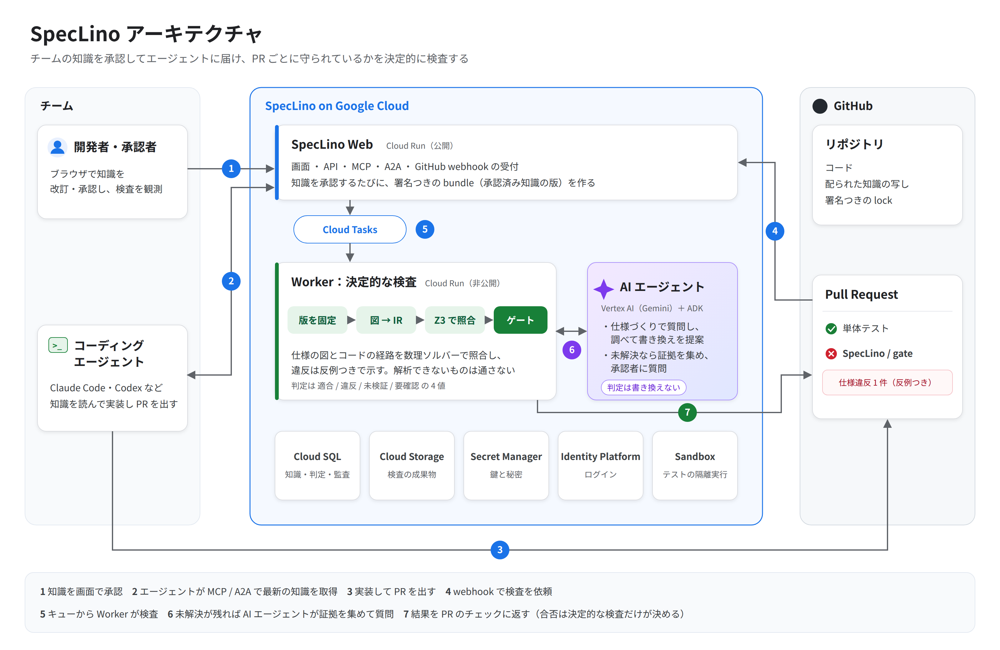

# SpecLino

[](https://github.com/tanabe-yudai/speclino/actions/workflows/ci.yml)
[](LICENSE.md)


**チームがコーディングエージェントに渡す知識を 1 か所で管理し、守られていることをゲートで保証する。**

- ホスティング版（招待制）: https://speclino.dev
- ドキュメント: [docs/README.md](docs/README.md)



コーディングエージェントの出来は、渡す知識で決まる。規約・スキル・AGENTS.md・仕様が各リポジトリや
各自の手元に散らばっていると、エージェントごとに読むものが違い、守ったかどうかも誰にも分からない。
SpecLino は、チームの知識を画面で改訂・承認し、各自のエージェントに MCP / A2A / `speclino sync` で配り、
PR ごとに「承認済みの知識どおりか」を決定的に検査する。

| 種類 | 中身 | 守られているかの確かめ方 |
| --- | --- | --- |
| **規約** | コーディング規約、命名規則、API のエンドポイント、エラーとレスポンスの形式、エラーメッセージの書き方 | 決定的な検査器（AST・OpenAPI・CI の定義）。それ以外は LLM 支援（常に「要確認」で、人が確定する） |
| **スキル** | チームのツールの使い方、環境の癖、文書の書き方（Agent Skills 形式の `SKILL.md`） | 配った版（lock）が最新か |
| **指示書** | `AGENTS.md` / `CLAUDE.md` | 配った版（lock）が最新か |
| **仕様** | 人が読める Markdown ＋ 厳格な UML（Mermaid の部分集合） | UML を決定的に IR へ変換し、Z3 とオートマトンで実装と照合 |

```text
R-CANCEL-04：在庫復元コマンドを1回呼ぶ
判定：VIOLATED（missing_effect）
条件：管理者でない / 所有者である / 注文が PENDING
実装：inventory_restore_command を 0 回
コード：examples/orders/app/service.py:19-27
```

AI（Gemini + ADK）は仕様の**書き換えを提案**し、検査の後に**証拠を集めて人に聞く**。
仕様を機械可読な形に**変換するのも、判定するのも決定的な処理だけ**で、AI の出力は判定経路に入らない
（`spec/uml/`・`conformance/`・`analysis/` は LLM・外部 I/O を import できず、テストで強制している）。

> 第5回 Agentic AI Hackathon with Google Cloud 提出作品。審査員向けの操作手順は [docs/submission/judge-guide.md](docs/submission/judge-guide.md)、提出情報は [docs/submission/](docs/submission/README.md)。

## 何を保証するか

判定は 4 値を正直に保つ。「解析できなかった」を「適合」と言わない。

| 判定（画面の表記） | 意味 |
| --- | --- |
| `VERIFIED_IN_SCOPE`（適合） | 記述した観測範囲の中で、全経路で成立することを確認した |
| `VIOLATED`（違反） | 反例がある（記号的、またはテスト実行による観測） |
| `UNKNOWN`（未検証） | 解析できない・対応が見つからない・上限に達した・出るべき結果が出なかった |
| `REVIEW`（要確認） | 人の確認が要る（仕様に無い挙動、LLM 支援の規約、lock が古い、bindings の変更） |

**ゲートはフェイルクローズ**。必須（mandatory）の要求・規約に `VIOLATED` / `UNKNOWN` / `REVIEW` が
1 件でも残れば GitHub の Check は失敗する。間に合わない・解析できない部分は UNKNOWN になるだけで、
偽の VERIFIED_IN_SCOPE を出さない。詳しくは [docs/concepts.md](docs/concepts.md)。

## Get started

### ホスティング版を使う

[https://speclino.dev](https://speclino.dev)（招待制）。
ワークスペースに招待されたら、画面で知識を書いて承認し、GitHub App でリポジトリを接続する。

### CLI だけで 1 件検査する（DB なし）

必要なもの: Python 3.12、[uv](https://docs.astral.sh/uv/)。DB も GitHub App も無しで動く。
同梱の題材（`examples/orders/`：注文キャンセル、旧形式の要求 9 件）を検査する。

```sh
uv sync
uv run speclino check --repo . --project examples/orders --head WORKTREE --out build/review
```

```text
VERIFIED_IN_SCOPE: 9
VIOLATED: 0
UNKNOWN: 0
REVIEW: 0
gate: pass (必須ルールはすべて成立)
```

オプション・終了コード・違反を作って試す手順は [docs/getting-started.md](docs/getting-started.md)。

### ローカルでサーバと画面を起動する

必要なもの: Python 3.12、uv、Node.js 20+、Docker（DB とサンドボックス用）。

```sh
make setup          # uv sync + npm ci
make db-up          # ローカル PostgreSQL（docker compose）
make db-migrate     # alembic upgrade head
make dev            # FastAPI（http://localhost:8080、SPECLINO_ROLE=all）
cd web && npm run dev   # 画面（Vite。/api は :8080 に転送）
```

ローカルの既定は開発用の認証（`SPECLINO_AUTH_KIND=dev`、`SPECLINO_ENV=local` のときだけ有効）。
ログイン画面の「開発用ログイン」で入り、ワークスペースは CLI で作る
（[docs/getting-started.md](docs/getting-started.md)）。

## ドキュメント

| ページ | 中身 |
| --- | --- |
| [docs/concepts.md](docs/concepts.md) | 考え方（保証すること・しないこと、流れ、bundle） |
| [docs/architecture.md](docs/architecture.md) | アーキテクチャ（Cloud Run の役割分担、判定の順序） |
| [docs/getting-started.md](docs/getting-started.md) | ローカル起動と CLI の検査 |
| [docs/knowledge.md](docs/knowledge.md) | 知識の管理（画面、承認、AI と作る、UML の書き方、bindings） |
| [docs/distribution.md](docs/distribution.md) | 配信（`speclino sync` と lock、MCP / A2A、Claude Code プラグイン） |
| [docs/verdicts.md](docs/verdicts.md) | 判定の読み方、LLM 支援の規約と確定、LLM に送るもの |
| [docs/operations.md](docs/operations.md) | 可観測性、CI での運用、自己検証、評価、既知の制約 |
| [docs/guides/github-app-setup.md](docs/guides/github-app-setup.md) | GitHub App の作成と接続 |
| [docs/guides/deploy-runbook.md](docs/guides/deploy-runbook.md) | GCP への初回デプロイ |
| [docs/demo-knowledge-registry.md](docs/demo-knowledge-registry.md) | デモの手順 |
| [docs/submission/README.md](docs/submission/README.md) | ハッカソンの提出情報と予算計画 |

## 開発

```sh
make check           # lint + typecheck + test + selfcheck をまとめて
make lint            # ruff
make typecheck       # mypy strict
make test            # 単体 + 統合（統合は SPECLINO_DATABASE_URL が要る）
make selfcheck       # SpecLino を自分自身に当てる
make eval            # Golden 評価
make schemas         # domain/ の pydantic モデルから schemas/*.schema.json
make diagrams        # docs/diagrams/*.mmd から png・svg
```

コードの規約は [CLAUDE.md](CLAUDE.md)・[AGENTS.md](AGENTS.md)・プロジェクト規約
`.speclino/policy/speclino-core.yaml`。コミットメッセージは Conventional Commits
（例: `feat: 新機能の説明`）。規約を変えるときは PR で変える。自己検証と評価の詳細は
[docs/operations.md](docs/operations.md)。

## ライセンス

AGPL-3.0-or-later。全文は [LICENSE.md](LICENSE.md)。作者もホスティング版（招待制）を提供している。
改変版をネットワーク越しに利用者へ提供する場合は、その改変版のソースを公開する義務がある。
