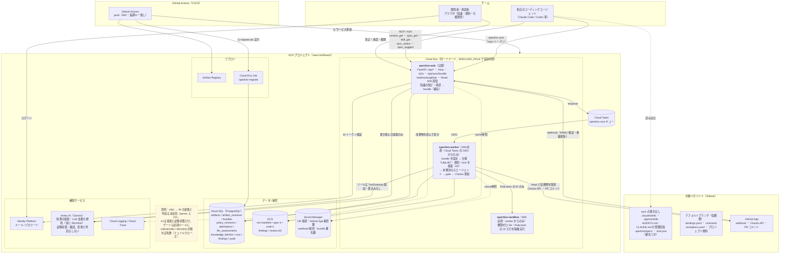
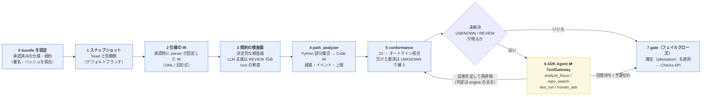

# アーキテクチャ

Cloud Run の役割分担と、判定が起きる順序。

以下は詳細な構成図と、判定の順序。

Cloud Run を役割別（web / worker / sandbox）に分け、秘密と権限を分離する。

判定はこの順序でしか起きない。エージェントは **5 で未解決が残ったときだけ** 呼ばれ、証拠を足して
engine に再評価させる。エージェントの文章は判定に入らない。

（画像版: [architecture.png](diagrams/architecture.png) / [pipeline.png](diagrams/pipeline.png)。図の正本は
`docs/diagrams/*.mmd` で、`make diagrams` で作り直す）

ローカルでは同じコードが in-process キュー・ローカル FS・Docker サンドボックスに切り替わる
（`SPECLINO_QUEUE_KIND` / `SPECLINO_BLOB_KIND` / `SPECLINO_SANDBOX_KIND`）。

エージェントが判定を上書きできないのは、(a) 判定を書くツールが存在しない (b) 検査器は型付きの
IR と Evidence しか受け取らず、それを作るのは決定的なモジュールだけ (c) LLM の文章は保存されるだけで
検査器の入力にならない、という構造による。
