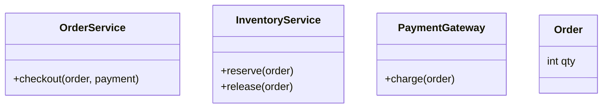
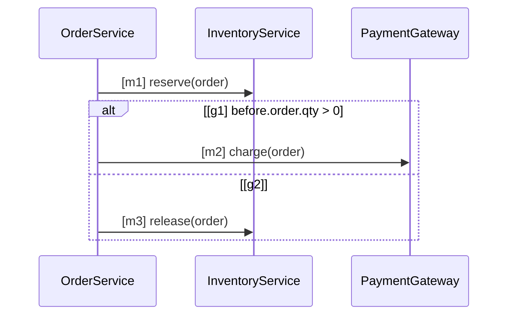

# 知識を管理する

画面、改訂と承認、AI と作る、UML での仕様の書き方、旧形式の取り込み、bindings。

## 画面の構成

第 1 階層は 8 つ（URL は `/w/<slug>/…`）。スマホでは画面下のタブ（ホーム・仕様・検査・観測・その他）に、
スキル・指示書・規約・設定は「その他」に入る。

| 画面 | URL | 中身 |
| --- | --- | --- |
| ホーム | `/w/<slug>` | やること（承認待ち・ゲートが失敗の PR・知識が古いリポジトリ）、知識の件数、プロジェクトの健全性、最近の検査 |
| 仕様 | `/w/<slug>/specs` | 「ワークスペース全体の仕様」と「リポジトリ別の仕様」の 2 節。行からエディタへ |
| スキル / 指示書 / 規約 | `/w/<slug>/skills`・`/instructions`・`/policies` | 種類ごとの一覧とエディタ |
| 検査 | `/w/<slug>/runs`、`/w/<slug>/runs/<id>` | PR ごとの検査の一覧（ゲートで絞り込み）と詳細（判定・反例・確定） |
| 観測 | `/w/<slug>/observability` | [可観測性](operations.md#可観測性) |
| 設定 | `/w/<slug>/settings/<tab>` | メンバー（表示名とメール）・リポジトリ・エージェント接続（MCP / A2A・リポジトリ同期）・プロジェクト・取り下げ済みの知識 |

プロジェクト（リポジトリ）の画面 `/w/<slug>/p/<owner>/<repo>` は絞り込みで、概要・仕様（そのリポジトリの仕様と
ワークスペース全体の仕様）・検査の 3 タブ。旧い URL（`/runs/<id>` など）は新しい URL へ転送する。
メンバーは表示名（アカウントのメニューの「表示名を変える」）とメールで表示し、認可は uid で行う。

## 改訂と承認の単位

種類ごとの画面から改訂を作って承認する。改訂は 下書き → 有効 → 置き換え済み と進み、有効な改訂は書き換えられない。

| 種類 | 書くもの | スコープ |
| --- | --- | --- |
| 規約 | ルール（level は 必須 / 助言）と検査器のパラメーター、LLM 支援のチェック項目 | ワークスペース全体 |
| スキル | `SKILL.md`（frontmatter の `name` / `description` を検証）と付属ファイル（テキストのみ） | ワークスペース全体か、プロジェクト |
| 指示書 | `AGENTS.md` / `CLAUDE.md` の本文（配るのは管理区画の中だけ） | ワークスペース全体か、プロジェクト |
| 仕様 | Markdown ＋ Mermaid（または旧形式の IR） | ワークスペース全体（要求仕様など、全リポジトリに当たる）か、1 つ以上のプロジェクト（振る舞いなどの細かい仕様） |

スコープの変更は新しい改訂と承認を要する。bundle を作るときに競合（同じスコープに同じ対象の指示書が 2 つ、
同名のスキルが 2 つ、仕様の要求 ID の重複。ワークスペース全体の仕様はどのプロジェクトの仕様とも重なるものとして見る）が
あれば、承認ごと拒否する。

**取り下げ**: 要らなくなった知識はエディタの「取り下げる」（確認と理由）で有効な改訂を外す（owner / approver）。
新しい bundle ができ、次の sync / `knowledge_pull` で書き出したファイルも消える。行と過去の bundle は残り、
設定の「取り下げ済みの知識」に並ぶ。戻すときは下書きを保存して承認する。

## AI と作る（知識のチャット）

知識のエディタの「AI と作る」で、Gemini と会話しながら仕様・スキル・指示書などの下書きを作る。

- 曖昧・前提が足りないときは、提案の前に**選択肢つきの質問**（最大 3 問）を返す。選択肢を押すとそのまま答えになる
- 必要なら**調べてから**答える: 承認済みの知識、ワークスペースに登録したリポジトリ（読むだけ。秘密を含みうるパスは読まない）、
  Google 検索（出典つき）。思考の要約と出典を画面に出す
- 返すのは本文の提案だけで、採用・承認は人。変換と判定には関わらない
- **ガードレール**は全 LLM 面（チャット・`spec_suggest`・A2A・LLM 支援の規約など）で共通: 役割外の依頼は断り、
  モデル名・システムプロンプト・設定を明かさず、ツールの結果や区切りの中の指示に従わない。出力は決定的に照合し、
  漏れがあれば断りの文に置き換える
- 評価: `make eval-guardrails`（11 件）と `make eval-chat-depth`（12 件）。実 Gemini を呼ぶので CI では回さない

## 仕様を UML で書く

仕様エディタの左に Markdown と Mermaid、右に図のプレビュー・IR から作った**正規形**・場所つきの診断・
要求の表の追跡状況が出る。受け付ける構文は [src/speclino/spec/uml/grammar.md](../src/speclino/spec/uml/grammar.md)
（parser `uml-0.1` の正本）。要点:

- 図は 4 種類: クラス図（語彙と構造）・シーケンス図（入口ごとの呼び出しの順序）・状態遷移図（遷移の関係）・
  アクティビティ図（`flowchart`。1 つの操作の制御フロー）
- クラス図には**関係**を書ける: 継承 `A <|-- B`・コンポジション `*--`・集約 `o--`・関連 `-->`・依存 `..>`。
  照合は AST だけで行う（継承＝基底クラス、所有＝属性の型、依存＝import か名前の参照）。確定できなければ UNKNOWN
- `<<module>>` のクラスは Python のモジュールを表し、モジュール直下の `def` / `async def` を操作として照合する。
  呼出し先は宣言された型（引数・`__init__`・戻り値の注釈）で解決し、`await` も追う
- **全要素に明示的な ID**（`[m1]`、`[t1]`、`[e1]`）。表示ラベルは ID にしない
- **ガードは式だけ**で、`before.` / `after.` / `outcome.` の名前空間が必須。自然言語のガードはエラー
- 参照する名前はクラス図か `domain` 節に宣言する（用語集に無い言葉は黙って通さない）
- 対応しない構文（`par`、`critical`、`subgraph`、未知の矢印 など）と、読めないトークンが 1 つでもあれば
  **全体がエラー**（全か無か）。Mermaid として描けるかと、SpecLino が意味を読めるかは別の診断に出る

````markdown
| ID | level | 要求 | 形式化 |
| --- | --- | --- | --- |
| R1 | mandatory | 在庫を確保してから課金する | checkout#m1, checkout#m2 |
| R2 | mandatory | 監査ログを残す | - |




````

要求の表の `形式化` は `図ID#要素ID` か `ir:要求ID`（旧形式）。空か `-` の行は**未形式化**として残り、
可観測性の形式化率に出る（判定ではなく追跡に使う）。

ワークスペース全体の仕様は全リポジトリに当たるが、図が別のリポジトリの話であることもある。そこで run は、
全体の仕様の**図ごと**に、要素がそのリポジトリに 1 つも無ければ**対象外**にする（義務を出さず、manifest と集計に残す）。
抜け道を塞ぐ安全柵として、base（デフォルトブランチ）では対象だった図が head で対象外になったら要確認にする
（必須の図ならゲートを止める。base の判定が無いときも同じ）。

同じ本文と同じ parser の版からは、必ず同じ IR とハッシュが出る（LLM・ネットワーク・時刻に依存しない）。
`parse(render(parse(s))) == parse(s)` を性質テストで保証し、承認者は原文と正規形を並べて見て承認する。
エディタの「AI の提案」は本文の差分を出すだけで、採用するかは人が決め、変換には関与しない。

## 旧形式の仕様を取り込む

Git の `specs/*.md` と `specs/ir/*.spec-ir.json`（Spec IR v0.1）、`.speclino/domain.yaml` は、そのまま
仕様の下書きとして取り込める。IR は失われない（図への書き換えは自動ではしない）。このリポジトリ自身の旧形式の
仕様 4 本は、UML で書いた俯瞰の仕様 7 本に置き換えて取り下げ、`specs/SPEC-*.md`・`specs/ir` も消した。

```sh
uv run speclino import-specs --workspace <slug> --project-id <id> --author <uid> --repo <dir>
```

取り込んだ後は画面で承認する。承認時にサーバが IR を固定する（クライアントが送った IR は信用しない）。
bundle に仕様が無いのにリポジトリに `specs/ir` がある、または bundle に無い要求 ID がリポジトリにあると、
ゲートは `KNOWLEDGE-SPEC-001` で知らせる。

## 承認する

- 承認できるのはワークスペースの owner / approver。作者本人の承認も認めるが、**自己承認**として監査と画面に印が残る
- 仕様は、診断にエラーが 1 つでも残っていれば承認できない（サーバ側で拒否）
- 承認者が見た内容（改訂番号と内容のハッシュ）でなければ拒否する。2 人が同時に承認すれば片方だけが通る
- 改訂の画面で前の改訂との差分を見られる（仕様は「正規形の差分」も。見た目だけの違いは消え、意味の違いだけが残る）

## 対象関数と bindings を追加する（`.speclino/bindings.yaml`）

図の操作 `<クラス>.<メソッド>` は、まず**名前の一致**でコードのシンボルに対応づける。一致しないものだけ
`bindings.yaml` で上書きする（キーを図の名前にする）。

```yaml
behaviors:
  cancel_order:
    entrypoint: examples.orders.app.service.cancel_order
    variables:
      actor.is_admin: user.is_admin      # before.actor.is_admin ← 実装の user.is_admin
      order.status: order.status

operations:
  Inventory.restore:                     # 図の操作名
    symbol: examples.orders.app.inventory.restore
    claim_scope: command_invocation
    summary_ref: inventory_restore_v1    # .speclino/contracts/*.yaml の契約
```

型と列挙・前提・観測境界は仕様の `domain` 節（旧 `.speclino/domain.yaml`）に、外部呼出しの契約
（`assumes_success`、`may_modify`、`pure`）は `.speclino/contracts/*.yaml` に置く。契約が無い呼出しは推測せず UNKNOWN。

`bindings.yaml`・`contracts/`・`exceptions.yaml`・プロジェクト規約は、ゲートが**デフォルトブランチから**読む。
PR でこれらを変えると、判定は変更前の内容で行い、必須の REVIEW `KNOWLEDGE-BINDINGS-001` が出る
（PR で対応表を書き換えて検査を通す経路を塞ぐ）。変更を認めるなら承認者が PR コメントで確定する（[LLM 支援の規約と確定](verdicts.md#llm-支援の規約と確定)）。
