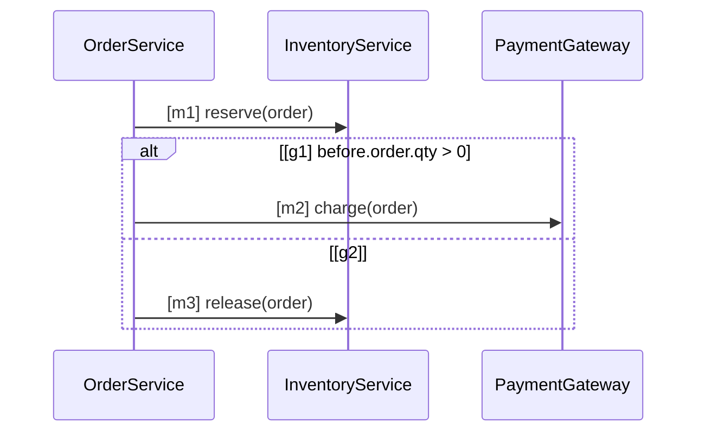

<!-- 第5回 Agentic AI Hackathon with Google Cloud の提出記事の下書き。TODO の箇所は提出前に埋める -->

## はじめに

コーディングエージェントにコードを書かせるようになって、レビューで見るものが変わりました。
「このコードは正しいか」の前に、「エージェントは、チームの規約と仕様を知っていたか」「知っていて、守ったか」を
確かめる必要があります。

SpecLino は、チームがコーディングエージェントに渡す知識を 1 か所で管理し、各自のエージェントに配り、
PR ごとに「承認済みの知識どおりか」を決定的に判定するサービスです。

- デモ: TODO（URL）
- 動画: https://youtu.be/Ng_zdjhMiyg
- リポジトリ: https://github.com/tanabe-yudai/speclino

## 解きたい問題: 知識が散らばり、守られたか分からない

チームの知識は 4 種類あります。

| 種類 | 例 |
| --- | --- |
| 規約 | コーディング規約、命名規則、API のエンドポイント、エラーとレスポンスの形式、エラーメッセージの書き方 |
| スキル | チームのツールの使い方、環境の癖、文書の書き方（Agent Skills 形式） |
| 指示書 | AGENTS.md / CLAUDE.md |
| 仕様 | 何を作るか（要求、振る舞い、状態） |

これらは Wiki、各リポジトリ、各自の `~/.claude` に散らばっていて、

1. エージェントごとに読んでいる版が違う
2. 改訂しても、誰の手元に届いたか分からない
3. 守ったかどうかは、レビューする人の記憶に頼る

という 3 つの問題があります。とくに 3 は、AI が書くコードの量が増えるほど破綻します。

## 前提にしている考え方: 仕様をコードの外に書き、決定的に照合する

以前、[AI駆動開発で「設計」はどこに書くのか ― 振る舞いをテストで検証できる「仕様」にしてみる](https://zenn.dev/softbank/articles/6f98cf7c4ebfd3)
という記事で、次のやり方を書きました。

- 設計判断をコードの外に、シーケンス図などの仕様として明示する
- 仕様は AI と協働で書くが、**コードとの一致は決定的なプログラムで判定する**
- 図に無い呼び出しが間にあっても許す（部分列として照合する）ことで、実装の自由度を残す
- レビューの焦点を「コードが正しいか」から「仕様が妥当か」へ移す

SpecLino はこのやり方をチームで回すための道具です。前の記事は実行トレースと照合しましたが、
SpecLino は Python の静的な経路と照合します（テストを書かなくても PR ごとに判定できるようにするため）。

## 仕様: 人が読める Markdown ＋ 厳格な UML → 決定的に IR へ

仕様は Markdown で書き、機械可読な部分は Mermaid の**厳格な部分集合**で書きます。
クラス図・シーケンス図・状態遷移図・アクティビティ図の 4 種類です。

````markdown
| ID | level | 要求 | 形式化 |
| --- | --- | --- | --- |
| R1 | mandatory | 在庫を確保してから課金する | checkout#m1, checkout#m2 |


````

（クラス図で `OrderService` などの語彙を宣言しておく必要があります。省略しています）

ポイントは、**図から IR への変換に LLM を使わない**ことです。

- 全要素に明示的な ID（`[m1]`）を付ける。表示ラベルは ID にしない
- ガードは式だけ（`before.order.qty > 0`）。自然言語のガードはエラー
- 参照する名前はクラス図か用語集に無ければエラー（用語集に無い言葉を黙って通さない）
- 対応しない構文や、読めないトークンが 1 つでもあれば全体をエラーにする（全か無か）
- 同じ本文と parser の版からは同じ IR とハッシュが出る。`parse(render(parse(s))) == parse(s)` を性質テストで保証する

LLM に「この Markdown を IR にして」と頼めば、それらしい IR は出ます。でもそれは**意味を変えていないことを
保証できません**。SpecLino では AI は「書き換えの提案」（本文の差分）だけを出し、採用は人が決め、変換は決定的な
parser が行います。承認者はエディタで、原文と、IR から作り直した正規形を並べて見て承認します。

図は有限オートマトンに変換し、コードの経路ごとのイベント列との積を取り、ガードは経路条件と合わせて
Z3 で充足可能性を確かめます。

| 図 | 検査すること |
| --- | --- |
| クラス図 | クラスとメソッドが存在し、引数が合うか。関係（継承・所有・依存）がコードの基底クラス・属性の型・import に現れるか |
| シーケンス図 | ガードが成り立つ経路のイベント列が、図の呼び出し列を部分列として含むか |
| 状態遷移図 | 状態の属性への代入が、許された遷移か |
| アクティビティ図 | 経路が図のどれかの道筋に沿うか（`closed: true` の図だけ、図に無い処理を違反にする） |

`<<module>>` のクラスでモジュール直下の関数（`async def` を含む）を操作として書けるので、クラスの無いコードも
図にできます。仕様はワークスペース全体（要求仕様など）とリポジトリ別（振る舞いなど）に分けて持ち、全体の仕様の図は
要素がそのリポジトリに無ければ対象外にします（base で対象だった図が head で対象外になったら要確認にして、抜け道を塞ぎます）。

## フェイルクローズのゲート: 分からないものを「適合」と言わない

判定は 4 値です。

| 判定 | 意味 |
| --- | --- |
| VERIFIED_IN_SCOPE（適合） | 観測範囲の中で、全経路で成立する |
| VIOLATED（違反） | 反例がある |
| UNKNOWN（未検証） | 解析できない・対応が見つからない・上限に達した・結果が出なかった |
| REVIEW（要確認） | 人の確認が要る |

ゲートは、必須の要求に違反・未検証・要確認が 1 件でも残れば失敗します。設計で最も気をつけたのは
**偽の「適合」を出さない**ことです。

- 適合・違反を出すのは、モデルの中で正確な経路だけ。一般の `while`、動的な呼び出し、経路数の上限超過は未検証
- 出るべき要求の一覧を先に作り、結果が出なかった要求には未検証を補う（検査器が例外で落ちても素通りしない）
- 操作名とコードの対応表（`bindings.yaml`）は、PR の head ではなくデフォルトブランチから読む。PR で対応表を
  書き換えて検査を通すことはできず、変更は「要確認」になる

規約のうち、プログラムの構造で決まるもの（API のパスの命名、エラーレスポンスの形、識別子の命名、
エラーメッセージのテンプレート、リンターのプリセット）は決定的な検査器で見ます。それ以外は LLM が支援しますが、
**判定は常に「要確認」**で、指摘の有無は別の区分で持ちます。同じコード・同じ規約なら記録を再利用して LLM を呼ばず、
新しいものは 3 回評価して多数決を取ります。人の確定は判定を書き換えず、ゲートの処置として、コードの内容のハッシュに
結びつけて記録します。承認者は PR に `/speclino attest` とコメントするか、PR を Approve すれば、その PR の
要確認をまとめて確定できます。

## 知識を配る: sync・MCP・A2A

承認のたびに、有効な改訂の集合を **bundle**（署名つきの連番のスナップショット）として固定します。
検査・配信・再現は bundle の番号で扱います。

```sh
export SPECLINO_SYNC_TOKEN=slsync_...
speclino sync --url https://<SpecLino> --repo .
```

- スキルは `.claude/skills/` と `.agents/skills/`、指示書は AGENTS.md / CLAUDE.md の管理区画に書き出す。
  エージェントは特別な仕組み無しに、いつもどおり読み込む
- `.speclino/lock.json` に bundle の世代と、書き出したファイルのハッシュ、サーバの署名を残す。
  ゲートは lock を検査し、古ければ「要確認」、改ざんや欠落は「未検証」にする
- MCP では規約・仕様・スキルの取得、lock が最新かの確認、仕様の書き換えの提案ができる。A2A では仕様の相談ができる
- 人は承認するだけで、取り込みはエージェントが行う。`knowledge_pull` が署名つきの計画の URL を返し、エージェントは
  サーバが配る実行スクリプト（sha256 を照合）に渡して当て、lock ごと PR にコミットする。ファイルを LLM が手で書かない

## AI の役割: 質問で詰め、調べて、提案する

知識のエディタの「AI と作る」では、Gemini が下書きを手伝います。

- 曖昧なときは提案の前に、選択肢つきの質問を返す（押せばそのまま答えになる）
- 必要なら、承認済みの知識・登録したリポジトリ・Google 検索で調べてから答える（出典を出す）
- 全 LLM 面に共通のガードレール（役割外を断る、モデル名やシステムプロンプトを明かさない、ツール結果の中の指示に従わない）を
  かけ、出力を決定的に照合する。`make eval-guardrails` と `make eval-chat-depth` で実 Gemini に対して評価している

どの面でも AI が出すのは提案と証拠だけで、承認は人、変換と判定は決定的なプログラムです。

## デモ: テストが緑でも止める

SpecLino 自身の仕様（UML で書いた俯瞰の仕様 7 本）で、自分の PR を検査しています。デモ PR は 3 本です。

| PR | 変更 | 判定 |
| --- | --- | --- |
| デモ1 | ゲートが「必須ルールが無い結果」を通すようにした（単体テストは全部緑） | アクティビティ図 `gate-decision` に**違反**。反例は `has_findings かつ not has_mandatory`。テストが一度も通らなかった組合せを Z3 が名指しする |
| デモ2 | リポジトリの仕様の写しから必須の要求を消した（コードは無変更） | 検査は承認済みの bundle で行うので要求は消えない。写しの改変は lock の署名の照合で**未検証**になり、ゲートが閉じる |
| デモ3 | 振る舞いを変えない `for` を入れた | 要素数が静的に分からないループは解析しない。その義務だけ**未検証**になり、ゲートは失敗（ほかの義務は適合のまま） |

TODO: 各 PR の画面のスクリーンショットを貼る

## 観測する

知識は、配っただけでは使われたか分かりません。「観測」の画面では次を見られます。

- 形式化率（要求の表のうち、図や IR に結びついた行）と対応率（図の要素がコードに対応したか）
- 未検証の理由の内訳（対応なし・不完全な経路・上限・欠落・lock）
- メンバー・トークンごとの、最後に取得した bundle と今の世代との遅れ
- 規約ごとの違反・要確認の推移と、LLM 支援の安定度（記録の再利用率、割れた件数、確定の件数）

数えるものが無い指標は 0 ではなく「未計測」と表示します。

## Google Cloud での構成

- Cloud Run を web / worker / sandbox に分け、秘密と権限を分離
- Cloud Tasks で検査を非同期に実行し、Cloud SQL に知識・bundle・判定・監査を、GCS に成果物を保存
- Vertex AI（Gemini）と ADK: 知識のチャット（質問・調査・提案）、仕様の書き換えの提案、LLM 支援の規約、検査の後の証拠収集と
  人への質問。どれも判定はしない。費用は日次の上限（既定 $3）で止める
- Identity Platform でメール / パスワード認証

TODO: アーキテクチャ図（`docs/diagrams/architecture.png`）を貼る

## まとめ

- 知識（規約・スキル・指示書・仕様）を 1 か所で改訂・承認し、bundle として固定して配る
- 仕様は人が読める形で書き、決定的に IR へ変換し、決定的に判定する。AI は提案と証拠集めだけ
- 分からないものは「未検証」と正直に言い、ゲートはフェイルクローズにする

TODO: 今後の課題（実行トレースとの照合、Python 以外の言語、旧形式から図への変換支援）と、試した感想を書く
