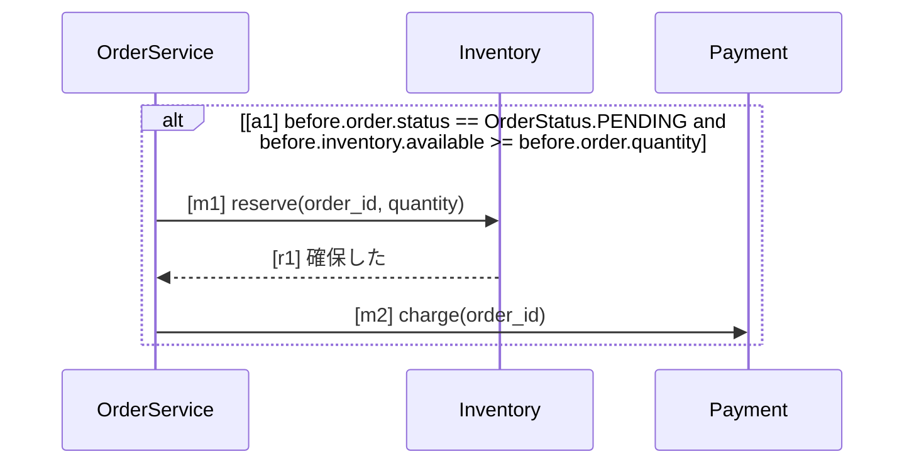

<!-- 第5回 Agentic AI Hackathon with Google Cloud の提出記事の下書き。公開時にこのコメントを消す -->

## はじめに

コーディングエージェントの出来は、渡す知識で決まります。
チームのコーディング規約、ツールの使い方、AGENTS.md、そして「何を作るか」の仕様。
これらが Wiki や各リポジトリ、各自の `~/.claude` に散らばっていると、エージェントごとに読んでいるものが違い、
守ったかどうかも誰にも分かりません。

**SpecLino** は、チームがコーディングエージェントに渡す知識を 1 か所で書いて承認し、MCP で各自のエージェントに配り、
PR ごとに「承認した仕様どおりに実装されているか」を反例つきで示すサービスです。

- サービス: https://speclino-web-6h5m3svkja-an.a.run.app （招待制）
- デモ動画: https://youtu.be/Ng_zdjhMiyg
- ソースコード: https://github.com/tanabe-yudai/speclino （AGPL-3.0）


## 解きたい問題

エージェントにコードを書かせるようになって、レビューで確かめたいことが変わりました。
「このコードは正しいか」の前に、「エージェントはチームの規約と仕様を知っていたか」「知っていて、守ったか」です。

ところが現実には、次の 3 つが起きます。

1. **読んでいる版が違う**: 人によって、手元の AGENTS.md やスキルが古い
2. **届いたか分からない**: 規約を改訂しても、誰のエージェントに届いたか分からない
3. **守ったか分からない**: 確かめるのはレビューする人の記憶頼みで、AI が書くコードの量が増えるほど追いつかない

SpecLino はこの 3 つを、それぞれ「承認」「配信」「検査」で解きます。

## SpecLino が扱う 4 種類の知識

| 種類 | 中身 | 守られているかの確かめ方 |
| --- | --- | --- |
| **規約** | コーディング規約、命名、API のパス、エラーの形式など | 構造で決まるものは決定的な検査器。それ以外は LLM が支援し、判定は常に「要確認」で人が確定する |
| **スキル** | チームのツールの使い方、手順（Agent Skills 形式の `SKILL.md`） | 配った版が最新か |
| **指示書** | `AGENTS.md` / `CLAUDE.md` に書き出す本文 | 配った版が最新か |
| **仕様** | 要求と振る舞い。人が読める Markdown と、厳格な UML（Mermaid） | 図とコードを検査器が照合し、違反は反例つきで示す |

どれも画面で改訂し、承認したものだけが有効になります。承認のたびに、有効な知識の集合を
**bundle**（署名つきの連番のスナップショット）として固定し、配信も PR の検査も、同じ番号の bundle を読みます。

## 使い方の流れ

見本の題材（注文の確定・出荷・取消を持つ小さなショップ）で、最初から PR の検査まで通してみます。
ここに載せている出力は、本番の SpecLino で実際に出たものです。

### 1. ワークスペースを作る

ログインして「ワークスペースの一覧・作成」から、識別子と表示名を入れて作ります。作った人がオーナーになります。
新しいワークスペースには、MCP の使い方を説明するスキル `speclino-mcp-guide` が最初から承認済みで入っているので、
エージェントをつないだ直後から、SpecLino の使い方をエージェント自身が読めます。

### 2. 知識を書いて、承認する

指示書・スキル・仕様・規約は、それぞれのエディタで書きます。エディタの横の「**AI と作る**」では、
Gemini と ADK で動く執筆エージェントが下書きを手伝います。

たとえばスキルの画面で「PR の説明文を書く手順をスキルにしたい。見出しは『変更点』『理由』『確かめ方』の 3 つ」と頼むと、
`name:` と `description:` を持つ `SKILL.md` を書き、チームの指示書（「テストが通らない変更は PR にしない」など）にも
沿わせてきます。要件が曖昧なときは、書く前に選択肢つきの質問で詰めます。必要なら、承認済みの知識や登録したリポジトリ、
Google 検索で調べ、出典を添えます。

提案を採るか、保存するか、承認するかは、人が決めます。承認すると「改訂 1 を承認しました（自己承認）。以後の検査に使われます」
と出て、bundle の番号が 1 つ進みます。改訂を重ねると、履歴と差分がいつでも見られます。

### 3. 仕様は Markdown と厳格な UML で書く

仕様は、人が読む Markdown の中に、要求の表と Mermaid の図を書きます。

````markdown
| ID | level | 要求 | 形式化 |
| --- | --- | --- | --- |
| R-SHOP-02 | mandatory | 在庫が足りる PENDING の注文は、在庫を確保してから決済する | place#a1, place#m1, place#m2 |


````

使える図は、クラス図・シーケンス図・状態遷移図・アクティビティ図の 4 種類です。どれも Mermaid の**厳格な部分集合**で、
エディタのプレビューにそのまま図として描かれます。

- 要素には明示的な ID（`[m1]`）を付け、要求の表の「形式化」の列から指します
- ガードは式だけで書きます。自然言語のガードは受け付けません
- クラス図で宣言していない名前を使うと、診断が出ます。たとえば `before.order.quantity` を `before.order.qty` と
  書き間違えると、プレビューに「診断 1」と出て、承認できません

図は、決定的な parser が中間表現（IR）に変換します。**この変換に LLM は使いません**。
LLM に「この Markdown を IR にして」と頼めば、それらしい IR は出ます。でも、それが意味を変えていないことは保証できません。
SpecLino では、AI が出すのは本文の書き換えの提案だけで、変換と判定は決定的なプログラムが行います。

### 4. リポジトリをつなぐ

GitHub App をインストールし、設定の「リポジトリ」で `owner/name` を入れて「GitHub で確認して追加」を押します。
登録する人がそのリポジトリの管理者であることを、GitHub の認可で確かめてから登録します。プライベートのリポジトリも登録できます。

### 5. 各自のエージェントに配る

設定の「エージェント接続」でトークンを発行し、手元の Claude Code に MCP を登録します。

```sh
claude mcp add --transport http speclino https://<SpecLino>/mcp \
  --header "Authorization: Bearer slmcp_..."
```

これで、エージェントが承認済みの知識を読み、手元に取り込めるようになります。

| MCP のツール | すること |
| --- | --- |
| `context_get` / `spec_get` / `skill_get` | 承認済みの規約・仕様・スキルを読む |
| `sync_status` / `knowledge_pull` | 手元の写しが最新かを確かめ、古ければ取り込む |
| `spec_draft_save` / `spec_suggest` | 仕様の書き換えを下書きや提案として出す |
| `verification_start` / `verification_get` | 書いたコードをその場で検査にかける |

取り込みでは、スキルを `.claude/skills/` と `.agents/skills/` に、指示書を `AGENTS.md` / `CLAUDE.md` の管理区画に書き出し、
`.speclino/lock.json` に bundle の世代・ファイルのハッシュ・サーバの署名を残します。エージェントは特別な仕組み無しに、
いつもどおりこれらを読み込みます。エージェントの無い環境（CI など）では、`speclino sync` で同じものを書き出せます。

### 6. エージェントが仕様を書き、人が承認する

エージェントは知識を読むだけでなく、仕様を書くこともできます。Claude Code に次のように頼んでみます。

```
SpecLino の MCP で、仕様 shop-order を spec_get で読んで。
要求の表の最後に、次の行を足して、spec_draft_save で下書きに保存して。承認はしないで。
| R-SHOP-06 | mandatory | 出荷できるのは決済済みの注文だけ | status#t2 |
```

エージェントは `spec_get` で改訂 1 を読み、行を足して `spec_draft_save` で保存しました。返ってきたのは、
下書きの改訂番号（改訂 2）、図の診断（エラー 0 件）、承認する画面の URL です。保存には、読んだ改訂の番号と
ハッシュを添えるので、その間に誰かが下書きを変えていれば保存は止まります。

承認する手段は、エージェントには渡していません。人が画面で差分を見て、「承認して有効にする」を押して初めて有効になります。

### 7. PR で確かめる

PR を出すと、`SpecLino / gate` のチェックが付きます。見本のコードから、決済を呼ぶ 1 行を消した PR を出してみます。

```diff
     def place_order(self, order: Order, stock: Stock) -> None:
         ...
         self.inventory.reserve(order.id, order.quantity)
-        self.payment.charge(order.id)
         order.status = OrderStatus.PAID
```

単体テストも型も壊れない 1 行の削除ですが、ゲートは 21 秒で失敗になりました。

```text
違反 1 / 要確認 0 / 未検証 1 / 適合 8（ゲート: 失敗）

place#OrderService.place_order: 経路 p3_return で順序の義務に反する
  Inventory.reserve の後に Payment.charge の呼出しを期待したが、経路はそれを呼ばずに終わる
  - before.order.status = PENDING
  - before.inventory.available = 0
  - before.order.quantity = 0
```

「在庫が足りる PENDING の注文」という図のガードが成り立つ具体的な値と、実装が実際にたどった呼び出し列が出ます。
レビューする人は、コードを読み解く前に、どの要求がどの条件で破れたかを知ることができます。

もう 1 件の「未検証」は、このリポジトリにまだ知識を取り込んでいない（`.speclino/lock.json` が無い）ためです。
どの知識で作業したか確かめられないものも、ゲートは通しません。

### 8. 観測する

知識は、配っただけでは使われたか分かりません。「観測」の画面では、次を 1 つの集計から見られます。

- トークンやメンバーごとに、最後に取得した知識が最新か（例: 「古い（1 回前の承認）」）
- 要求のうち図に結びついた割合と、判定できた割合、未検証の理由の内訳
- 規約ごとの違反・要確認の推移と、LLM 支援の判定の安定度

測っていないものは 0% や 100% ではなく、「未計測」と表示します。

## エージェントの仕組み

SpecLino には、役割の違うエージェントがいます。

| エージェント | どこから | すること |
| --- | --- | --- |
| あなたのコーディングエージェント | MCP | 承認済みの知識を取り込み、仕様を書いて下書きに出し、書いたコードを検査にかける |
| 執筆エージェント | 画面の「AI と作る」 | 選択肢つきの質問で要件を詰め、調べて、書き換えを差分で提案する |
| 調査エージェント | PR の検査のあと | 未検証が残ったときだけ動き、再解析・コード検索・テストの隔離実行で証拠を集め、分からないことは承認者に質問する |
| ほかのエージェント | A2A | 承認済みの知識を読み、書き換えを提案する |

SpecLino の中のエージェントは、Vertex AI の Gemini と Agent Development Kit（ADK）で動きます。
どのエージェントにも、**判定を書くツールは持たせていません**。判定を出すのは決定的な検査器だけで、承認するのは人だけです。
すべての LLM の面に共通のガードレール（役割外を断る、システムプロンプトを明かさない、ツール結果の中の指示に従わない）をかけ、
出力も決定的に照合しています。

## 安心して任せられる理由

### 分からないものを「適合」にしない

判定は 4 つです。

| 判定 | 意味 |
| --- | --- |
| 適合 | 観測範囲の中で、全経路で成り立つ |
| 違反 | 反例がある |
| 未検証 | 解析できない、対応が見つからない、上限に達した、結果が出なかった |
| 要確認 | 人の確認が要る（LLM 支援の規約、古い知識、対応表の変更など） |

ゲートは、必須の要求に違反・未検証・要確認が 1 件でも残れば失敗します。設計で一番気をつけたのは、
**偽の「適合」を出さない**ことです。

- 一般の `while` や動的な呼び出しなど、正確に解析できない経路は未検証にする
- 出るべき要求の一覧を先に作り、結果が出なかった要求には未検証を補う（検査器が例外で落ちても素通りしない）
- 操作名とコードの対応表（`bindings.yaml`）は、PR の head ではなくデフォルトブランチから読む。PR で対応表を書き換えて
  検査を通すことはできず、変更は要確認になる

### 承認したものだけが届く

配信も検査も、承認で作った署名つきの bundle を読みます。リポジトリにある仕様の写しを PR で書き換えても、
検査は承認済みの bundle で行われ、写しの改変は lock の署名の照合で止まります。

### 規約は、決まるものは決定的に、決まらないものは人が確定する

API のパスの命名、エラーレスポンスの形、識別子の命名、エラーメッセージのテンプレートなど、構造で決まる規約は決定的な検査器で
見ます。それ以外は LLM が支援しますが、判定は常に「要確認」です。同じコードと規約なら記録を再利用し、新しいものは 3 回評価して
多数決を取ります。承認者は PR に `/speclino attest` とコメントするか PR を Approve すれば、要確認をまとめて確定できます。
確定は判定を書き換えず、コードの内容のハッシュに結びつけて記録します。

### あとから辿れる

検査は bundle とコミットで固定し、同じ入力から再現できます。誰が何をいつ承認したか、どのエージェントがいつ知識を取り込んだかも
記録に残ります。

## Google Cloud での構成

- **Cloud Run**: 公開の web（画面・API・MCP・A2A・GitHub の webhook）、非公開の worker（検査）、テストを隔離して動かす sandbox に分け、
  秘密と権限を分離
- **Cloud Tasks**: PR の検査を非同期に実行
- **Cloud SQL / Cloud Storage**: 知識・bundle・判定・監査と、検査の成果物
- **Vertex AI（Gemini）と ADK**: 執筆エージェント、調査エージェント、LLM 支援の規約、A2A。費用は日次の上限で止める
- **Identity Platform**: メール / パスワードでのログイン
- **Secret Manager**: GitHub App の鍵、bundle の署名鍵など

## 設計の背景

以前、[AI駆動開発で「設計」はどこに書くのか ― 振る舞いをテストで検証できる「仕様」にしてみる](https://zenn.dev/softbank/articles/6f98cf7c4ebfd3)
という記事で、次のやり方を書きました。

- 設計判断をコードの外に、シーケンス図などの仕様として明示する
- 仕様は AI と協働で書くが、**コードとの一致は決定的なプログラムで判定する**
- 図に無い呼び出しが間にあっても許す（部分列として照合する）ことで、実装の自由度を残す
- レビューの焦点を「コードが正しいか」から「仕様が妥当か」へ移す

SpecLino は、このやり方をチームで回すための道具です。前の記事では実行トレースと照合しましたが、SpecLino は Python の
静的な経路と照合します。テストを書かなくても、PR ごとに判定できるようにするためです。
さらに、仕様だけでなく規約・スキル・指示書も同じ「承認して配る」流れに載せ、エージェントが読む知識全体を扱うようにしました。

SpecLino 自身も、SpecLino で開発しています。製品の仕様 8 本を SpecLino に登録し、開発に使うエージェントは MCP で仕様を読み、
自分の PR は自分のゲートで検査しています。

## 試してみる

- **見本のリポジトリ**: [tanabe-yudai/speclino-sample](https://github.com/tanabe-yudai/speclino-sample) をテンプレートにすると、
  この記事のショップの例をそのまま試せます
- **CLI だけで試す**: DB も GitHub App も無しで、手元で検査できます

  ```sh
  git clone https://github.com/tanabe-yudai/speclino && cd speclino
  uv sync
  uv run speclino check --repo . --project examples/orders --head WORKTREE --out build/review
  ```

- **サービス**: https://speclino-web-6h5m3svkja-an.a.run.app は招待制で提供しています

第5回 Agentic AI Hackathon with Google Cloud の審査では、テストアカウントで自分のワークスペースを作り、
ここに書いた流れを試していただけます（手順は [judge-guide.md](https://github.com/tanabe-yudai/speclino/blob/main/docs/submission/judge-guide.md)）。

## 今後

- 実行トレースとの照合（静的に解析できない経路を、テストの実行で補う）
- Python 以外の言語への対応
- 既存の文章の仕様から、図への書き換えを支援する

## まとめ

- 規約・スキル・指示書・仕様を 1 か所で書いて承認し、署名つきの bundle として固定する
- MCP で各自のコーディングエージェントに配り、エージェントは知識を読むだけでなく、仕様の下書きも書ける
- PR では承認済みの仕様と実装を照合し、違反は反例つきで示す。分からないものは「未検証」と正直に言い、ゲートは通さない
- AI は書いて、調べて、提案する。変換と判定は決定的なプログラムが、承認は人が行う
