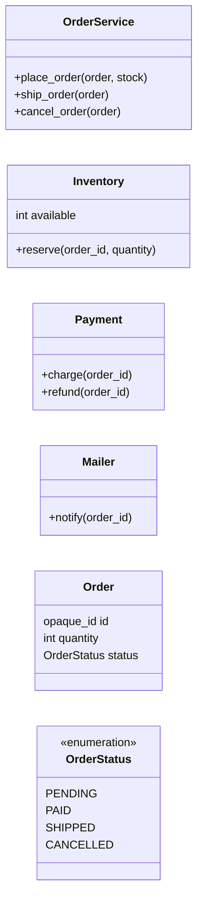
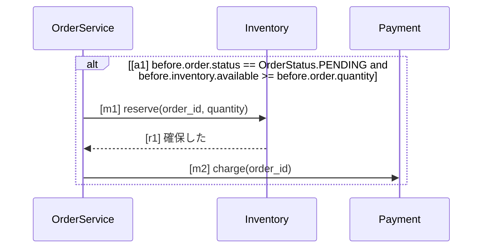
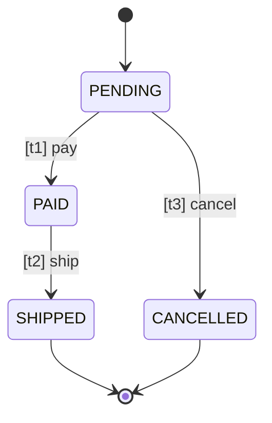

# ショップの注文

注文の確定・出荷・取消の振る舞いを、Mermaid の UML（SpecLino が受け付ける部分集合）で書いた仕様。
図の文法は `src/speclino/spec/uml/grammar.md`。図の名前（`<クラス>.<メソッド>`）とコードの対応は
`.speclino/bindings.yaml` に書く。

## 要求

| ID | level | 要求 | 形式化 |
| --- | --- | --- | --- |
| R-SHOP-01 | mandatory | 注文・在庫・決済・通知の操作を持つ | vocab#OrderService, vocab#Inventory, vocab#Payment, vocab#Mailer |
| R-SHOP-02 | mandatory | 在庫が足りる PENDING の注文は、在庫を確保してから決済する | place#a1, place#m1, place#m2 |
| R-SHOP-03 | mandatory | 注文の状態は図の遷移でだけ変わる | status#t1, status#t2, status#t3 |
| R-SHOP-04 | mandatory | 注文の取消は通知だけを行い、ほかの操作を呼ばない | cancel#e1, cancel#e2, cancel#e3, cancel#notify |
| R-SHOP-05 | advisory | 通知の文面はチームの書式に従う | - |

## 語彙（クラス図）



## 注文の確定（シーケンス図）

在庫が足りる PENDING の注文は、在庫の確保 → 決済の順で呼ぶ。図に無い呼出し（通知など）を
挟んでもよい（シーケンス図は「この順で含む」の義務）。



## 注文の状態（状態遷移図）



## 注文の取消（アクティビティ図、閉じた図）

`closed: true` なので、図に無い操作を呼ぶ実装は違反になる。

```mermaid
%%@ id: cancel
%%@ entry: OrderService.cancel_order
%%@ closed: true
flowchart TD
    start((start))
    check{PENDING か}
    notify[Mailer.notify]
    done((end))
    start -->|[e1]| check
    check -->|[e2] before.order.status == OrderStatus.PENDING| notify
    check -->|[e3] before.order.status != OrderStatus.PENDING| done
    notify -->|[e4]| done
```
